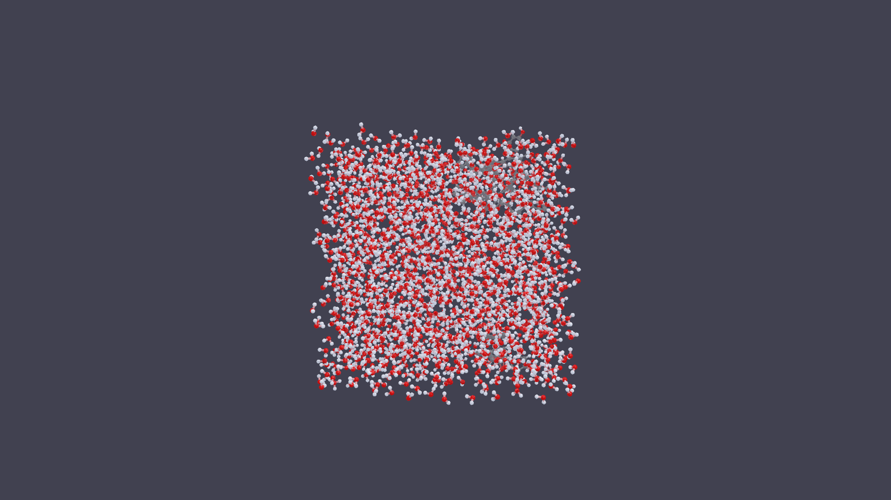
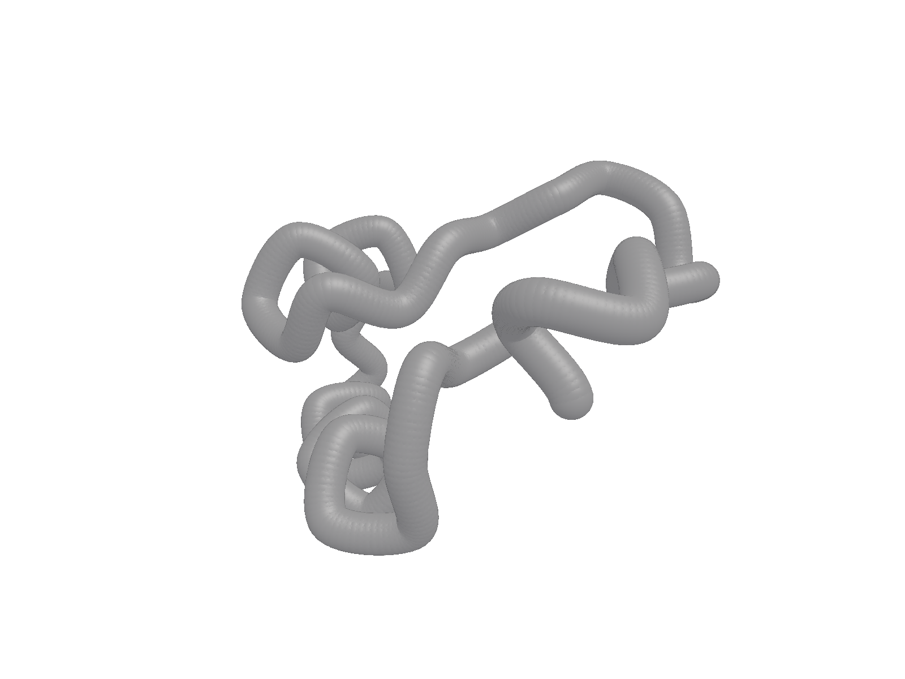
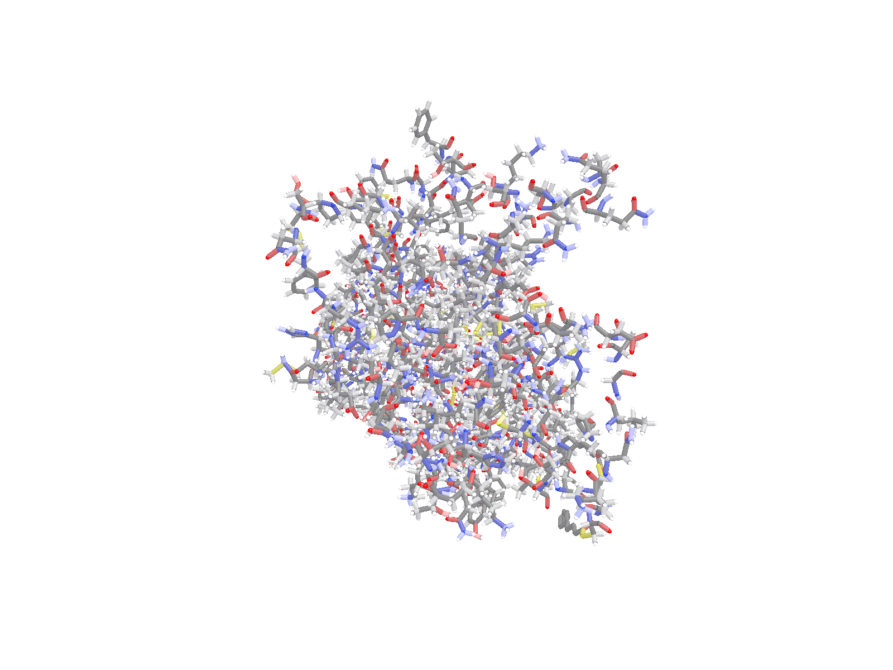
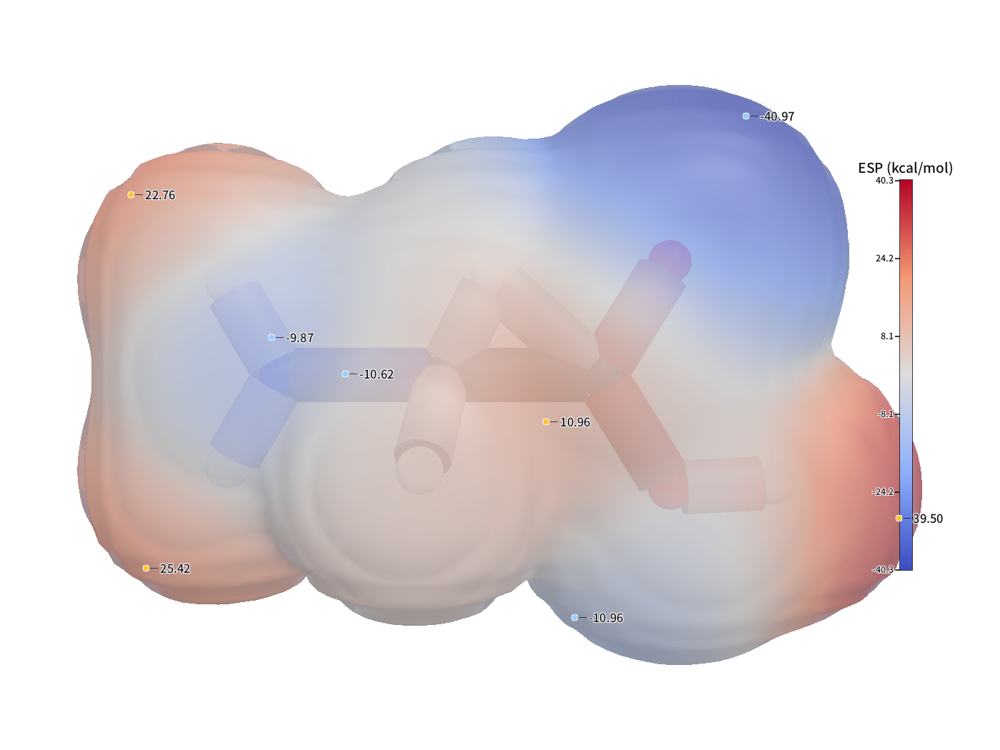
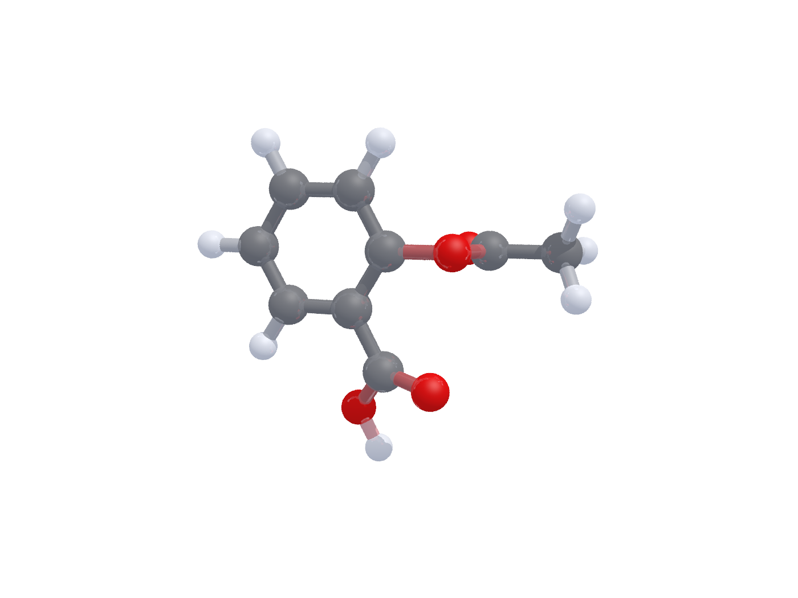

<div align="center">


**A molecular viewer and rendering engine for structural biology and computational chemistry.**

Load, inspect, style, animate and export in one window — then reproduce the exact same picture
from the command line for a paper.

[](LICENSE)
[](#build)
[](#build)
[](#architecture)
[](#testing)
[](docs/_internal/CHANGELOG-2026-10-22-v2.13.md)
[](https://github.com/moyudoing/MolecuLens/actions/workflows/quality.yml)
[](https://moyudoing.github.io/MolecuLens/)

**[English](README.md)** · **[简体中文](README.zh-CN.md)** · [Documentation](docs/) · [Changelog](docs/_internal/)

</div>

---

## Why another molecular viewer?

Two workflows, one binary.

*Exploration* — a single-window workbench built for large systems: a fixed five-zone layout,
a real-time Vulkan viewport, per-representation styling, trajectory scrubbing that stays above
100 FPS while surface meshes are rebuilt in the background.

*Reproduction* — every visible setting has a CLI flag, so a figure you tuned interactively can be
regenerated bit-for-bit in a script or CI job: `moleculens-cli render … --rep quicksurf --style publication`.

It is a standalone application, not a plugin host. The renderer, the representation system, the
trajectory reader and the CPU ray tracer are all implemented in this repository (~41k lines of C++20,
no Python or runtime dependency in the shipped app).

## Gallery

<table>
<tr>
<td width="58%"><br>
<sub><b>Aurora workbench</b> — nav rail, viewport, inspector and status bar; FPS, atom and molecule counts at a glance.</sub></td>
<td width="42%"><br>
<sub><b>ESP-mapped surface</b> — electron-density isosurface coloured per vertex by electrostatic potential, with colourbar and min/max callouts.</sub></td>
</tr>
<tr>
<td><br>
<sub><b>CPU ray tracing</b> — 1080p, 4 spp, GROMACS water box, built-in BVH; no GPU required.</sub></td>
<td><br>
<sub><b>Trajectory frame</b> — GROMACS XTC at frame 500, publication style (white background, crisp outlines).</sub></td>
</tr>
</table>

More figures (materials, tessellation, quality comparisons) live in [`docs/figs_v2/`](docs/figs_v2/).

## Open data & demos

[`datasets/`](datasets/) ships 12 openly licensed structures, small molecules and a 51-frame
trajectory. Every image below was rendered by `moleculens-cli` from those files — no post-processing.

<table>
<tr>
<td width="50%"><br>
<sub><b>1CRN · new-cartoon</b> — 327 atoms, publication style.</sub></td>
<td width="50%"><br>
<sub><b>Rhodopsin trajectory · frame 25</b> — 5,547 atoms, 51 frames at 20 ps.</sub></td>
</tr>
<tr>
<td><br>
<sub><b>ESP-mapped surface</b> — density isosurface coloured by electrostatic potential (synthetic fixture).</sub></td>
<td><br>
<sub><b>CPU ray tracing</b> — aspirin, 4 spp, soft shadows.</sub></td>
</tr>
</table>

Provenance, SHA-256 checksums and licenses: [`datasets/README.md`](datasets/README.md).
Full gallery and exact commands: [Open data & demos](docs/06-开源数据集与演示.md).

## Features

| Area | What you get |
| --- | --- |
| **Input formats** | PDB, GRO, SDF, Gaussian cube (`.cube`/`.cub`); trajectories **DCD**, **XTC**, **TRR** (GROMACS legacy *and* 2023+ layouts) |
| **Representations (17)** | wireframe, stick, ball-and-stick, spacefill, VdW, licorice, tube, ribbon, cartoon, new-cartoon, surface, QuickSurf, ESP surface, plate, diamond, dot cloud, polyhedron |
| **Colouring** | CPK by element, atom-name palette (cyan carbon, red oxygen, blue nitrogen, white hydrogen), chain, residue, B-factor, uniform |
| **ESP surfaces** | density isosurface + per-vertex electrostatic potential, colour maps (`bwr`, `coolwarm`, `viridis`, `jet`, reference/spectral), colourbar and extrema labels |
| **Ray tracing** | built-in CPU path tracer with a compact BVH for spheres, capsules and triangles — surfaces and QuickSurf meshes included, no GPU or OptiX needed |
| **Trajectories** | time-driven playback at 12–60 FPS, selection-aware looping, frame-accurate scrubbing, frame-incremental uploads |
| **Animation export** | PNG sequence, APNG, GIF, MP4, WebM (the last four through `ffmpeg`; override the encoder with `MOLECULENS_FFMPEG`) |
| **Workbench** | fixed layout (nav rail + left tool shelf + viewport + inspector), 9 inspector modules (display, molecules, ESP, orbitals, trajectory, annotations, analysis, log, settings), left shelf tools (browse / distance measure / label / arrow, + display toggles), light/dark themes, Chinese and English UI |
| **Publication output** | style presets `default` / `soft` / `publication` / `vivid`, 8-bit and 16-bit PNG, transparent background, OBJ / POV / STL / `.mlscene` export |
| **Engineering** | Catch2 suites, spdlog level logging, Vulkan single backend with an offscreen FBO path, three-platform CMake build |

## Build

### Requirements

* CMake ≥ 3.21 and a C++20 compiler (MSVC 2022, GCC 11+, Clang 14+)
* [vcpkg](https://github.com/microsoft/vcpkg) for dependencies (`vcpkg.json` in the repository root)
* Vulkan SDK (headers and loader)
* Optional: `ffmpeg` on `PATH` (or `MOLECULENS_FFMPEG`) for MP4 / WebM / GIF export

Full dependency list, versions and platform notes: **[DEPENDENCIES.md](DEPENDENCIES.md)**.

### Build and run

```bash
cmake -B build -S . -DCMAKE_BUILD_TYPE=Release \
      -DCMAKE_TOOLCHAIN_FILE="$VCPKG_ROOT/scripts/buildsystems/vcpkg.cmake"
cmake --build build --config Release -j

# GUI (pass a structure to open it directly, or use Ctrl+O)
./build/src/app/Release/moleculens_app data/EPI.pdb

# headless CLI
./build/src/cli/Release/moleculens-cli info data/EPI.pdb
```

Unit and integration tests:

```bash
ctest --test-dir build -C Release --output-on-failure
# or run the binary directly
./build/tests/Release/moleculens_tests
```

## Command line

`moleculens-cli` exposes three subcommands — `info`, `render`, `convert` — and the `render` command
covers every visual setting of the GUI.

```bash
# structure summary
moleculens-cli info data/EPI.pdb

# publication still (white background, crisp outlines)
moleculens-cli render md.gro --rep ballstick --style publication --bg white \
    --size 1920 --height 1080 --out fig.png

# trajectory frame
moleculens-cli render md.gro --traj md.xtc --frame 500 --out frame500.png

# ESP-mapped surface from a density cube + an electrostatic-potential cube
moleculens-cli render density.cube --esp ESP.cube --cmap coolwarm \
    --vmin -40 --vmax 40 --out esp.png

# CPU ray tracing instead of the rasteriser
moleculens-cli render md.gro --rt 4 --size 1920 --height 1080 --out rt.png
MOLECULENS_RT_NO_BVH=1 moleculens-cli render md.gro --rt 1 --out linear.png   # A/B against the linear tracer

# animation
moleculens-cli render md.gro --traj md.xtc --anim movie.mp4 --anim-fps 30 --anim-range 0:200
```

Other useful flags: `--rep` / `--repr`, `--coloring`, `--color`, `--material`, `--opacity`,
`--surf-iso`, `--surf-grid`, `--system-surface`, `--iso`, `--density`, `--clip`, `--clip-offset`,
`--camera`, `--zoom`, `--msaa`, `--light-az`, `--light-el`, `--seg`, `--detail`, `--invert`,
`--esp-opacity`, `--anim-step`, `--anim-interp`.

## Python API (optional)

[`python/`](python/README.md) contains an optional pybind11 binding of the data layer
(parsers, atom/bond snapshots, selection language). It links only `moleculens_entity`,
so it imports without a GPU, and is **OFF** by default — the shipped app stays free of
Python dependencies.

```bash
pip install pybind11 pytest pillow
cmake -B build -S . -DMOLECULENS_BUILD_PYTHON=ON
cmake --build build --config Release --target _native moleculens-cli
PYTHONPATH=build/python python -m pytest python/tests -q
```

```python
import moleculens

mol = moleculens.load("data/EPI.pdb")
mol.atoms[0].element                    # 'O'
mol.select("within 1.9 of element O")   # global atom indices
mol.summary()["composition"]            # {'C': 15, 'H': 14, 'O': 6}

moleculens.render("data/EPI.pdb", "epi.png",
                  rep="ballstick", style="publication", size=(1280, 720))
moleculens.render_animation("data/md.gro", "md.gif",
                            trajectory="data/md.xtc", frame_range="0:30")
```

Rendering is a thin wrapper around the same `moleculens-cli render` used by the GUI and
tests, so both front-ends share one parameter table. The 54-case pytest suite includes a
real end-to-end render pipeline (PNG/16-bit/transparency, trajectory frames, ESP, CPU ray
tracing, GIF animation, OBJ export). Build layout, semantics and limitations:
[`python/README.md`](python/README.md).

## Performance

Measured on a GROMACS fixture (`md.gro`, 6,452 atoms / 2,042 water molecules) and a surface mesh of
911,096 triangles. Absolute numbers depend on the machine; the ratios are the point.

| Workload | Result |
| --- | --- |
| QuickSurf density kernel + marching cubes, 1 thread | 100.9 ms + 61.0 ms |
| Same, 8 threads | 15.6 ms + 31.7 ms (**3.4×**), bit-identical output |
| CPU ray tracing 480×360 / 1 spp, spheres and capsules | **138 ms** with BVH vs **31,904 ms** linear (**231×**) |
| CPU ray tracing 1920×1080 / 4 spp | 3.8 s |
| Ray-traced mesh (911k triangles), 960×540 / 1 spp | 6.5 s, of which ~5 s is BVH build (single-threaded) |
| Trajectory playback with per-frame QuickSurf (Release) | 98–119 FPS |

## Architecture

```text
src/entity/   domain model (element table, structure keys, scene, selection language) + IO + persistence
src/engine/   scene graph, representations, command stream, camera, picking,
              Vulkan backend (+ offscreen FBO), exporters, CPU ray tracer
src/app/      composition root, event bus, controllers, Aurora workbench (style · modules · layout)
src/cli/      headless CLI: info / render / convert
tests/        Catch2 unit and integration tests
python/       optional pybind11 data-layer bindings (OFF by default)
plugins/      plugin ABI sample and RPC client scripts
data/         demo structures, trajectory fixtures, bundled font
```

Dependencies point one way: `entity ← engine ← app / cli`. Protocol headers
(`engine/cmd/cmd.h`, `persist/mlscene/mlscene.h`) compile standalone. Every directory keeps
at most three `.cpp/.h` pairs, checked by `cmake/check_tree.py`.

## Testing

* **187 test cases / 193,781 assertions** across 34 test files — element and structure recognition,
  selection language, serialisation, camera, cartoon geometry, scheduler, Vulkan smoke tests,
  UI layout, DCD/XTC/TRR reading, exporters, ray-tracer equivalence.
* Rendering changes are held to a bit-exact standard: the BVH and linear tracers, and the QuickSurf
  threaded and scalar kernels, are compared by PNG md5 in the tests.
* `cmake/check_tree.py` enforces the directory rule; `moleculens_tests` covers behaviour.

## Documentation

The long-form documentation is written in Chinese; English translations are welcome.

| Document | Contents |
| --- | --- |
| [软件架构书](docs/01-软件架构书.md) | layering, modules, data flow, command stream, render pipeline, ADR and deviation log |
| [功能介绍书](docs/02-功能介绍书.md) | feature matrix, per-module walkthrough, comparison with Multiwfn / GaussView |
| [使用说明](docs/03-使用说明.md) | installation, UI tour, per-module operations, shortcuts, CLI reference, FAQ |
| [测试报告](docs/04-测试报告.md) | real 6,452-atom benchmark: surface speed, export, trajectories, defects found and fixed |
| [DFT 常用绘图指南](docs/05-DFT常用绘图指南.md) | paper figure types → data source → parameters → tool → support status |
| [Open data & demos](docs/06-开源数据集与演示.md) | 12 openly licensed datasets, provenance, licenses and reproducible renders |
| [ESP_SURFACE.md](ESP_SURFACE.md) | ESP surface data path, parameters and figure recipes |
| [REMAINING_WORK.md](REMAINING_WORK.md) | open work index and build/environment conventions |
| [DEPENDENCIES.md](DEPENDENCIES.md) | dependency installation, versions, environment |

## What's new in v2.13

* Per-frame QuickSurf now follows trajectory playback — a 24-frame LRU cache plus a low-priority
  prefetch queue for the next 6 frames — instead of freezing one stale surface (98–119 FPS).
* Coordinate replay no longer rebuilds frozen system surfaces, and mesh uploads are skipped when
  the geometry has not changed (`meshSerial` vs `listRevision`).
* Rendering-view panel redesigned as a list + form, with stronger selection contrast.
* `Diamond` and `Polyhedron` draw one shape per non-hydrogen atom; material presets are localised.
* ESP colourbar and extrema labels move above the timeline when a trajectory is loaded.

Full entry: [CHANGELOG v2.13](docs/_internal/CHANGELOG-2026-10-22-v2.13.md).

## Documentation & open data (2026-10-22)

* New `datasets/` collection: 12 openly licensed files (RCSB PDB structures, PubChem 3D
  conformers, an MIT-licensed 51-frame trajectory) with provenance, SHA-256 checksums and a
  reproducible demo gallery.
* GitHub Pages documentation site, community health files, issue/PR templates and a CI gate that
  checks relative links and keeps the documentation free of third-party product names.
* The long-form documentation is now vendor-neutral; third-party reference notes and assets were
  removed from the repository.

## Roadmap

* Shared unit-sphere mesh with per-instance transforms and a parallel BVH build — cuts the 911k
  triangles by one to two orders of magnitude and the 5 s build to tens of milliseconds.
* DFT property views: MO isosurfaces and energy-level diagrams.
* Transparent surfaces in the ray tracer, incremental BVH, video-export polish.

See [ROADMAP-渲染与DFT视图](docs/_internal/ROADMAP-渲染与DFT视图.md) and
[ISSUES-已知问题登记](docs/_internal/ISSUES-已知问题登记.md) for the full list.

## Contributing

Issues and pull requests are welcome. Start with **[CONTRIBUTING.md](CONTRIBUTING.md)** — it covers
the local build, the conventions this codebase enforces (naming, directory granularity, dependency
direction) and the one rule reviewers check hardest: rendering changes must be bit-exact, proved by
an unchanged PNG md5. Please run `moleculens_tests` before opening a PR, and sign your commits
(`git commit -s`) to certify the Apache-2.0 contribution.

## License

Apache License 2.0 — see [LICENSE](LICENSE) and [NOTICE](NOTICE).
Third-party libraries, fonts and test data: [THIRD_PARTY_NOTICES.md](THIRD_PARTY_NOTICES.md).

* The bundled UI font (Noto Sans SC subset) is SIL OFL 1.1 — `data/font/OFL.txt`.
* `data/traj_xtc_10f10a.xtc` is a GPL-2.0+ fixture from MDAnalysis and is **not** covered by the
  Apache-2.0 grant.
* The names *MolecuLens* and *分子视镜* are trademarks; Apache-2.0 grants no trademark rights.
