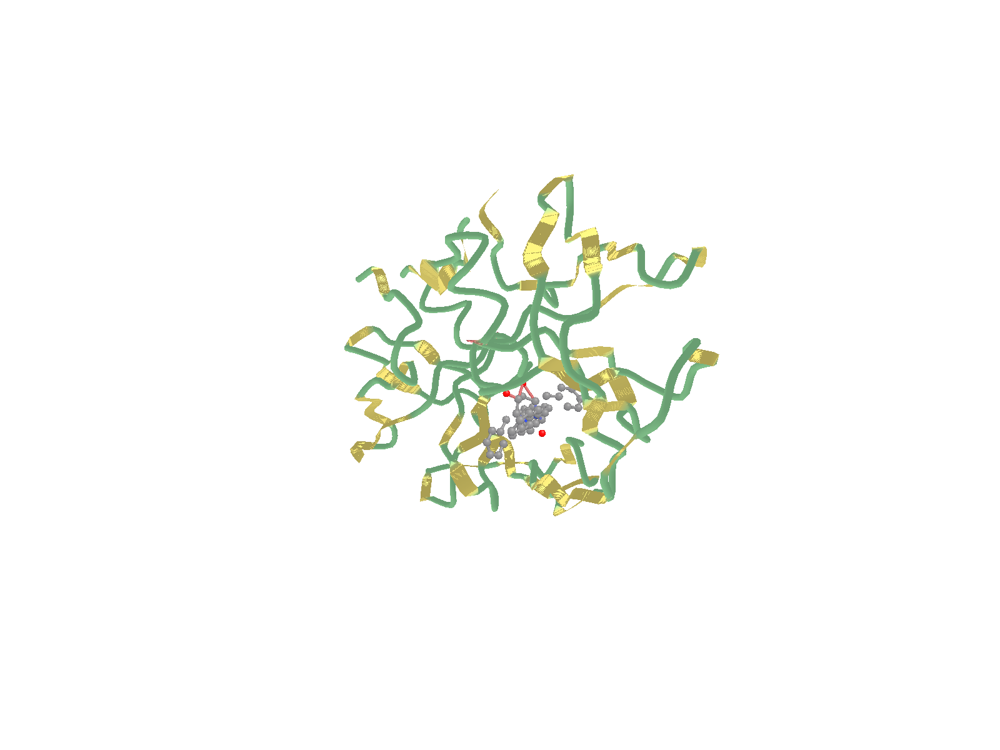

<div align="center">


**面向结构生物学与计算化学的分子显示与渲染引擎。**

一个窗口里完成载入、检查、调样、播放、导出；再用命令行把同一张图逐像素复现出来写进论文。

[](LICENSE)
[](#构建)
[](#构建)
[](#架构)
[](#测试)
[](docs/_internal/CHANGELOG-2026-10-22-v2.19.md)
[](https://github.com/moyudoing/MolecuLens/actions/workflows/quality.yml)
[](https://moyudoing.github.io/MolecuLens/)

**[简体中文](README.zh-CN.md)** · **[English](README.md)** · [文档](docs/) · [更新记录](docs/_internal/)

</div>

---

## 为什么再造一个分子查看器

两种工作流，一个可执行文件。

**探索**：面向大体系的单窗口工作台 —— 固定五区布局、实时 Vulkan 视口、逐表示的样式编辑，播放轨迹时
表面网格在后台重建，界面仍稳定在 100 FPS 以上。

**复现**：界面上能调的每一项都有对应的命令行参数，所以你在交互界面里调好的图，可以在脚本或 CI 里
逐像素重新生成：

```bash
moleculens-cli render md.gro --rep quicksurf --style publication --bg white --out fig.png
```

它是独立应用，不是插件宿主：渲染器、表示系统、轨迹读取和 CPU 光追都在本仓库实现
（约 4.1 万行 C++20，发布的应用不依赖 Python 运行时）。

## 界面与效果

<table>
<tr>
<td width="58%"><br>
<sub><b>Aurora 工作台</b> —— 左导航、视口、检查器、状态栏；FPS、原子数、分子数常驻可见。</sub></td>
<td width="42%"><br>
<sub><b>ESP 映射表面</b> —— 电子密度等值面按静电势逐顶点着色，带色标条与极值标注。</sub></td>
</tr>
<tr>
<td><br>
<sub><b>CPU 光追</b> —— 1920×1080、4 spp，GROMACS 水域箱，自研 BVH；无需 GPU。</sub></td>
<td><br>
<sub><b>轨迹帧</b> —— GROMACS XTC 第 500 帧，出版风格（白底 + 清晰描边）。</sub></td>
</tr>
</table>

更多插图（材质、细分对比、画质对比）在 [`docs/figs_v2/`](docs/figs_v2/)。

## 开源数据集与演示

[`datasets/`](datasets/) 收录 19 个可公开分发的结构、小分子与 51 帧轨迹文件，包含蛋白-配体
复合物（1HVR）、膜蛋白（1U19）与 38 模型 NMR 结构（1L2Y）。下面的每张图都由
`moleculens-cli` 直接从这些文件渲染，未做后期处理。

<table>
<tr>
<td width="50%"><br>
<sub><b>1CRN · 改进卡通</b> —— 327 原子，白底出版风格。</sub></td>
<td width="50%"><br>
<sub><b>1HVR · 蛋白-配体</b> —— HIV-1 蛋白酶卡通 + XK2 抑制剂球棍。</sub></td>
</tr>
<tr>
<td><br>
<sub><b>视紫红素轨迹 · 第 25 帧</b> —— 5,547 原子，51 帧 × 20 ps。</sub></td>
<td><br>
<sub><b>ESP 映射表面</b> —— 密度等值面按静电势逐顶点着色（合成夹具）。</sub></td>
</tr>
</table>

来源、SHA-256 与许可见 [`datasets/README.md`](datasets/README.md)；完整图库与复现命令见
[开源数据集与演示](docs/06-开源数据集与演示.md)，Python 用法与数据案例见
[Python 接口与案例](docs/07-Python接口与案例.md)。

## 功能

| 方面 | 内容 |
| --- | --- |
| **输入格式** | PDB、GRO、SDF、Gaussian cube（`.cube`/`.cub`）；轨迹 **DCD / XTC / TRR**（GROMACS 经典与 2023+ 布局） |
| **表示（17 种）** | 线状、棍状、球棍、空间填充、范德华球、甘草棍、管状、丝带、卡通、改进卡通、表面、QuickSurf、ESP 映射表面、平板、菱形、点云、多面体 |
| **配色** | 元素 CPK、原子名调色板（碳青、氧红、氮蓝、氢白）、链、残基、B 因子、单色 |
| **ESP 表面** | 密度等值面 + 静电势逐顶点着色，色标可选 `bwr` / `coolwarm` / `viridis` / `jet` / 参考谱，附极值数值标注 |
| **光追** | 自研 CPU 路径追踪 + 紧凑 BVH（球、胶囊、三角形），表面与 QuickSurf 网格同样可光追，不依赖 GPU 或 OptiX |
| **轨迹** | 时间驱动播放 12–60 FPS、选区循环、逐帧精确拖动、帧增量上传 |
| **动画导出** | PNG 序列 / APNG / GIF / MP4 / WebM（后四者经 `ffmpeg`，可用 `MOLECULENS_FFMPEG` 指定编码器） |
| **工作台** | 固定布局（左导航 + 左侧工具栏 + 视口 + 检查器）、9 个检查器模块（显示/分子/ESP/轨道/轨迹/标注/分析/日志/设置）、左侧工具栏（浏览/测距/标注/箭头 + 显示开关）、浅色深色双主题、中英双语 |
| **出版出图** | 风格预设 `default`/`soft`/`publication`/`vivid`、8 位与 16 位 PNG、透明背景；OBJ / POV / STL / `.mlscene` 导出 |
| **工程** | Catch2 测试、spdlog 分级日志、Vulkan 单后端 + 离屏 FBO、三平台 CMake 构建 |

## 构建

### 前置

* CMake ≥ 3.21，C++20 编译器（MSVC 2022 / GCC 11+ / Clang 14+）
* [vcpkg](https://github.com/microsoft/vcpkg) 管理依赖（仓库根目录的 `vcpkg.json`）
* Vulkan SDK（头文件与 loader）
* 可选：`ffmpeg` 在 `PATH` 上（或设置 `MOLECULENS_FFMPEG`），用于 MP4 / WebM / GIF 导出

完整依赖清单、版本与平台说明见 **[DEPENDENCIES.md](DEPENDENCIES.md)**。

### 构建与运行

```bash
cmake -B build -S . -DCMAKE_BUILD_TYPE=Release \
      -DCMAKE_TOOLCHAIN_FILE="$VCPKG_ROOT/scripts/buildsystems/vcpkg.cmake"
cmake --build build --config Release -j

# GUI（可传结构文件直接打开，或用 Ctrl+O）
./build/src/app/Release/moleculens_app data/EPI.pdb

# 无头 CLI
./build/src/cli/Release/moleculens-cli info data/EPI.pdb
```

测试：

```bash
ctest --test-dir build -C Release --output-on-failure
# 或直接运行测试二进制
./build/tests/Release/moleculens_tests
```

> Windows 下可执行文件在 `build/src/app/Release/` 等目录，工程结构见下文「架构」。

## 命令行

`moleculens-cli` 提供 `info` / `render` / `convert` 三个子命令，`render` 覆盖界面里所有视觉参数。

```bash
# 结构概要
moleculens-cli info data/EPI.pdb

# 出版出图（白底 + 清晰描边）
moleculens-cli render md.gro --rep ballstick --style publication --bg white \
    --size 1920 --height 1080 --out fig.png

# 轨迹某一帧
moleculens-cli render md.gro --traj md.xtc --frame 500 --out frame500.png

# ESP 映射表面（密度 cube + 静电势 cube）
moleculens-cli render density.cube --esp ESP.cube --cmap coolwarm \
    --vmin -40 --vmax 40 --out esp.png

# 走 CPU 光追而不是光栅化
moleculens-cli render md.gro --rt 4 --size 1920 --height 1080 --out rt.png
MOLECULENS_RT_NO_BVH=1 moleculens-cli render md.gro --rt 1 --out linear.png   # 与线性遍历做 A/B

# 动画
moleculens-cli render md.gro --traj md.xtc --anim movie.mp4 --anim-fps 30 --anim-range 0:200
```

其它常用参数：`--rep` / `--repr`、`--coloring`、`--color`、`--material`、`--opacity`、
`--surf-iso`、`--surf-grid`、`--system-surface`、`--iso`、`--density`、`--clip`、`--clip-offset`、
`--camera`、`--zoom`、`--msaa`、`--light-az`、`--light-el`、`--seg`、`--detail`、`--invert`、
`--esp-opacity`、`--anim-step`、`--anim-interp`。

## Python 接口（可选）

[`python/`](python/README.md) 提供 pybind11 数据层（解析器、原子/键快照、选择语言）与 CLI 绘图层
封装。它默认 **OFF**，发布的应用不依赖 Python；数据层只链接 `moleculens_entity`，无 GPU 也能导入。

```bash
python -m pip install pybind11 pytest pillow
cmake -B build -S . -DMOLECULENS_BUILD_PYTHON=ON
cmake --build build --config Release --target _native moleculens-cli
PYTHONPATH=build/python python -m pytest python/tests -q
```

```python
import moleculens as ml

mol = ml.load("datasets/pdb/1HVR.pdb")
ml_ligand = mol.select("resname XK2")             # 46 个全局原子下标
pocket = mol.select("within 6 of resname XK2")    # 260 个口袋原子

ml.render("datasets/pdb/1HVR.pdb", "1hvr.png",
          rep=["cartoon:not resname XK2:chain", "ballstick:resname XK2:element"],
          zoom=1.2, style="publication", background="white", size=(1200, 900))
```

78 个 pytest 用例覆盖数据层、选择语言与真实出图流程，并校验 `datasets/` 下每个文件。可运行
[`python/examples/dataset_tour.py`](python/examples/dataset_tour.py) 一键巡览 15 个数据案例；
完整说明见 [Python 接口与案例](docs/07-Python接口与案例.md) 与
[`python/README.md`](python/README.md)。

## 性能

在 GROMACS 算例（`md.gro`，6452 原子 / 2042 个水分子）与 911,096 三角形的表面网格上实测。
绝对值取决于机器，加速比才是重点；Debug 构建下测得，除注明外。

| 负载 | 结果 |
| --- | --- |
| QuickSurf 密度核 + Marching Cubes，单线程 | 100.9 ms + 61.0 ms |
| 同上，8 线程 | 15.6 ms + 31.7 ms（**3.4×**），输出逐位一致 |
| CPU 光追 480×360 / 1 spp（球 + 胶囊） | BVH **138 ms** vs 线性 **31,904 ms**（**231×**） |
| CPU 光追 1920×1080 / 4 spp | 3.8 s |
| 网格光追（911k 三角形）960×540 / 1 spp | 6.5 s，其中建树约 5 s（当前单线程） |
| 逐帧 QuickSurf 的轨迹播放（Release） | 98–119 FPS |

## 架构

```text
src/entity/   领域模型（元素表、结构识别码、场景、选择语言）+ IO + 持久化
src/engine/   场景图、表示、命令流、相机、拾取、Vulkan 后端（含离屏 FBO）、导出器、CPU 光追
src/app/      组合根、事件总线、控制器、Aurora 工作台（style · modules · 五区布局）
src/cli/      无头 CLI：info / render / convert
tests/        Catch2 单元与集成测试
plugins/      插件 ABI 样例、RPC 客户端脚本
python/       可选 pybind11 绑定 + 示例/测试
datasets/     可公开分发的结构、轨迹与 ESP 夹具
data/         演示结构、轨迹夹具、界面字体
```

依赖方向单向：`entity ← engine ← app / cli`。协议头（`engine/cmd/cmd.h`、`persist/mlscene/mlscene.h`）
可独立编译；每个目录最多三个 `.cpp/.h` 对，由 `cmake/check_tree.py` 检查。

开发约定：类 `PascalCase`、方法 `snake_case`、成员 `lowercase_`、命名空间 `moleculens`；
重建命令流必须 `bumpSerial()`。

## 测试

* **210 个用例 / 193,948 条断言**，分布在 37 个测试文件：元素与结构识别、选择语言、序列化、
  相机、卡通几何、调度器、Vulkan 冒烟、界面布局、DCD/XTC/TRR 读取、导出器、光追一致性。
* 渲染改动按**逐位一致**验收：BVH 与线性遍历、QuickSurf 多线程与标量内核，用 PNG md5 对比。
* `cmake/check_tree.py` 守目录粒度，`moleculens_tests` 守行为。

## 文档

| 文档 | 内容 |
| --- | --- |
| [01-软件架构书](docs/01-软件架构书.md) | 分层、模块、数据流、命令流、渲染管线、ADR 与设计偏差记录 |
| [02-功能介绍书](docs/02-功能介绍书.md) | 功能矩阵、模块逐项说明、与 Multiwfn / GaussView 的对照 |
| [03-使用说明](docs/03-使用说明.md) | 安装、界面导览、逐模块操作、快捷键、命令行参数、FAQ |
| [04-测试报告](docs/04-测试报告.md) | GROMACS 6452 原子真实算例：表面速度、导出、轨迹、缺陷与修复 |
| [05-DFT常用绘图指南](docs/05-DFT常用绘图指南.md) | 论文插图类型 → 数据来源 → 参数 → 工具 → 本项支持度 |
| [06-开源数据集与演示](docs/06-开源数据集与演示.md) | 19 个公开数据集、来源与许可、可复现演示图 |
| [07-Python接口与案例](docs/07-Python接口与案例.md) | 安装构建、数据层、选择语言、出图与数据案例巡览 |
| [ESP_SURFACE.md](ESP_SURFACE.md) | ESP 映射表面的数据链、参数与出图配方 |
| [REMAINING_WORK.md](REMAINING_WORK.md) | 剩余工作索引与**环境/构建约定**（新会话先读） |
| [DEPENDENCIES.md](DEPENDENCIES.md) | 依赖安装、版本、环境配置 |

内部设计文档（改造清单、已知问题、路线图）在 [`docs/_internal/`](docs/_internal/)。

## v2.19 更新

* **动态 FPS 轨迹播放**：刷新同步 / 固定帧率 / 动态三种模式，写入 `settings.json`；
  追帧上限可调，掉帧不会积压成一串跳跃。
* **表面绘制模式与实例范围**：整体系表面逐顶点着色，实心 / 线框 / 半透明可选；
  按类型 / 比例 / 步长筛选溶剂实例。
* **多视图对照**：单视图、左右双视图、上下双视图、2×2 四视图，各自独立相机与显示范围
  （`Ctrl+1`…`Ctrl+4`）。
* **GPU 光追**：Vulkan KHR 加速结构与 5 组光追管线，失败自动回退 CPU
  （`--rt-backend cpu|gpu|auto`）。
* **Python 绑定**：pybind11 数据层 + CLI 绘图层，附数据巡览脚本与 78 个 pytest 用例。

完整条目见 [CHANGELOG v2.19](docs/_internal/CHANGELOG-2026-10-22-v2.19.md)。

## 文档与开源数据（2026-10-22）

* 新增 `datasets/`：19 个可公开分发的数据文件（RCSB PDB 结构、PubChem 3D 构象、MIT 许可的
  51 帧轨迹），附来源、SHA-256 与可复现演示图库。
* 新增 GitHub Pages 文档站、社区健康文件、issue/PR 模板，以及检查相对链接与第三方产品名的
  CI 文档门禁。
* 长篇文档改为不依赖任何第三方软件命名；相关参考笔记与素材已从仓库移除。

## 路线图

* 共享单位球网格 + 逐实例变换 + 并行建树：把 911k 三角形降一到两个数量级，建树从 5 s 降到几十毫秒。
* DFT 属性视图：MO 等值面与能级图。
* 光追里的半透明表面、增量 BVH、视频导出收尾。

详见 [ROADMAP-渲染与DFT视图](docs/_internal/ROADMAP-渲染与DFT视图.md) 与
[ISSUES-已知问题登记](docs/_internal/ISSUES-已知问题登记.md)。

## 参与

欢迎 issue 与 PR。先看 **[CONTRIBUTING.zh-CN.md](CONTRIBUTING.zh-CN.md)**：里面写了本地构建、
这个仓库坚守的约定（命名、目录粒度、依赖方向），以及评审时查得最严的一条——渲染改动必须逐位一致，
用改前改后相同的 PNG md5 证明。提 PR 前请跑一遍 `moleculens_tests`，并用 `git commit -s` 签署，
表示同意按 Apache-2.0 授权你的贡献。

## 许可证

本项目（代码与文档）采用 **Apache License 2.0**，见 [LICENSE](LICENSE) 与 [NOTICE](NOTICE)。
第三方库、字体与测试数据的来源和许可见 [THIRD_PARTY_NOTICES.md](THIRD_PARTY_NOTICES.md)。

* 界面字体 Noto Sans SC 为 SIL OFL 1.1（`data/font/OFL.txt`），随二进制分发时保留该许可。
* `data/traj_xtc_10f10a.xtc` 为 MDAnalysis 的 **GPL-2.0+** 测试夹具，单独声明，不适用 Apache-2.0。
* 项目名称 `MolecuLens` / `分子视镜` 的商标权保留；Apache-2.0 不授予商标许可。
