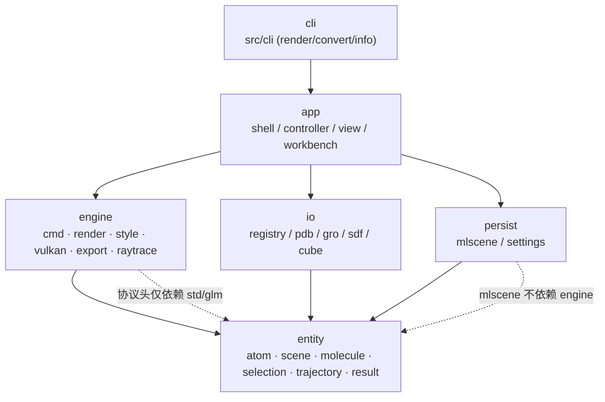
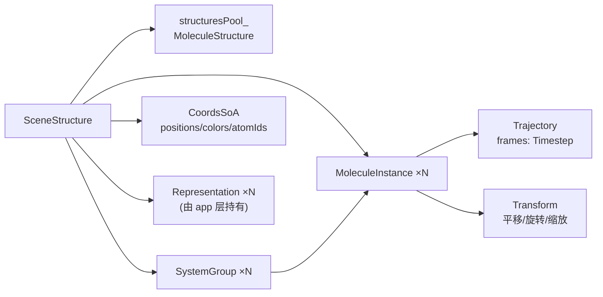
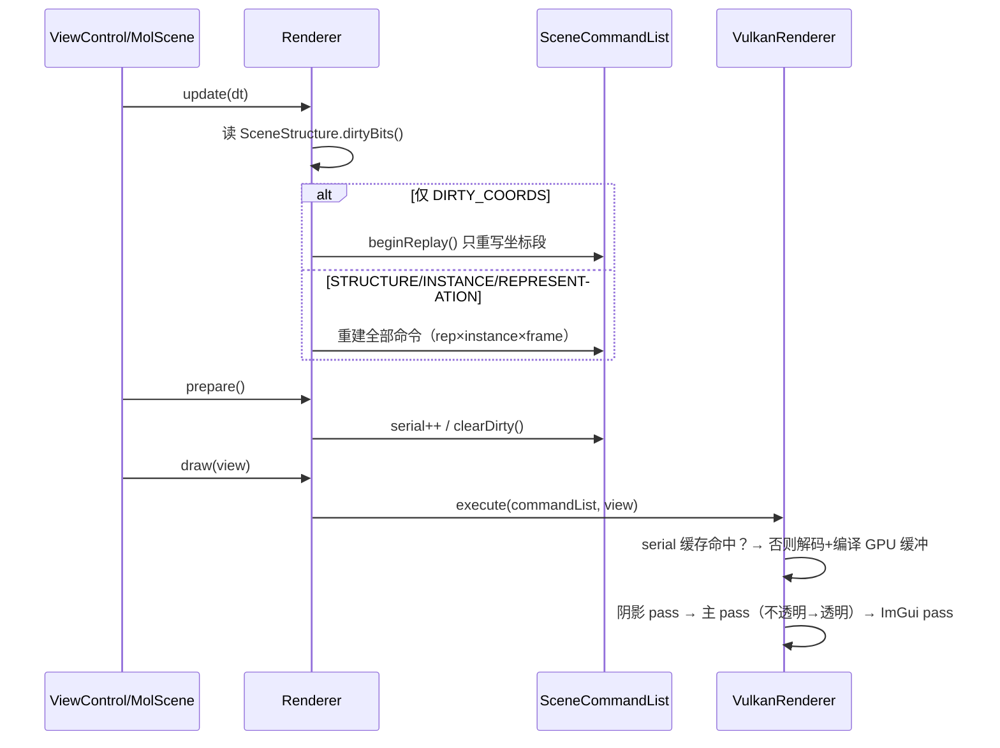
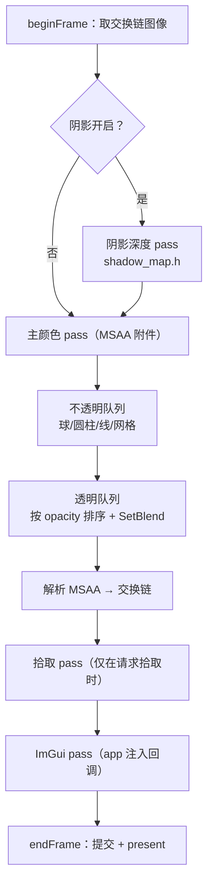
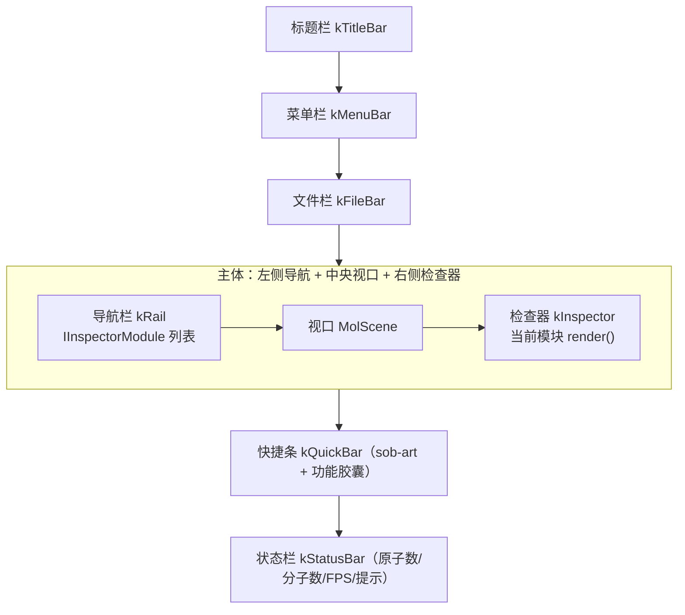
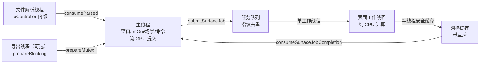

# MolecuLens v2 软件架构书

| 项目 | 内容 |
| --- | --- |
| 文档编号 | 01 |
| 文档名称 | MolecuLens v2 软件架构书（Software Architecture Document） |
| 版本 | 2.1.4 |
| 日期 | 2026-10-21 |
| 修订记录 | v2.1.6（2026-10-21）：新增第 14 种表示 **「平板（Plate，辅基）」**——5.4.2 补 14 项样式表与 Plate 实现要点（链+残基分组、≥3 原子、主成分轴、厚度 0.08–0.30 Å、`type="plate"`、`--repr plate`），6.7 补「卡通 + 平板」搭配，测试 176 例 / 193,708 断言。v2.1.5（2026-10-21）：新增「标注」模块与示意图风格——检查器模块 9→**10**（6.1 表新增 `AnnotationModule`）、新增 **6.7 场景标注**（`scene_overlay.h` 快照，视口与 PNG 8-bit 导出共用、900 px 基准等比放大、透明背景/16-bit/光追导出不含、**标注随 `.mlscene` 可选键 `annotations` 保存**）；测试 171→**176**（4 个栅格/可见性 + 1 个 mlscene 往返）；标注随 `.mlscene` 可选键 `annotations` 保存；`navIcon` 已补齐 10 个 `case`、关于页模块数改为 `moduleCount()` 动态。v2.1.4（2026-10-21）：UI 丰富与调色盘——检查器默认 300→**380**（260–480，视口宽高比接近 1.2:1）；新增「背景与主题色」主题强调色覆盖（`Settings::accent` = `#RRGGBB`，`aurora::setAccent` 推导 accentHi/accentSoft/onAccent）与「显示 → 调色盘 · 原子颜色」（Uniform 配色 + HSV 轮盘 + 12 色块；`representer.cpp` 顶点色改白修正颜色变暗）；新增剖切面（`SceneProperties.clipEnabled/clipPlane`、GlobalUBO 320→352B、片元 `discard`、GUI 卡片与 CLI `--clip/--clip-offset`）；6.1/6.3/6.5 相应更新。v2.1.3（2026-10-21）：新增 **5.4.1 渲染风格（v2.2）**——GlobalUBO 288→320B（`styleParams` + `backgroundColor`）、环绕漫反射/摄像机补光/`fwidth` 像素轮廓/背景色距离淡出、四套预设与 GUI/CLI 入口；同步实测测试数 165→171；记录"轮廓在无后处理通道下的边界与 SSAO 后续项"。v2.1.2（2026-10-21）：同步「左导航可收起」——6.1 增补 92 → 46 px 两档宽度、顶部 ‹‹/›› 按钮、`Ctrl+B`、「视图 → 收起工作区 / 展开工作区」与视口宽度自适应，6.5/6.6/12 相应修订；4.2 增补「扩展名单一事实来源（`allExtensions()`）」与 Unicode 文件对话框/内嵌 NUL 过滤器的约束（对应 03 §7.10）；8.1 按当前源码重写 `.mlscene` 段布局（补坐标 SoA 段、CRC32、可选内嵌轨迹段及新旧兼容规则），8.2 增 `sceneSaveMode`。v2.1.1（2026-10-21）：快捷条移除 IBOview/HoukMol/IQmol 三个风格胶囊（仍保留在「样式」菜单），空位改放「网格质量」弹窗与「光追预览」；数字键由 1–4 收为 `1`=sob-art，并新增 `H`=隐藏氢。v2.1.0：按"工作台已接线"后的源码同步 6.1（五区尺寸、首帧装配、九模块表、v1 面板 `#if 0`）、6.3（材质预设 23 项）、6.5（布局持久化现状）、5.6（v2 导出链与 `exportPng` 占位）、9.3/13 状态、附录 D2 作废并新增 D7；章节结构未变 |
| 作者 | 架构文档组（arch-writer） |
| 状态 | 评审稿（Review Draft）——事实基线为仓库当前源码，非设计意图 |
| 上游依据 | `docs/_internal/blueprint.md`（v2 设计基线，权威）、`README.md`、`REMAINING_WORK.md`、`FIXES.md`、`DEPENDENCIES.md`、`VERIFICATION.md`、`ESP_SURFACE.md` |
| 适用范围 | `F:\MolecuLens` 全部源码（`src/`）、构建脚本（`CMakeLists.txt`、`vcpkg.json`）、资源（`shaders/`、`font/`） |
| 变更约定 | 本文档只描述**代码中真实存在**的接口；设计意图与实现不符处，在正文以「实现现状」小节标注并在第 12 章 ADR 中留痕 |

> **阅读提示**：本文所有类型名、函数签名、文件路径均可在源码中检索到；标注为「规划中」的条目在当前源码中**没有**可用实现，不应据此排期。

---

## 1 引言

### 1.1 目标

MolecuLens 是一个面向计算化学与结构生物学的分子可视化桌面工具：读入 PDB / GRO / SDF / Gaussian cube 等结构文件与 DCD / XTC / TRR 轨迹，按样式（球棍、空间填充、卡通、表面、ESP 映射等）在 GPU 上实时绘制，并把画面导出为图片、动画或三维格式。

v2 重构的目标是把 v1 里「一个 ViewControl 里堆了近千行界面逻辑 + 渲染器直接读全局场景」的结构，改造为**接口稳定、可独立编译、可增量替换**的分层架构：

1. **协议化**：渲染侧以「设备无关命令流」为唯一协议，实时后端、离屏后端、OBJ/POV/STL 导出全部消费同一份命令流，保证「屏幕上看到的」与「导出得到的」同源。
2. **分层可编译**：`entity`、`io`、`engine`、`persist` 各自是独立 CMake 库，低层不得反向依赖高层（约束来源：`src/engine/cmd/cmd.h` 头注释「独立编译约束（主方案 §3.5.3）」）。
3. **性能可预测**：以脏位域 + serial 缓存把「每帧重建整条命令流」压缩为「仅在拓扑/表示变化时重建，帧切只重放坐标段」。
4. **交互不卡顿**：把耗时 200 ms 级的整体系等值面生成移出主线程，旧画面继续显示，避免界面冻结。

### 1.2 范围与状态标记

本文档覆盖架构层面的 13 个关注点，与 `blueprint.md` §7.1 的章节划分一一对应。文档中的功能状态统一使用以下标记，**不做模糊表述**：

| 标记 | 含义 | 判定标准 |
| --- | --- | --- |
| ✅ | 已实现 | 源码中有完整实现，且被构建系统与主流程实际引用 |
| ◐ | 部分实现 | 主体已实现，但存在明确缺口（未接线、仅单路径、缺参数、缺交互） |
| ○ | 规划中 | 仅有骨架/头文件/文档描述，未纳入构建或未被调用 |

### 1.2.1 文档维护规则

1. **事实优先**：任何"已实现"的断言必须能在源码中定位到符号；无法定位的一律降级为 ○，并写明缺失点。
2. **数字可回溯**：性能、测试数量等数字必须给出处（`文件:行`）与观测日期；二手转抄的数字不得进入正文。
3. **偏差留痕**：实现与 `blueprint.md` 不符时，正文如实描述代码现状，同时在附录 A 登记偏差编号，供评审决定是"改文档"还是"改代码"。
4. **章节稳定**：第 1–13 章与 `blueprint.md` §7.1 对齐，新增内容优先进入附录，避免评审时章节号漂移导致引用失效。

不在范围内：着色器内部算法细节（见 `shaders/*.glsl`）、第三方库内部实现（ImGui、Vulkan-Hpp/volk、nlohmann/json、glm、Catch2、vcpkg 端口）、安装包制作流程的运维细节。

### 1.3 术语表

| 术语 | 英文/标识符 | 含义与出处 |
| --- | --- | --- |
| 结构 | `MoleculeStructure` | 蛋白/分子拓扑（原子表 + 键表），可在场景中被多个实例共享（`src/entity/molecule/molecule.h`） |
| 实例 | `MoleculeInstance` | 结构的一次摆放：引用结构下标 + `Transform` + 轨迹 + 显隐（`src/entity/scene/scene.h`） |
| 体系 | `SystemGroup` | 一次导入的多分子文件形成的整体单位；有独立位姿与渲染模式（`scene.h:155`） |
| 表示 | `Representation` | 一条「选择 + 样式 + 配色 + 材质 + 参数」的绘制规则（`src/engine/rep/representation.h`） |
| 命令流 | `SceneCommandList` | 引擎与后端之间唯一的设备无关协议（`src/engine/cmd/cmd.h`） |
| 脏位域 | `DirtyBits` | 场景变更分类位掩码，决定重建粒度（`scene.h:38`） |
| serial | `SceneStructure::serial()` | 场景全局修订号，作为后端缓存键（P5） |
| 坐标 SoA | `CoordsSoA` | 上传 GPU 的段式坐标/颜色/拾取 ID 布局（`scene.h:165`） |
| 阶梯状坐标块 | `Timestep` | 单帧坐标（SoA 扁平），含可选速度与周期盒子（`scene.h:73`） |
| 最小镜像 | `minimumImageDelta` | 周期边界下把坐标差折算到最近镜像（`scene.h:92`） |
| 表面任务 | `submitSurfaceJob` | 后台线程生成等值面的任务队列（`src/engine/async/surface_jobs.h`） |
| 步骤 | 检查器模块 | `IInspectorModule`，左侧导航一项 + 右侧检查器一页（`src/app/workbench/modules/module.h`） |

### 1.4 读者

- **新加入的开发者**：第 2、3、4 章给出全局心智模型与模块边界。
- **渲染/性能负责人**：第 5、7、11 章（两阶段管线、并发、基准与测试策略）。
- **界面负责人**：第 6 章（Aurora 工作台、主题、i18n、布局持久化）。
- **评审人/架构治理**：第 2.2 节依赖规则、第 9 章扩展点、第 12 章 ADR 与第 13 章路线图。
- **集成方**（未来插件/Python 使用者）：第 8、9、10 章（文件格式、扩展点、构建与部署）。

### 1.5 约束与前提

| 编号 | 约束 | 依据 |
| --- | --- | --- |
| C1 | Windows 10/11 x64 + MSVC，C++17 | `CMakeLists.txt`、`blueprint.md` |
| C2 | 图形 API 只有 Vulkan（`volk` 加载），无 OpenGL/D3D 回退 | `src/engine/vulkan/realtime/vulkan_renderer.h:2`「唯一渲染后端」 |
| C3 | `engine` 不得依赖 `imgui`；ImGui 由 app 层以回调注入 | 同上头注释「ImGui 经 UI 回调注入（engine 不依赖 imgui）」 |
| C4 | `cmd.h` / `mlscene.h` 等协议头只依赖 `<cstdint>` / `<glm>` / 标准库 | `src/engine/cmd/cmd.h:8`、`src/persist/mlscene/mlscene.h:7` |
| C5 | 领域层必须是 `Result<T>` 显式错误返回，不抛异常穿透层边界 | `src/entity/result.h` 及其全部调用点 |
| C6 | 依赖通过 vcpkg 清单模式引入，工具链文件优先 `F:/vcpkg` | `CMakeLists.txt:3-13`、`vcpkg.json` |
| C7 | 用户数据目录经 `std::filesystem` 定位，不写死绝对路径 | `src/persist/settings/settings.h:53` |

---

## 2 架构总览

### 2.1 分层图



依赖方向单一：**上层依赖下层，同层之间只经协议/事件，不互相包含实现**。`engine` 与 `persist` 之间没有直接依赖——`.mlscene` 里存的命令流段是「已序列化字节」，由 app 层调用 `engine::SceneCommandList::writeTo/readFrom` 完成编解码（`src/persist/mlscene/mlscene.h:15-18`）。

### 2.2 依赖规则

| 编号 | 规则 | 违反检测方式 | 现状 |
| --- | --- | --- | --- |
| R1 | `entity` 不依赖任何上层（不得出现 `engine/`、`app/` 头） | 头文件 grep + 单独编译 `moleculens_entity` | ✅ |
| R2 | `engine` 不依赖 `imgui` / `app` | `moleculens_engine` 独立链接 | ✅ |
| R3 | `persist::mlscene` 不依赖 `engine`（曾出现反向依赖，已修） | `mlscene.h:15` 注释记录该历史缺陷 | ✅ |
| R4 | 控制器之间不互相持有，只经 `EventBus` 通信 | `AppServices` 只暴露裸指针服务 | ◐（`Workbench` 直接持有 5 个控制器指针与 `SceneStructure*`，并代理 `activeRepIndex`；模块侧已收敛为只经 `Workbench` 访问器，见 6.1） |
| R5 | 渲染器**不拥有**表示数据，只持只读视图 + 修订号 | `Renderer::bindRepresentations(const std::vector<Representation>*, uint64_t)` | ✅ |
| R6 | 视图层不得绕过 `CameraController` 改相机 | `camera_controller.h:28-29` 明确「唯一入口」 | ✅ |

**历史上被修掉的四次越界**（每次都直接导致过缺陷，可作为评审检查清单）：

1. `persist::mlscene` 直接调用 engine 符号序列化，使 `moleculens_entity` 反向依赖 `moleculens_engine`——只因所有消费者同时链接两者而未暴露。现改为「命令流段按已序列化字节原样读写」，编解码留在 app 层（`mlscene.h:15-18`）。
2. `DrawBuffers` 把「CPU 侧要画什么」与「GPU 缓冲画到哪」混在一个结构体里，并在两个后端各复制一份。现拆为设备无关的 `DrawList`（`engine/vulkan/backend/draw_list.h`，不含任何 `Vk*`）+ 后端自有 GPU 资源。
3. `Renderer` 按值持有 `std::vector<Representation>`，视图层每次变更（含滑杆逐帧拖动）都要深拷贝整表。现改为只读视图 + 修订号。
4. 样式分派表在 `Representer` 内自建一份，与渲染样式注册表可能漂移。现以 `style_registry.h` 的 `kStyleStaticTable` 为唯一事实来源。

### 2.3 质量属性场景

| 编号 | 质量属性 | 场景（刺激 → 响应） | 度量与当前达成 |
| --- | --- | --- | --- |
| QA1 | 可用性（流畅） | 用户拖动滑杆调整材质 → 逐帧变更 | 目标 ≥ 30 FPS；材质变更只触发表示重建，不重发几何（✅，见 5.2） |
| QA2 | 响应性 | 用户切换到整体系 QuickSurf → 生成表面 | 目标：主线程不阻塞 > 50 ms；实现为异步任务 + 保留旧命令流（✅ GUI 路径，见 5.5） |
| QA3 | 正确性（视觉/导出一致） | 视口画面与 PNG 导出对比 | 二者共用同一命令流 + 同色域附件（`Rgba8Srgb`）（✅，见 5.6） |
| QA4 | 可维护性 | 新增一种样式 → 改动面 | 目标：≤ 2 个文件（样式实现 + 注册表一行）；见 9.2（✅ 静态表） |
| QA5 | 可移植性 | 将 GUI 替换为另一套外壳 | `engine` 不依赖 `imgui`，只在 app 层（✅ 结构成立；v2 工作台的依赖全部经 `WorkbenchServices` 注入，替换外壳只需重建该结构体，见 6.1） |
| QA6 | 大数据可用性 | 打开 10 万原子 + 多帧轨迹 | 坐标段按需重放；内存线性（◐：无分块/LOD，见 13） |
| QA7 | 国际化 | 切换中/英 | 未翻译键原样返回中文，不空白不崩溃（✅，覆盖率工具兜底，见 6.4） |
| QA8 | 可测试性 | 在无窗口/无 GPU 的 CI 上验证渲染逻辑 | Stage1 纯 CPU 可跑；GPU 路径靠离屏后端 + 金色图（◐：纯 CPU 部分已可测，离屏测试依赖 Vulkan 驱动） |
| QA9 | 数据完整性 | 保存后重开场景 | 元数据 + 命令流完整往返，掉字段即视为缺陷（✅ v2 格式；v1 文件明确拒绝） |
| QA10 | 可诊断性 | 用户报"卡了一下" | 可用 `surfaceGenerationPending()`、`lastPrepareWasReplay()`、`commandSerial()` 还原时序（✅ 接口齐备，缺统一日志面板汇总） |

---

## 3 领域模型

### 3.1 聚合关系



### 3.2 Atom 与 Bond

`Atom` 是紧凑 AoS 布局（`src/entity/atom/atom.h`），刻意用整数代替浮点以省内存：

| 字段 | 类型 | 语义 |
| --- | --- | --- |
| `element` | `ElementType` | 元素类型（`src/entity/element/element.h`） |
| `occupancy` | `uint8_t` | 占有率的整数百分数（0–100） |
| `bfactor` | `int16_t` | B 因子 ×100 存整数，避免浮点误差 |
| `residueId` | `int32_t` | 残基索引，-1 = 无 |
| `chainId` | `int32_t` | 链索引，-1 = 无 |

`Bond` 为 `{ uint32_t a, b; uint8_t order; }`，约定 `a < b` 表示无向键，`order` 取 0（芳香）/1/2/3。键的判定与补全在 `src/entity/search/bond_search.h`，使用最小镜像距离，因此**判键正确性与坐标包裹状态无关**。

**失败模式**：元素符号无法识别时回落到"未知元素"占位而非抛错（解析失败只影响该原子，不中断整文件）；键表缺失时由 `bond_search` 按共价半径推断。

### 3.3 CoordsSoA 与 FrameData

坐标按「段」组织（`src/entity/scene/scene.h:165`）：

| 字段 | 类型 | 用途 |
| --- | --- | --- |
| `positions` | `std::vector<glm::vec3>` | 世界坐标（Å），段长 = 该结构原子数 |
| `colors` | `std::vector<glm::vec4>` | 预计算颜色（含 alpha），供后端直接取用 |
| `atomIds` | `std::vector<uint32_t>` | 拾取回查：pickId → 全局原子 ID |
| `version` | `uint64_t` | 坐标段版本号，**帧切只递增这里**，不触碰拓扑 |

`FrameData`（`scene.h:173`）是样式层的只读输入：`const std::vector<glm::vec3>* positions` + 可选 `const Timestep* timestep`（保留速度等信息）。样式实现只读它，不得回写场景——这是"引擎不拥有场景"的具体体现。

### 3.4 Trajectory / Timestep / 实例与体系

- `Timestep`：单帧 SoA，`positions`（Å）、`velocities`（可选）、`box`（9 元素周期盒子，可选）。
- `Trajectory`：`std::vector<Timestep> frames` + `dt`（ps）+ `periodic`。
- **体系级轨迹共享**：`MoleculeInstance::trajAtomOffset` 与共享 `std::shared_ptr<Trajectory>` 的设计，使"同一体系必须同步播放"成为**结构上的必然**而不是约定（`scene.h:132-138`）。`trajAtomOffset == 0` 表示实例私有轨迹（历史行为）。
- `SystemGroup`：带稳定 `id`（非下标）的组，含整体 `Transform` 与独立 `SystemRenderMode`（Solid / Wireframe / Transparent / Point）。

**失败模式**：轨迹帧数与结构原子数不匹配时，`setInstanceTrajectory` 拒绝挂载并返回 `false`，避免后续越界读坐标段。

### 3.5 Selection 语法

选择语言定义于 `src/entity/selection/selection.h`（规格 §4.6）：

```
表达式 := 因子 (AND|OR|NOT 因子)*
因子   := 关键字 | 属性比较 | "(" 表达式 ")"
```

语法树节点 `detail::SelectionNode` 的 `Kind` 有 7 种：`And / Or / Not / Word / Cmp / Within / SameResidue`。`Cmp` 支持 `Eq/Ne/Lt/Gt/Le/Ge/Range` 七种比较符，属性名清单由 `parse_table.h` 提供（`name / resid / chain / element / occupancy / bfactor` 等）。`Within` 带 `dist`（Å），按帧求值——因为坐标相关关键字依赖当前帧。

app 层入口为 `SelectionController::select(const std::string&)`，求值结果以 `mask()`（`std::vector<bool>`，与 `CoordsSoA` 全局原子顺序一致）暴露，命中数经 `SelectionChanged` 事件载荷广播（`src/app/controller/selection/selection_controller.h:30-34`）。

**失败模式**：语法错误返回 `false` 且**保留上一次成功的 mask 与表达式字符串**，界面不会因用户打字中间态而闪空。

### 3.6 单位与周期边界（PBC）

- **单位**：`enum class Units : uint8_t { Angstrom, Nanometer }`（`scene.h:27`）。加载时统一换算为 Å（`Timestep::positions` 注释「Å（加载时统一换算）」），界面显示可切换但内部单一单位，避免混算。
- **PBC 问题**：结构/轨迹坐标常被写为"包裹后"坐标，一个分子可能被盒子边界拆开。判键用最小镜像所以正确，但**渲染按原始坐标连键**会画出跨越盒子的长棍（实测 `data/md.gro` 有 20 根，盒长 40.28 Å，见 `scene.h:85-86`）。
- **做法**：`minimumImageDelta(d, boxLen[3])` 把位移折算到最近镜像；`unwrapAroundFirst(pts, count, box)` 以首原子为锚，把整段坐标补齐到同一镜像（`scene.h:92-116`）。
- **范围限制**：只支持正交盒子（取 `box[0]/box[4]/box[8]` 三个对角元）。三斜盒退化为恒等变换——**不引入错误，只是保持原行为**（`scene.h:109-111`）。

### 3.7 DirtyBits：变更分类与重建粒度

| 位 | 值 | 语义 | 触发时机 | 重建粒度 | 消费方 |
| --- | --- | --- | --- | --- | --- |
| `DIRTY_COORDS` | `1u<<0` | 坐标变化 | 帧切、坐标编辑、实例/体系位姿变更 | 只重放坐标类命令段 | `Renderer::rebuildCommandList(replay=true)` |
| `DIRTY_STRUCTURE` | `1u<<1` | 拓扑增删 | 导入/删除结构 | 整条命令流重建 | 同上 `replay=false` |
| `DIRTY_INSTANCE` | `1u<<2` | 实例增删/显隐 | 实例操作 | 整条命令流重建 | 同上 |
| `DIRTY_PROPERTIES` | `1u<<3` | 背景/光照/雾/缩放/单位 | 渲染控制器写入 `SceneProperties` | **无需重建**，只进 GlobalUBO | `VulkanRenderer::execute` 的 UBO 上传 |
| `DIRTY_REPRESENTATION` | `1u<<4` | 表示/配色/材质变更 | 表示控制器 `touch()` | 整条命令流重建 | `Renderer`（比对 `repsRevision_`） |

设计要点：**位姿变更归 COORDS 而非 INSTANCE**（位姿只改坐标不改拓扑，`scene.h:36-37`）；`DIRTY_ALL` 为全位掩码，用于整场景替换（`SceneStructure::clear()`）。脏位清理由渲染器在 `prepare()` 末尾统一完成，控制器只负责置位。

---

## 4 模块设计

### 4.1 entity（领域层，`moleculens_entity`）

**职责**：纯数据结构与纯算法，无 IO、无 GPU、无 UI。

关键公开接口：

- `Result<T>`（`src/entity/result.h`）：全层统一错误返回。调用方必须检查 `ok()`，否则视为缺陷。
- `SceneStructure`（`scene.h:179`）：`registerStructure()` 去重注册（命中返回既有下标）、`addInstance()`、`addTrajectoryInstance()`、`addSystem()` / `removeSystem()` / `moveInstanceToSystem()`、`setSystemRenderMode()`、`setInstanceVisible()`、`setInstanceTrajectory()`、`clear()`、`setDirty()` / `dirtyBits()` / `clearDirty()`、`bumpSerial()` / `serial()`。
- `StringPool`（`src/entity/string_pool.h`）：原子名/残基名/链名去重，万级原子下把重复字符串内存压到常数级。
- `ParserRegistry` 与 IO 读取器虽在 `io` 库，但返回的 `ParseResult` 是 entity 类型，保证领域层不感知文件格式来源。

**关键算法**：结构去重（按原子数 + 元素序列 + 坐标指纹，命中即复用 `structuresPool_` 槽位）；PBC 补齐（3.6）；键搜索（按共价半径 + 最小镜像）。

**失败模式**：`addInstance` 对越界的 `structureIndex` 返回 `UINT32_MAX` 表示失败（不抛异常）；`registerStructure` 永不失败，只在内存不足时由 `std::vector` 抛出（顶层 main 捕获并落日志）。

### 4.2 io（输入层）

**职责**：文件格式识别与解析，输出 `ParseResult`（结构 + 可选轨迹 + 元信息）。

- `IFileReader`（`src/io/registry/ifile_reader.h`）：所有解析器的统一契约。
- `ParserRegistry`（`src/io/registry/parser_registry.h`）：`registerParser()`、`findForPath()`、`parseFile(path, ParseOptions)`、`defaultRegistry()`。
- **两级识别**（蓝本 §4.8）：先按扩展名匹配，未命中再按文件头魔数 + 文本启发式兜底——因此 `.txt` 里的 PDB 也能正确识别。
- 已接入：PDB（`io/pdb/pdb_parser.h`）、GRO（`io/gro/gro_parser.h`）、SDF（`io/sdf/sdf_parser.h`）、cube（`io/cube/cube_parser.h` + `cube_volume.h`）。
- 轨迹：DCD（`src/entity/trajectory/dcd_reader.h`）、XTC（`src/entity/trajectory/xtc/xtc_reader.h`）、TRR（`src/entity/trajectory/trr/trr_reader.h`），经 `trajectory_reader.h` 统一门面；TRR 读取器同时支持 GROMACS 经典 64 字节布局与 2023+ 的 version 13 / `"GMX_trn_file"` 84 字节布局。
- **扩展名的单一事实来源**：`entity::ParserRegistry::allExtensions()`（`src/io/registry/parser_registry.h`，注册顺序、小写、去点、去重）当前返回 `pdb, ent, gro, sdf, mol, cube, cub`；工作台的「分子结构文件」过滤器据此拼出通配串（`*.pdb;*.ent;*.gro;*.sdf;*.mol;*.cube;*.cub`），**新增解析器只改注册表、不改对话框**。轨迹（`dcd/xtc/trr`）单列一个过滤器，故意不并进结构过滤器。
- **文件对话框**（`src/app/view/control/view_control.cpp` 的 `nativeOpenFileDialog()`）：Unicode 版 `GetOpenFileNameW` / `GetSaveFileNameW` + `OPENFILENAMEW`，owner 取 `GetActiveWindow()`（取不到回退 `GetForegroundWindow()`），32 KiB 路径缓冲（不是 `MAX_PATH`），`nFilterIndex = 1`，打开标志 `OFN_EXPLORER | OFN_FILEMUSTEXIST | OFN_PATHMUSTEXIST | OFN_NOCHANGEDIR | OFN_HIDEREADONLY`（保存另加 `OFN_OVERWRITEPROMPT`），打开时 `defExt = nullptr`。过滤器串是「说明`\0`通配`\0`…`\0\0`」的**内嵌 NUL** 串，必须整段（双 NUL 结束）传给 Win32：UTF-8 经 `std::wstring` 透传、或用 `trItems()` 逐段翻译后重连；**不得**用 `std::string(const char*)` 承接——那会在第一个 NUL 截断成「只有说明、没有通配符」，文件列表因此为空（2026-10 实修，现象与自检见 03 §7.10）。

**失败模式**：解析器返回 `Result<ParseResult>` 的错误分支，`IoController` 将其转为界面提示并**不改动当前场景**（避免"打开失败把已打开的文件清掉"）。

### 4.3 engine（引擎层）

按子域划分，全部消费同一份 `cmd.h` 协议：

| 子域 | 位置 | 关键接口 | 状态 |
| --- | --- | --- | --- |
| 命令协议 | `engine/cmd/cmd.h` | `SceneCommandList`、13 种 `Cmd`、`CmdHeader`(8B)、`SphereInst`(48B)/`CylinderInst`(64B)/`LineInst`(48B)/`TriMeshVertex`(48B)/`MaterialBlock`(80B) | ✅ |
| 编排 | `engine/render/renderer.h` | `update(dt)`、`prepare()`、`draw(view)`、`prepareBlocking()`、`commandList()`、`commandSerial()` | ✅ |
| 表示/样式 | `engine/rep/representation.h`、`engine/style/style_registry.h` | `Representer::generate`、`kStyleStaticTable`、`staticStyleFor()` | ✅ |
| Vulkan 实时 | `engine/vulkan/realtime/vulkan_renderer.h` | `init/beginFrame/execute/endFrame/resize/shutdown` | ✅ |
| Vulkan 离屏 | `engine/vulkan/offscreen/offscreen_renderer.h` | `render` + `readbackPixels`（`PixelFormat::{Rgba8,Rgba16F}`、`ColorAttachment::{Rgba8Srgb,Rgba16Float}`） | ✅ |
| 绘制列表 | `engine/vulkan/backend/draw_list.h` | `DrawList{spheres,cylinders,lines,meshes}`（纯 POD，无 `Vk*`） | ✅ |
| 异步表面 | `engine/async/surface_jobs.h` | `submitSurfaceJob(key, work)`、`surfaceJobsBusy()`、`consumeSurfaceJobCompletion()` | ✅ |
| 导出 | `engine/export/{obj,pov,stl,png,overlay}` | `obj_exporter.h`、`pov_exporter.h`、`stl_exporter.h`、`png_encoder.h`、`text_raster_ttf.h` | ✅ |
| CPU 光追 | `engine/raytrace/ray_tracer.h` | `RtScene`、`buildRtScene`、多线程逐行 | ✅ |
| GPU compute 表面 | `engine/vulkan/compute/surface_compute.h` | `SurfaceCompParams` | ○（未列入 CMake 源，无 `.cpp`） |
| 帧调度 | `engine/scheduler/frame_scheduler.h` | 播放状态机 | ✅ |
| 拾取 | `engine/picking/picking.h` | `PickResult` | ✅ |

**关键算法**：命令流生成（每 rep × instance × 当前帧 → 按 `StyleDrawFn` 产出实例化图元）；命令 → `DrawList` 解码（`engine/vulkan/backend/decode.h`）；`DrawList` → GPU 缓冲编译并以 serial 为键缓存；等值面抽取（Surface 用 Marching Cubes，`engine/style/surface/mc_tables.h`；QuickSurf 用高斯密度场 + 同一 MC 表）。

**失败模式**：Vulkan 初始化失败时 `init()` 返回 `false` 并填充 `outError`，app 层降级为"无 3D 视口但界面可用"；表面生成失败时后端回退 CPU 路径（`surface_compute.h:10` 的契约，同样适用于异步任务失败重试）。

### 4.4 app（应用层）

`Application` 是**唯一组合根**（`src/app/shell/application.h`）：

```
struct AppServices {
    entity::SceneStructure* scene;
    engine::Renderer* renderer;
    engine::VulkanRenderer* vkRenderer;
    engine::OrbitCamera* camera;
    engine::FrameScheduler* scheduler;
    EventBus* bus;
    DataManager* data;
    ViewControl* view;
};
```

八个控制器（`src/app/controller/*`）都继承 `Subscriber`，构造时注入同一个 `AppServices&`，彼此**不持有对方**：

| 控制器 | 主要接口 | 发布事件 |
| --- | --- | --- |
| `SceneController` | `addInstance` / `removeInstance` / `setVisible` / `setTransform` / `setInstancePosition` / `addSystem` / `moveInstanceToSystem` / `setSystemRenderMode` | `MoleculeChanged` |
| `RepresentationController` | `addRepresentation` / `setType` / `setSelection` / `setColorScheme` / `setMaterial` / `setEsp*` / `attachToRenderer` / `replaceAll` / `activeIndex` | `RepresentationChanged` |
| `RenderController` | `setBackgroundColor` / `setAmbient` / `setFog` / `setGlobalScale` / `setSkyColor` / `setGroundColor` / `setDirLight*` / `setShadowsEnabled` | `PropertiesChanged` |
| `CameraController` | `centerOnScene` / `setPerspective` / `setFov` / `orbit` / `dolly` / `pan` / `rollView` | `CameraChanged`（仅程序化变更） |
| `TimelineController` | `setActive` / `play` / `pause` / `seek` / `step` / `setSpeed` / `setInOut` / `poll(dtReal)` | `FrameChanged` |
| `SelectionController` | `pick(pickId)` / `pickRay(ndcX, ndcY, w, h)` / `select(expr)` | `SelectionChanged` |
| `IoController` | 异步打开/解析（文件解析线程）+ 主线程 `consumeParsed` | `MoleculeChanged` |
| `RenderController`/其余 | 见各自头文件 | — |

**关键设计**：`RepresentationController` 是表示数据的**唯一持有者**，`Renderer` 只持只读视图 + 修订号（`attachToRenderer()`）；`activeIndex()` 由控制器统一管理，样式面板与材质面板编辑**同一个**表示——避免"两份选中下标"导致的界面值与生效参数不一致（`representation_controller.h:76-82`）。

**失败模式**：所有控制器接口返回 `bool`/`int32_t`，失败时**不广播事件**，界面据此显示错误提示而不进入幻觉状态。

#### 事件一览

| 事件 | 发布者 | 典型订阅者 | 语义 |
| --- | --- | --- | --- |
| `MoleculeChanged` | `SceneController` / `IoController` | 分子列表、视口状态栏 | 实例/体系增删、显隐、位姿 |
| `RepresentationChanged` | `RepresentationController` | 样式面板、材质面板、导出面板 | 表示列表或参数变化 |
| `PropertiesChanged` | `RenderController` | 视口 | 背景/光照/雾/缩放/单位 |
| `CameraChanged` | `CameraController`（仅程序化） | 面板回显 | 自动取景、透视切换、FOV |
| `FrameChanged` | `TimelineController` | 视口、时间轴 | 帧切/播放推进 |
| `SelectionChanged` | `SelectionController` | 状态栏、样式面板 | 拾取或表达式求值 |

约定：事件是**通知**而非命令——订阅者不得在回调里反向触发同一事件（会形成环）；需要链式反应时由控制器方法显式调用并各自广播。

---

## 5 渲染管线

### 5.1 两阶段（prepare / draw）



**为什么分两阶段**：Stage1 是纯 CPU、无 GPU 依赖、可在无窗口环境（CLI/测试）执行的"要画什么"；Stage2 才是"怎么画"。这条边界使离屏导出、OBJ/POV/STL 导出、单元测试都能复用 Stage1（`renderer.h:55-61`）。

### 5.2 SceneCommandList 与 serial 缓存

- 协议版本 `kCmdProtocolVersion = 1`，载荷 16B 对齐（`kCmdAlign`），单命令载荷上限 16 MiB（`kCmdMaxPayload`）。
- 命令头 8B（`CmdHeader{code, pad[3], size}`），13 种命令（0–12）。注意 `Cmd::Label` 为**保留槽位**：Label 表示已移除，不再发射/消费（`cmd.h:36`）——协议不删槽位，保证旧序列化数据仍可解析。
- **serial 缓存**：`Renderer::commandSerial()` 暴露命令流修订号；`VulkanRenderer::execute` 与 `OffscreenRenderer` 以 `(serial, 表示修订号)` 为键缓存已编译的 GPU 缓冲，未变化则直接重放已录制的次级命令缓冲，跳过解码与上传。
- **坐标重放**：`rebuildCommandList(replay=true)` 只重跑各表示的坐标数学，把载荷写回上次记录的偏移，不重发材质/渲染模式等状态命令。诊断接口 `Renderer::lastPrepareWasReplay()` 供测试断言该路径是否被走到。
- **表示列表零拷贝**：控制器持有 `std::vector<Representation> reps_`，渲染器 `bindRepresentations(&reps_, revision)`。此前按值持有导致滑杆逐帧拖动触发整表深拷贝（元素含 2 个 `std::string`），现已消除。

#### 命令类型与载荷

| 码 | 命令 | 载荷 | 作用 |
| --- | --- | --- | --- |
| 0 | `SphereInst` | 48B（`posRadius`/`color`/`pickId`） | 原子球：空间填充、球棍 |
| 1 | `CylinderInst` | 64B（`aPos`/`bPos`/`radius`/`color`/`pickId_pad`） | 键/棍圆柱 |
| 2 | `LineInst` | 48B（`aPos`/`bPos`/`color`） | 线框、坐标轴、高亮 |
| 3 | `TriMesh` | 头 8B + 顶点流 + 索引流 | 卡通、表面、导入网格 |
| 4 | `Label` | — | **保留槽位**（Label 表示已移除） |
| 5 | `MaterialBlock` | 80B（ambient/diffuse/specular/shininess/metallic/roughness/opacity/**shadowMask**） | 材质状态 + 阴影接收开关 |
| 6 | `Transform` | 矩阵 | 变换 |
| 7 | `PushMatrix` | 无 | 变换栈压栈 |
| 8 | `PopMatrix` | 无 | 变换栈弹栈 |
| 9 | `ClipPlane` | — | 裁剪面 |
| 10 | `SetBlend` | — | 混合开关（透明段） |
| 11 | `SetDepthWrite` | — | 深度写开关 |
| 12 | `RenderMode` | — | 体系渲染模式 → 后端切 VkPipeline |

二进制布局：每条命令 = 8B `CmdHeader` + `size` 字节载荷，载荷按 16B 对齐，不足处显式 pad；字节序小端。`TriMeshVertex` 为 48B（`pos`/`normal`/`color`，均为 `vec4` 以便 16B 对齐），索引流为 `uint32_t[indexCount]`。所有载荷结构都用 `static_assert(sizeof(...) == N)` 锁定布局，防止实现期漂移——这是协议可长期存盘的前提。

### 5.3 几何缓存

| 缓存 | 键 | 失效条件 | 位置 |
| --- | --- | --- | --- |
| 结果级：命令流 | `SceneStructure::serial()` + 表示修订号 | 任一脏位 | `engine/render/renderer.h` |
| 结果级：GPU 缓冲（`DrawList` → VkBuffer） | 命令流 serial | serial 变化 | `engine/vulkan/backend/*` |
| 中间级：卡通/丝带样条 | 结构指纹 | 拓扑或 `smoothness` 变 | 样式层内部 |
| 中间级：QuickSurf 网格 | 几何指纹（原子位置量化 + 网格间距 + 阈值） | 指纹变化 | `engine/style/quicksurf/quicksurf.h` |

**为什么要几何指纹**：异步表面任务以指纹为键去重（`submitSurfaceJob(key, work)`），同键在排队/运行中不会重复提交；主线程重建时若指纹未变直接命中缓存，表面瞬间换上。

### 5.4 阴影、MSAA、透明

| 特性 | 实现 | 配置入口 | 状态 |
| --- | --- | --- | --- |
| 方向光 + 半球环境光 | `SceneProperties` 的 `skyColor/groundColor/ambientColor/dirLight*` → `LightParams` → GlobalUBO | `RenderController::setSkyColor` 等 | ✅ |
| 阴影 | 深度 pass（`engine/vulkan/shadow/shadow_map.h`）+ PCF 采样 | `setShadowsEnabled` / `setShadowStrength` | ✅ |
| MSAA | 交换链与离屏附件多采样；默认 4× | `Settings::msaa`（`settings.h:29`） | ✅ |
| 透明 | `MaterialBlock::opacity < 1` → 走混合管线（`drawRun` 选择），`Cmd::SetBlend` / `SetDepthWrite` 控制状态；透明几何由 CPU 置 `shadowMask = 0`，不接收动态阴影（否则壳内球棍会在半透明壳上投出分子形黑斑） | 材质面板 / `setMaterial` | ✅ |
| 体系渲染模式 | `Cmd::RenderMode` → 切换 VkPipeline（实心/线框/透明/点） | `SceneController::setSystemRenderMode` | ✅ |

**关键陷阱**（源码注释记录的真实缺陷）：`MaterialBlock` 每个字段都带默认值。若不留默认值，`MaterialBlock mat;` 会留下未初始化的 `opacity`/`metallic`/`roughness`，而 `opacity` 决定**选哪条管线**——症状是同一场景在不同运行里走不同管线，冒烟测试随机失败且看起来与改动无关（`cmd.h:104-109`）。这是"协议结构体必须自带默认值"的强制约定。

### 5.4.1 渲染风格（v2.2：柔和光 / 轮廓 / 出版图；v2.3 增复合风格）

> 定位：把"教科书插图式"的观感做成显式、可调、可复现的参数。**全部为本仓库原实现**，
> 只借鉴通用的软光/轮廓/景深表现手法，未复制任何第三方渲染器代码或着色器。

**数据通路（不重建命令流）**：`RenderStyle{wrap, rim, outline, depthCue}` 由
`RenderController` 持有 → `Renderer::setRenderStyle` → `RenderView::style` →
后端写入 `GlobalUBO`。GlobalUBO 从 288B 扩到 **320B**，在末尾追加两个 vec4
（前 288B 布局与语义不变）：

| 偏移 | 字段 | 语义 |
| --- | --- | --- |
| 288 | `styleParams` | x = 漫反射环绕量（0 硬边 / 0.3–0.6 柔和）；y = 掠射亮边；z = 掠射压暗（描边）；w = 距离淡出倍率 |
| 304 | `backgroundColor` | 清屏色的**线性** RGB；雾/距离淡出的目标色必须与清屏一致 |

**着色模型**（`shaders/material_shading.glsl`，球/柱/网格共用）：

1. **环绕漫反射**：`ndl = clamp((N·L + wrap)/(1+wrap), 0, 1)` —— 明暗交界从硬边变柔和；
   阴影仍按原始 `N·L` 的可见度衰减，避免背光面漏光。
2. **摄像机侧补光**：`base * hemi * ndv² * 0.10` —— 没有屏幕空间 AO 通道时把正面暗部
   提起，得到"大面积柔光箱"的观感；强度刻意压低，不改变配色。
3. **像素级轮廓**：`edge = 1 - smoothstep(0, fwidth(ndv)*1.5, ndv)`，再用
   `styleParams.z` 压暗约 1–2 像素宽的边缘。用屏幕空间导数而不是 `pow(1-N·V,k)`，
   好处是线宽与分辨率/曲率解耦，球与键的边界是干净细线而非扩散暗块。
   这是**无后处理通道**条件下的轮廓近似；内部遮挡轮廓（原子之间）仍需 SSAO 类后处理。
4. **距离淡出**：`mix(col, backgroundColor, fogFactor(dist) * styleParams.w)`。
   旧实现雾色是 `ambient*0.15`，白底出图时会淡成一块灰雾；现在统一淡向清屏色。

**预设**（`engine/render_parameter.h`）：

| 预设 | wrap | rim | outline | depthCue | 附加改动 |
| --- | ---: | ---: | ---: | ---: | --- |
| 默认 | 0.35 | 0.18 | 0.32 | 1.0 | 无（保留当前背景/光照） |
| 柔和 | 0.55 | 0.14 | 0.14 | 1.0 | 环境光 ≥ 0.55 |
| 出版 | 0.45 | 0.00 | 0.55 | 0.0 | 白底、天顶/地面高调、环境光 0.42、方向光 0.50、关阴影 |
| 鲜明 | 0.18 | 0.30 | 0.38 | 1.0 | 环境光 ≤ 0.38 |

**复合风格（「标注」页，v2.3）**：两枚一键按钮作用在「背景 + 光照 + 材质 + 水盒/水印」上，与上面的 `RenderStyle` 预设互补：

| 按钮 | 改动 |
| --- | --- |
| 应用示意图风格 | 黑底、关阴影；`outline=0.80`、`wrap=0.55`、`rim=0`、`depthCue=0`；全部表示材质 ambient 0.95 / specular 0 / shininess 4 / roughness 1（平光）；自动打开水盒并把水印设为可见（文本为空时填 `MolecuLens`） |
| 应用出版风格 | 黑底、关阴影；材质 ambient 0.88 / specular 0.05 / shininess 8（黑底平光），不改轮廓参数 |

> 命名注意：这里的「应用出版风格」按钮是**黑底平光**（示意图/幻灯片用），与渲染风格预设「出版」（白底、关阴影）不是同一件事；图注里建议写清用的是哪一个。

**入口**：GUI「设置 → 渲染风格」卡片（预设下拉 + 四个滑杆，变更只进 UBO）；
CLI `--style default|soft|publication|vivid`（`publication` 自动切白底并关阴影，便于
论文插图一次出图）。风格参数按运行期状态处理，本轮不写入 `.mlscene`/`settings.json`
（场景文件格式与内嵌轨迹段互不影响）。

**为什么不做 SSAO 后处理**：实时与离屏后端目前都是单 pass（颜色/深度/ImGui 同 pass），
加 SSAO 需要中间颜色附件、第二 render pass、深度采样与布局迁移，属于独立架构改动；
本轮的轮廓/软光全部在片元着色器内完成，性能开销可忽略（CLI 出图逐字节可复现）。
SSAO/屏幕空间描边列为后续迭代。

### 5.4.2 表示样式（14 种，v2.3 增「平板」）

`RepresentationType`（`src/engine/rep/representation.h`）现在 **14 项**（`Count == 14`）：

| # | 枚举 | 中文名 | 说明 |
| --- | --- | --- | --- |
| 0 | `Wireframe` | 线框 | 仅画键骨架 |
| 1 | `Stick` | 棍状 | 均匀半径的键 |
| 2 | `BallAndStick` | 球棍 | 默认样式 |
| 3 | `Spacefill` | 空间填充 | 按 vdW 半径的实心球 |
| 4 | `Cartoon` | 卡通 | 二级结构卡通 |
| 5 | `Surface` | 分子表面 | CPU Marching Cubes |
| 6 | `Vdw` | 范德华球 | 全 vdW 球，不受 `radiusScale` 缩放 |
| 7 | `QuickSurf` | 快速表面 | 高斯密度等值面 |
| 8 | `Licorice` | 甘草棍 | 粗棍、无端帽球 |
| 9 | `Tube` | 管状 | backbone 平滑管 |
| 10 | `NewCartoon` | 改进卡通 | 更平滑的样条 |
| 11 | `Ribbon` | 丝带 | 薄带状 backbone |
| 12 | `EspSurface` | ESP 映射表面 | 密度等值面 + 静电势着色 |
| 13 | `Plate` | 平板（辅基） | 每残基/分子一块扁平方片（v2.3） |

**平板（`Plate`，第 14 种）实现要点**（`src/engine/style/plate/plate.cpp`）：

- **目的**：示意图里把叶绿素这类辅基画成彩色小方片，而不是球棍/空间填充；它只表达「位置 + 朝向 + 归属」，不表达原子级细节（参考 TCBG 光合体系图）。
- **分组**：按 **链 + 残基**（`chainId`/`residueId`）分组，单残基分子 = 每个实例一块；**至少 3 个原子**才生成（少于 3 个没有可用的平面朝向）。
- **朝向**：原子云协方差矩阵的**主成分轴**（幂迭代）→ 长轴 / 次轴 / 法线；退化（近似球形/线形）时构造任意正交基。
- **尺寸**：长/宽按原子云沿轴跨度 `×1.05`（半轴下限 0.45 / 0.30 Å），厚度钳在 **0.08–0.30 Å**，整体乘 `radiusScale`。
- **几何**：6 面 **12 个三角形**的 `TriMesh`（每面独立顶点与面法线，避免「圆滑骰子」），走既有网格管线，**无新着色器/管线**；每 256 块切一次命令载荷。
- **配色**：取该组**第一个原子**的 `colorForAtom` → 要区分不同辅基须用「按残基 / 按链」配色，并配合 Selection 只选辅基；元素 CPK 下同残基元素不同会只有一块颜色（取首原子）。
- **持久化**：`.mlscene` 表示 `type` 键写 `"plate"`（`scene_bridge.cpp` 的类型键表），旧文件不受影响。
- **入口**：GUI 显示模块样式下拉「平板（辅基）」；CLI `--repr plate`（也接受「平板」）；结构类型适用表允许 **Protein**（辅基就是蛋白残基）。
- **组合建议**：示意图用「卡通 + 平板」最能体现蛋白骨架与辅基的层次（见 6.7 与 03 §4.7）。

### 5.5 异步表面任务

- 背景：整体系 QuickSurf 的密度场 + Marching Cubes 单次约 **197 ms**，原先在 `Renderer::prepare()` 内同步执行 → 每点一次 QuickSurf 界面卡近 0.2 s，且随体系规模线性增长（`src/engine/async/surface_jobs.h:6`）。
- 机制：**单工作线程** + 指纹去重队列。主线程提交任务后**保留上一次命令流**（旧画面不消失）并立即返回；工作线程只做纯 CPU 计算并写线程安全缓存；主线程每帧 `consumeSurfaceJobCompletion()` 得知有新结果，下一次 `prepare()` 命中缓存换入新表面。
- 开关：`Renderer::setAsyncSurfaceEnabled(bool)`，默认关闭（CLI/导出/测试行为不变）；`surfaceGenerationPending()` 供界面显示"生成中…"。
- **导出线程专用**：`Renderer::prepareBlocking()` 先等未完成表面任务写完缓存再同步重建，保证导出不被"生成中"的旧画面污染。
- 线程契约（硬约束）：任务体**禁止**触碰命令流/场景/GPU/ImGui；失败时由模块吞掉，下一轮重建自动重试。

### 5.6 离屏导出

- `OffscreenRenderer`（`engine/vulkan/offscreen/offscreen_renderer.h`）无交换链，复用**同一套命令流**与同一渲染通路，因此导出与视口逐像素同源。
- 附件格式：`Rgba8Srgb`（默认，与主交换链 `B8G8R8A8_SRGB` 的硬件编码一致）或 `Rgba16Float`（半浮点线性，供高位深/HDR，回读后由调用方做色调映射 + sRGB 编码）。
- 回读：`readbackPixels` 输出 RGBA8/16F；PNG 编码由 `engine/export/png/png_encoder.h` 封装 lodepng 完成（单文件 MIT，带真实 deflate）。选 lodepng 而非 stb_image_write 的原因写在 `png_encoder.h:5-8`：后者只有 8-bit 路径，而高清导出需要 16-bit。另外两个容易踩的坑也在该文件里记录——必须显式关闭 lodepng 的 `auto_convert`（否则全不透明图像会被自动降为 RGB 而丢掉 alpha），16-bit 原始数据按大端解释、不能 `reinterpret_cast`。
- 动画导出：逐帧改写坐标段（`applyTrajectoryFrame`）→ 重建命令流 → 离屏渲染 → 编码，可注水印/标尺等覆盖层（`engine/export/overlay/`）。
- **v2 界面导出链（已落地）**：工作台导出弹窗（1×/2×/4× 缩放 + "透明背景"勾选）→ `MolScene::exportToPng(width, height, path, bgOverride, ssaa, colorDepth, transparentBg)`（`src/app/view/viewport/mol_scene.h:75-77`）。实参固定为 `bgOverride = nullptr`（用场景背景）、`ssaa = 1`、`colorDepth = 8`，缩放**作用在输出分辨率**（`outW = vw × scale`）而不是超采样倍数（`workbench.cpp:1142-1149`）；"透明背景"即 `transparentBg = true`，背景 alpha 写 0、几何仍不透明（`mol_scene.h:74`）。
- **不要误读 `IoController::exportPng`**：它仍是 M4 占位，恒返回 `false` 并只打一条 warn（`src/app/controller/io/io_controller.cpp:445-450`），工作台注释也明确提醒"点导出只会看到失败提示"（`workbench.cpp:1140-1141`）。已实现的能力在 `MolScene` 一侧，不在 IO 控制器一侧——评审时看到 `exportPng` 符号存在就判定"导出完成"是常见误判。
- CPU 光追导出：`MolScene::exportRayTracedToPng(w, h, path, bgOverride, samplesPerPixel)` 走 `engine/raytrace/ray_tracer.h`，与 GPU 路径并列而非替代。

### 5.7 pass 顺序



要点：拾取 pass 用独立的 `shaders/pick.vert` + `pick.frag` 把 pickId 写入颜色附件，`SelectionController::pick(pickId)` 回查 `CoordsSoA::atomIds`——**拾取不依赖 CPU 射线求交**（后者仅作为 `pickRay` 备用路径）。

### 5.8 性能数据（含来源）

下表只收录**源码注释中记录的实测数字**，不引用二手总结；旧文档（`VERIFICATION.md` 等）中的数字若无源码可回溯则标注为"待复测"。

| 场景 | 数字 | 来源 | 状态 |
| --- | --- | --- | --- |
| 整体系 QuickSurf 单次生成（同步，主线程） | ≈197 ms | `src/engine/async/surface_jobs.h:6`、`src/engine/render/renderer.h:65` | ✅ 实测记录 |
| QuickSurf「每分子一个表面」vs「整体系合并」（846 原子溶剂化体系） | 846 ms / 316 MB vs 170 ms / 19.8 MB | `src/app/controller/rep/representation_controller.h:97` | ✅ 实测记录 |
| 每实例独立表面的实例数阈值 | 32（`kSystemSurfaceInstanceThreshold`） | 同上 `:99` | ✅ |
| 坐标重放相对整条重建的收益 | 未量化（仅路径存在，需基准复测） | `Renderer::lastPrepareWasReplay()` | ◐ 待复测 |
| 帧率目标 | ≥ 30 FPS（万级原子球棍） | `blueprint.md` 质量目标 | ◐ 无 CI 基准 |

**结论与风险**：目前性能证据集中在"表面生成"一处，缺少可重放的自动化基准。第 11.4 节给出基准补充计划；在此之前，任何"整体流畅度"的说法都应视为未验证。

---

## 6 UI 架构

### 6.1 Aurora 工作台布局

v2 界面目标是一套**固定工作台**（Aurora），而不是可自由拖拽的多窗口布局：



实现：`Workbench::render()` 手工计算各区域矩形（`aurora::metrics::kTitleBar/kMenuBar/kFileBar/kRail/kInspector/kQuickBar/kStatusBar/kPad`），子渲染函数为 `renderTitleBar / renderMenuBar / renderFileBar / renderRail / renderViewport / renderInspector / renderQuickBar / renderStatusBar / renderToast / renderModals`（`src/app/workbench/workbench.cpp`）。检查器宽度 `inspectorW_` 被 `std::clamp` 限定在 `kInspectorMin..kInspectorMax`。

**实现现状（✅ 2026-10 已接线）**：自 `ViewControl::render()` 首帧装配后，工作台接管全部布局，`render()` 只做两件事——`workbench_.render()` 与 `renderLoadingOverlay()`（`src/app/view/control/view_control.cpp:600-608`）。v1 的整条 UI 路径（`renderMainMenuBar()`、`setupDocking()`、`tools_.renderAll()` 的七件套工具面板）移入同文件 609-696 行的 `#if 0` 块，仅供对照。**移除七件套的直接原因**写在 260 行注释里：它们各自订阅 `EventBus`，加载文件时分别新增/改写表示，实测启动后表示数从 1 变成 5，并叠出一层半透明大球——多套 UI 并存时"谁改表示"不可控。v1 的 dock 布局序列化仍在读写 `Settings::layout`（见 6.5），但已不影响画面。

**尺寸（`src/app/workbench/style/aurora.h:46-60`）**：标题栏 36、菜单栏 36、文件栏 44、左导航栏 92（`kRail`；**收起态 46** = `kRailCollapsed`；导航按钮高 62，含矢量图标）、检查器默认 **380**（`kInspectorMin`=260 / `kInspectorMax`=480，**不可拖拽**，只能用「设置 → 外观 → 宽度」滑杆调整）、快捷条 46、状态栏 26，通用内边距 12；中央视口吃剩余空间。v2.3 把检查器默认从 300 加宽到 380：新增渲染风格/剖切面/调色盘后内容变多，同时让视口宽高比更接近 1.2:1（用户建议"宽度微大、趋近方形"）。`workbench.cpp` 约 2050 行（`workbench.h` 约 260 行），负责布局、全局交互（菜单、文件栏、快捷键、对话框、toast、帮助/关于、保存场景双模式弹窗）与模块路由。

**左导航可收起（v2.1 已落地）**：左导航宽度不是常量，而是由 `Workbench::railCollapsed_`（`workbench.h` 的成员，注释标注为**纯运行期状态**，不写设置文件）二选一。`Workbench::render()` 里 `railW = railCollapsed_ ? kRailCollapsed : kRail`，视口宽度 `vpW = bodyW - railW - inspW - 16` 随之重算——收起后腾出的 46 px 自动归视口，不需要拖动或重启。三个入口等价：① 左导航顶部自绘的 **‹‹ / ›› 按钮**（26×22 px，展开态画 ‹‹、收起态画 ››，悬停 tooltip 写「收起工作区 (Ctrl+B)」或「展开工作区 (Ctrl+B)」，在 `renderRail()` 开头）；② 快捷键 **`Ctrl+B`**（`Workbench::render()` 的全局快捷键块，外面有 `!io.WantTextInput` 守护）；③ 菜单 **「视图 → 收起工作区 / 展开工作区」**（带勾选态与 `Ctrl+B` 提示，在「视图」菜单内）。收起后 **10 个模块按钮**只画矢量图标（`navButton(label="")` 的纯图标模式，tooltip 才给出模块名），顶部「工作区」小标题与底部 `v2.0` 一并隐藏，模块按钮的起始偏移由 46 收到 40，保证 46 px 内图标仍居中可点（均在 `renderRail()`）。切换时给一条 toast（「工作区已收起（Ctrl+B 展开）」/「工作区已展开」，`setRailCollapsed()`），帮助对话框（F1）的快捷键表同步列出该组合键。**边界**：这是固定工作台内部的宽度档位，不是 docking——左栏仍不可拖拽、不可浮动（ADR-01 不变）。

**首帧延迟装配（顺序约束）**：`Application` 先 `view_->init(...)`（`src/app/shell/application.cpp:189`），之后才逐个 `svcXxx()` 注入控制器（同文件 207-215）。因此在 `init()` 里读控制器只会拿到空指针，工作台改在 `ViewControl::render()` 首帧装配：`workbenchReady_` 守卫 → `initWorkbench()`（`view_control.cpp:307-339`）填 `WorkbenchServices`（`vk / renderer / data / viewport=&molScene_ / scene / sceneCtl / renderCtl / repCtl / timelineCtl / cameraCtl / ioCtl / fps` 十二项裸指针 + `requestClose / minimizeWindow / toggleMaximize / isMaximized / dragWindow / dlgOpen / dlgSave` 七个回调）后调 `workbench_.init(ws)`，并打印 `[ui] workbench v2 ready (fixed five-region layout)`。规则：**新增控制器必须经 `svcXxx()` 注入，不得假设它在 `ViewControl::init()` 内可用**。

#### 检查器模块清单（`src/app/workbench/modules/`）

`modules.cpp` 约 1690 行，实现 **10 个** `IInspectorModule`；`Workbench::init` 按固定顺序 `addModule(makeXxxModule())`（`Workbench::init()` 内，v2.3 起 10 行），左栏顺序即下表顺序：

| # | id | 类 | 左栏标签 | 职责（`subtitle()`） |
| --- | --- | --- | --- | --- |
| 1 | `visualize` | `VisualizeModule` | 显示 | 样式、材质与选择表达式 |
| 2 | `scene` | `SceneModule` | 分子 | 实例、体系与可见性 |
| 3 | `surface` | `SurfaceModule` | 表面 | 分子表面与快速密度表面 |
| 4 | `esp` | `EspModule` | ESP | 电子密度等值面 + 静电势着色 |
| 5 | `orbital` | `OrbitalModule` | 轨道 | cube 体数据的等值面可视化 |
| 6 | `trajectory` | `TrajectoryModule` | 轨迹 | 帧播放与时间轴 |
| 7 | `annotation` | `AnnotationModule` | 标注 | 水盒、分子标识、箭头与出版风格 |
| 8 | `analysis` | `AnalysisModule` | 分析 | 场景统计与结构信息 |
| 9 | `log` | `LogModule` | 日志 | 运行时消息 |
| 10 | `settings` | `SettingsModule` | 设置 | 外观、背景、光照与相机 |

> **图标已对齐（v2.3）**：`aurora::navIcon()` 现在有 `case 0–9`（10 个矢量图标），新增 `case 6` = 「标注」（标签框 + 锚点），分析/日志/设置顺移到 7/8/9；「语言与关于」的模块数改为动态 `Workbench::moduleCount()`（当前显示 10），以后加模块不会再漂。

**模块 = 检查器一页 + 左栏一个入口**：`render(Workbench&)` 只拿到工作台引用，控制器全部经其访问器取（`wb.reps()` / `wb.sceneCtl()` / `wb.renderCtl()` / `wb.timeline()` / `wb.cameraCtl()` / `wb.io()` / `wb.viewport()` / `wb.scene()`，`workbench.h:80-92`），模块自身不持有 `Renderer`（`modules/module.h:4-6`）。表示编辑目标也统一由工作台代理（`activeRepIndex()/setActiveRepIndex()/activeRep()`），避免"模块内一份、控制器里一份"的两份状态。新增一页 = 实现接口 + `Workbench::init` 里一行 `addModule` + `modules.cpp` 里一个工厂函数，布局代码不用改（见 9.3）。

### 6.2 IInspectorModule 契约

```cpp
class IInspectorModule {
public:
    virtual ~IInspectorModule() = default;
    virtual const char* id() const = 0;        // 稳定 ID（持久化当前页）
    virtual const char* label() const = 0;     // 导航栏标签（中文源串，外层 tr()）
    virtual const char* subtitle() const { return ""; }
    virtual void render(Workbench& wb) = 0;    // 已在滚动容器内
    virtual void onActivate(Workbench&) {}     // 切页回调（懒加载/校验）
};
```

约束（`src/app/workbench/modules/module.h:4-6`）：一个模块 = 左侧导航一项 + 右侧检查器一页；新增功能只需实现接口并在 `Workbench::init` 里 `makeXxxModule() + addModule()`；**模块不得直接持有 `Renderer`**，只能经 `Workbench` 暴露的服务访问控制器/场景。`Workbench::findModule(id)` 供页间跳转，`setModule(id)` 切换当前页（切换本身尚未落盘，见 6.5）。

#### 检查器增强（v2.1 迭代，按用户反馈加入）

| 增强 | 实现位置 | 架构意义 |
| --- | --- | --- |
| 左栏矢量图标 | `aurora::navIcon(ImDrawList*, int icon, …)`，9 个 `case` 用 `AddCircleFilled / AddLine / AddEllipse` 手绘，**不依赖图标字体**（`aurora.cpp`） | 无字体依赖 = 换字体/换语言不会掉图标；`navButton(label, active, size, icon)` 在高度 ≥44 时图标在上、文字在下；`label == ""` 时进入**纯图标模式**（用图标序号做 ImGui ID，避免 9 个按钮共用同一 ID），左导航收起态即走这条分支 |
| 左导航两档宽度 | `aurora::metrics::kRailCollapsed`（46）+ `Workbench::railCollapsed()/setRailCollapsed()/toggleRailCollapsed()`；`render()` 按 `railW` 重算视口宽度 | 布局多了**一个宽度档位**而非一套新布局：只改 `railW`，其余矩形由同一公式推导，不新增窗口/停靠概念；收起态靠 tooltip 补回标签，避免信息丢失 |
| 检查器默认 380 | `aurora::metrics::kInspector/Min/Max` + `Workbench::inspectorWidth()/setInspectorWidth()` | 检查器宽度右侧**唯一**可调布局参数（左栏另有 92 / 46 两档，见上一行）；同时删掉「拖左边缘」暗示，避免用户找不到抓手 |
| 设置页七卡片 | `SettingsModule::render`：外观 / 背景与主题色 / 光照与阴影 / 渲染风格 / 剖切面 / 相机 / 语言与关于 | 每个 `aurora::cardBegin(id,…)` 一张卡；颜色一律走 `ColorEdit3`（取色器），不写字面量 hex 输入 |
| 主题强调色 | `aurora::setAccent/clearAccent` + `SettingsModule` 的 8 色板；`Settings::accent`（`#RRGGBB`） | apply() 重建 palette 后 `recolorAccent()` 再上色，切深/浅主题不丢；主色/悬停/淡底/前景色由同一个颜色推导 |
| 原子颜色调色盘 | `VisualizeModule` 的「调色盘 · 原子颜色」：`ColorEdit3(PickerHueWheel)` + 12 色块 | 切 `ColorScheme::Uniform` 后写材质 diffuse；`representer.cpp` 顶点色返回白，颜色不再被平方变暗 |
| 背景取色弹窗 | 快捷条「背景」→ `ImGui::OpenPopup("##bg_popup")` + `ColorEdit3(PickerHueWheel)` + 5 色板 | 弹窗内「预览 + 预设」一次完成；写入仍是 `RenderController::setBackgroundColor`，与设置页共用同一条写路径 |
| 材质微调 | `VisualizeModule` 的 `TreeNodeEx("材质微调")`：三个取色器 + 光泽度/金属度/粗糙度 | 把 `Representation` 的 `ambient/diffuse/specular/shininess/metallic/roughness` 暴露给用户，同时保留「恢复预设材质」（回到 `kMaterialPresets[i]`） |

> **不变量（踩坑记录）**：`aurora::cardBegin()` 内部 `PushStyleColor×2 + PushStyleVar×3 + BeginChild`，`cardEnd()` 对应收尾。`BeginChild` 在卡片被滚动裁剪时返回 **false**，但**返回值不影响配对**——无论真假都必须调用 `cardEnd()`。v2.1 第一版把 `cardEnd()` 写在 `if (cardBegin(...)) { … }` 内，设置页最后一张卡被裁剪时 style 栈失衡，触发 `imgui.cpp:11082 Assertion failed: (0) && "Missing PopStyleColor()"`。修复：调用点改为「`if (…) {…}` 结束后无条件 `cardEnd()`」，并在 `aurora.h` 的声明处写明该约束。

### 6.3 主题系统

- v1：`UITheme`（`src/app/view/theme/ui_theme.h`）多预设（Tokyo Night / Dracula / Nord / One Dark / Solarized Dark），全局 `ui::C_BG` 等颜色变量 + `applyTheme()` 重写 ImGui 样式；`themeKey()` 存稳定字符串而非枚举序号；`toggleDarkLight()` 在"最近用过的暗色/亮色预设"之间切换。
- v2：`aurora`（`src/app/workbench/style/aurora.h/.cpp`）只认 `aurora-light` / `aurora-dark`，**旧主题键一律回落到浅色**（`workbench.cpp:75-78`）——这是"浅色优先"在代码中的落实点。v1 的 Tokyo Night / Dracula / Nord / One Dark / Solarized Dark 仅残留在 v1 主题表（`ui_theme.h`），v2 UI 中不再出现。
- v2.3 强调色覆盖：`aurora::setAccent()` 保存用户主色，`apply()` 内 `recolorAccent()` 从主色推导 `accentHi/accentSoft/onAccent`；颜色存 `Settings::accent`（`#RRGGBB`，旧值 `"teal"` 等解析失败回落到内置蓝）。切主题不会丢覆盖值。
- 资源规模：材质预设 `kMaterialPresetCount = 23`（`src/engine/render/render_parameter.h:105-131`），0 号为默认 `Opaque`；其数值必须与 `Representation` 的字段默认值逐项相同（同文件 101-104 行注释），否则"新表示 = Opaque"不自洽，既有截图与冒烟阈值都会失效。越界下标经 `materialPresetAt()` 回落 0 号（133-137 行），调用方无需判界。
- 共同约定：颜色取值集中在一处，控件不得内联硬编码色值；布局度量（`kPad`、`kRail` / `kRailCollapsed`）与调色板同源。

### 6.4 i18n：以中文源串为键

设计（`src/app/i18n/language.h:4-10`）：`tr("背景色")` 在英文下返回 `"Background"`，**不另造 key**。收益：调用点即文案、漏翻原样返回中文（不崩不空白）、可增量补齐；代价：同句不同义只能共用一条翻译（本工程无此情况）。

- 稳定键：settings 存 `"zh"` / `"en"`（`languageKey` / `languageFromKey`），不存枚举序号。
- 覆盖范围：全部界面文案 + **渲染模型名**（样式名、配色方案名）；材质名保持英文原名不译。
- `trItems({...})` 把 ImGui 多选项串逐项翻译后用 `'\0'` 重连——**不能**把整串交给 `tr()`：`std::string_view` 在第一个 NUL 处截断，键会退化成首项，永远匹配不上且不报错（`language.h:61-65`）。
- 覆盖率由 `tools/check_i18n_coverage.py` 扫描，缺翻译不会静默。

### 6.5 布局持久化

- 机制：ImGui 的 dock 布局序列化后 **base64** 存入 `Settings::layout`（`src/persist/settings/settings.h:28`），由 `dock::serializeLayout()` / `deserializeLayout()` 实现（`src/app/view/dock/dock_layout.h`），base64 编解码在 `app/view/dock/base64.h`（头文件实现，可单测）。
- **面板名与稳定 ID 必须分离**：窗口名写作 `显示名###稳定id`（`panel::windowLabel`），否则切换语言/改文案会让同一面板被当成新窗口，停靠位置与尺寸全部丢失、已保存布局失配（`dock_layout.h:23-27`）。面板 ID 常量集中在 `namespace panel`，`BaseToolView` 与 `buildDefaultLayout` 必须共用同一份。
- 默认布局（蓝本 §7.4）：右 25% / 下 10% / 右下再分 55%，在 `buildDefaultLayout(dockspaceId, workSize)` 中一次性重建节点树；`workSize` 必须用 `GetContentRegionAvail()`，用窗口尺寸会含内边距导致右/下溢出。
- v2 工作台不用 dock：当前页 `activeId_`、检查器宽度 `inspectorW_` 与左导航收起态 `railCollapsed_` 是**运行期状态**，尚未落盘（重启回到首个模块、380 px 与展开态，○）。`Settings::layout` 仍由 v1 路径读写（`view_control.cpp:252-253` 读、`528` 写），对固定布局无影响——`deserializeLayout()` 即使拿到旧字节也不会改画面，属于待清理遗留。工作台状态持久化落地时应一并移除这段，否则两套布局概念会长期误导维护者。

### 6.6 输入路由

| 输入 | 路由 | 说明 |
| --- | --- | --- |
| 视口鼠标（orbit/dolly/pan） | `MolScene::handleMouse/handleScroll` → `CameraController::orbit/dolly/pan` | 交互式相机变更**不广播** `CameraChanged`，由视口按相机指纹变更检测触发重绘（`camera_controller.h:24-27`） |
| 视口点击拾取 | `MolScene` → `SelectionController::pickRay(ndcX, ndcY, w, h)` 或 GPU `pickId` | GPU 拾取为主路径 |
| 面板控件 | 各 controller 方法 | 失败返回 `false`，界面提示 |
| 快捷键 | `Workbench` 全局处理（v1 菜单条路径已在 `#if 0` 内） | Ctrl+O 打开、Ctrl+S 保存、Ctrl+E 导出 PNG、Ctrl+L 切换语言、**Ctrl+B 收起/展开左导航**、F 取景、R 重置、F1 帮助、Space 播放/暂停、←/→ 切帧、1 应用快捷条风格 sob-art、H 隐藏氢（**数字键不切换模块**，模块切换只走左栏点击；快捷键块在 `Workbench::render()` 内，由 `!io.WantTextInput` 守护） |
| ImGui 输入 | ImGui 自己的 IO | 视口内不拦截 ImGui 捕获的输入，避免双响应 |

### 6.7 场景标注（视图叠加层，v2.3）

- **数据快照**：`engine/export/overlay/annotation/scene_overlay.h` 定义 `scene_overlay::Snapshot{ Box, labels[], arrows[], Watermark }`（水盒三棱向量、标签/箭头世界坐标、水印锚点），由 `Workbench::publishOverlaySnapshot()` 每帧覆盖写进**进程级单例**（与 `engine::espOverlaySnapshot()` 同一取舍：只存"画什么"，不存 UI 状态）。
- **两条消费链路共用一份数据**：① 视口实时绘制 `Workbench::drawSceneOverlay()`（ImGui，画在 3D 图之上、悬浮按钮之下）；② PNG 导出栅格化 `engine::scene_overlay::drawSceneOverlay()`（`scene_overlay_raster.h`），由 `MolScene::exportToPng()` 在写盘前调用。快照放在 engine 层，导出侧因此不需要认识 `Workbench`/ImGui，CLI、离屏与单测都能复用。
- **尺寸基准**：栅格器以 **900 px 图高**为基准等比放大（`uiScale(h) = max(0.5, h/900)`），所以 4×/4K 导出时盒线宽、标签字号、箭头宽度同比放大，不会出现"导出后标注变小"。
- **导出边界**：标注随 **8-bit** PNG 栅格化；**16-bit** 路径在写 16F 数据前已返回、**CPU 光追导出**走独立路径，两者都**不含**标注；**透明背景**（alpha=0）时标注与 ESP 色标一起跳过（同一取舍：栅格器只写 RGB，alpha=0 上不可见）。
- **持久化（v2.3+）**：标注写入 `.mlscene` 元数据的**可选键 `"annotations"`**——空标注不写该键，旧文件缺键 = 空，完全兼容。保存时 `IoController` 通过 `setAnnotationBridge(getter, setter)` 从 `Workbench::exportAnnotations()` 取值；载入时 `Workbench::importAnnotations()` 回填并提示「已载入场景标注（水盒/标签/箭头/水印）」。水盒按**原始几何**保存（`origin[3]` + `axes[9]`，支持三斜），载入后界面显示为「手动指定」；用户一旦改中心/半长，`setBoxCenter()/setBoxHalf()` 会清掉原始几何、切回轴对齐。字段：`box{visible, origin[3], axes[9], color[4], lineWidth}`、`labels[{text,pos[3],color[4],size,leader,visible}]`、`arrows[{from[3],to[3],color[4],width,headScale,doubleHead,style,visible}]`、`watermark{visible,text,color[4],scale,anchor}`（`style` 0 普通 / 1 波浪；`anchor` 0 右下 / 1 左下 / 2 居中 / 3 右上）。标注**不写入 `settings.json`**。
- **与示意图风格的搭配**：示意图里推荐「**卡通 + 平板（辅基）**」——卡通画蛋白骨架、平板画叶绿素等辅基；配色用「按残基 / 按链」区分不同辅基（元素 CPK 下平板只取组内首原子颜色），再用 Selection 只选辅基（见 5.4.2）。

---

## 7 并发模型



| 线程 | 职责 | 允许触碰 | 禁止触碰 | 同步手段 |
| --- | --- | --- | --- | --- |
| 主线程 | 窗口、ImGui、场景修改、`prepare`、GPU 提交 | 全部 | — | — |
| 表面工作线程 | 等值面密度场 + MC 抽取 | 自有缓存（互斥保护） | 命令流、场景、GPU、ImGui | 队列 + `consumeSurfaceJobCompletion()` |
| 文件解析线程 | 读盘 + 解析为 `ParseResult` | 独立缓冲 | 场景、渲染器 | 结果交接给主线程 `consumeParsed` |
| 导出线程 | 离屏渲染/编码 | 只读场景快照 | 修改场景 | `Renderer::prepareMutex_` 串行化 `prepare` |

**所有权规则**：场景（`SceneStructure`）与表示列表（`std::vector<Representation>`）**只被主线程写**；工作线程拿到的只是值拷贝/指纹。`Renderer` 持 `std::atomic<bool> asyncSurface_`、`waitingForSurface_` 与 `std::mutex prepareMutex_`，因为 `prepare()` 可能被主线程与导出线程同时调用。

**必须主线程的操作清单**：任何 `SceneStructure` 修改、任何 `Representation` 修改、命令流重建（`rebuildCommandList`）、GPU 资源创建/销毁、ImGui 调用、窗口事件处理。

**已知风险**：`pendingSurfaceJobCount()` 与 `submittedSurfaceJobCount()` 之间无原子配对，若将来允许多个导出线程并发提交，需要用返回的 serial 做配对而非计数差。

---

## 8 数据持久化

### 8.1 .mlscene（场景文件，v2 二进制）

| 段 | 大小 | 内容 |
| --- | --- | --- |
| 固定前缀 `Header` | 16B | `magic[6] = "MLSCN\x02"`、`version = 2`、`metaSize`(u64) |
| 元数据段 | `metaSize` | JSON：原子名/残基/链/BFactor、体系分组（位姿+渲染模式+溶剂标记）、完整光照与雾、表示全部参数、轨迹引用（含 `mode`/`embeddedIndex`/`trajAtomOffset`）、**可选标注 `annotations`（v2.3，见 6.7）** |
| 命令流段 | `u64 cmdSize` + `cmdSize` | `SceneCommandList` 的**已序列化字节**，由 app 层调用 `writeTo/readFrom` 原样读写 |
| 坐标 SoA 段 | `u64 coordsSize` + `coordsSize` | 三张平行表：`u64 posCount` + `float32[3]` 位置、`u64 colorCount` + `float32[4]` 预计算 RGBA、`u64 idCount` + `uint32` 全局原子 ID；三者数量必须相等，否则拒绝加载 |
| 内嵌轨迹段（**可选**） | `u64 trajSize` + `trajSize` | 仅嵌入式保存时出现，布局见下 |
| CRC32 | 4B | IEEE 802.3（多项式 `0xEDB88320`），覆盖 `[0, filesize-4)` |

字节序 little-endian，长度字段 u64，段内 16B 对齐（内嵌轨迹段无对齐填充）。

**内嵌轨迹段（`traj[]`）布局**：`u32 trajCount`，随后每条轨迹为 `{u64 frameCount, u32 atomCount, u32 flags, float32 positions[frameCount × atomCount × 3], [float32 boxes[frameCount × 9]]}`——`flags` 的 bit0 表示有盒子；`positions` 帧优先 `[f][atom][xyz]`（每原子 12 B）；`boxes` 可选（每帧 36 B，9 个 float32）。

**可选段与兼容规则**：

- 位置**固定在坐标 SoA 段之后、CRC32 之前**。链接式保存不写该段，文件字节布局与旧版完全一致（旧文件在坐标段后直接就是 CRC）。
- **读侧判据**：坐标段读完 `pos += coordsSize` 后，只有 `pos + 8 <= filesize - 4` 才尝试读 `trajSize`，且 `pos + 8 + trajSize <= filesize - 4` 才解析；越界时 `strict` 报错、`lenient` 跳过——旧文件因此不会被误读成轨迹。
- **版本号不变**（`version = 2`）：CRC 按「文件末尾 4 字节」读取，旧读器仍能通过 CRC 与结构解析，但会忽略内嵌段和未知 JSON 键——表现是场景能打开、轨迹页却没有帧。因此嵌入式场景应由**同版本或更新版本**的客户端打开；链接式场景新旧互通。
- **JSON 侧只存形状**：`instances[].trajectory` 增可选键 `mode`（`"linked"` / `"embedded"`，缺省 `"linked"`）、`embeddedIndex`（int，`-1` = 无）、`trajAtomOffset`（u32，体系级共享轨迹时本实例第 0 个原子在整体系帧坐标里的偏移）；快照级 `embeddedTrajectories: [{frameCount, atomCount, dt, periodic, hasBoxes}]` 与二进制段的 `trajCount` 一一对应（顺序即 `embeddedIndex`）。
- **去重**：同一 `shared_ptr<Trajectory>` 只内嵌一份——多实例体系（如 2042 个实例共享一条整体系轨迹）文件体积不随实例数增长。
- **读回**：`applySnapshot()` 从内嵌表重建 `Trajectory`，打开嵌入式场景**不需要**外部轨迹文件；`sourcePath`/`sourceSize`/`sourceMtime` 仍照写，用于溯源与「原文件是否还在」的提示。
- **可选标注键 `annotations`（v2.3）**：标注（水盒/标签/箭头/水印）随场景保存；空标注不写该键，旧文件缺键 → 空，完全兼容。水盒存 `origin[3] + axes[9]`（a1+a2+a3，三斜精确），载入后界面显示「手动指定」，一旦改中心/半长即转轴对齐；字段结构见 6.7。

**保存链路**：`IoController::saveScene(path, mode)` 用 `engine::makeSnapshot()` 把场景 / 表示 / 相机 / 命令流 / 轨迹打成 `SceneSnapshot`，再交 `MlSceneSerializer::save()`（临时文件 + fsync + rename 的原子替换）。`SceneSaveMode` 枚举为 `Linked` / `Embedded`（默认 `Linked`，旧调用点无需改动），稳定字符串键由 `modeKey()` / `modeFromKey()` 提供（未知键回落 `linked`）。快照的 `embedTrajectories` 与 `SaveOptions::embedTrajectories` **必须同时为 true**——只开一个会得到「JSON 说有内嵌、文件里却没有」的半截文件。命令行本轮不新增开关：CLI 保存仍按链接式。

**体积口径**：对话框给用户的估算为 `bytes ≈ frames × (atoms × 12 + 36)`（每帧 `atoms × 12 B` 坐标 + 36 B 盒子；无盒子时为 `frames × atoms × 12`）；估算 ≥ **200 MB** 时追加「体积较大，建议改用链接式」的警告。

**版本策略**：v2 相对 v1 是**破坏性变更**，不做 v1 兼容读取，版本不匹配直接拒绝（`mlscene.h:9-13`）。原因：v1 元数据缺原子名/残基/链/BFactor、体系分组、完整光照与表示参数，存出来的场景重新打开会"掉色、掉分组"——假装兼容会让用户以为文件损坏。**内嵌轨迹段不构成版本变更**：它只是「坐标段之后、CRC 之前」的可选增量，旧文件照常按链接式读取。

**失败模式**：magic 不符 → `Result` 错误"不是 MolecuLens 场景文件"；version 不符 → 明确提示版本不支持；命令流段/坐标段长度不足或 `trajSize` 越界 → `strict` 报错、`lenient` 跳过，且不改变当前场景。

### 8.2 settings.json

路径由 `SettingsStore::settingsPath()` 经 `std::filesystem` 定位用户配置目录（`src/persist/settings/settings.h:53`）。字段（同文件 `struct Settings`）：

| 分组 | 字段 | 语义 |
| --- | --- | --- |
| 外观 | `theme` / `language` / `accent` | 稳定字符串键（`"tokyo-night"`/`"aurora-light"`、`"zh"`/`"en"`） |
| 布局 | `layout` | base64(imgui dock 序列化) |
| 渲染 | `msaa`(默认 4) / `colorScheme` / `fov` / `ambient` | — |
| 时间轴 | `timelineLoop` / `timelineDt` / `timelineSpeed` | — |
| 文件 | `recentFiles` | 最近文件列表（MRU） |
| 文件 | `sceneSaveMode` | 保存场景时选过的轨迹存储方式：`"linked"` / `"embedded"`，缺省 `"linked"`；只影响下次对话框的默认项 |
| 相机 | `cameraTarget` / `cameraDistance` / `cameraYaw` / `cameraPitch` | 上次视角 |
| RPC | `rpcEnabled` / `rpcPort`(5555) / `rpcToken` / `pythonInitialScript` | ZMQ 默认关（`MOLECULENS_ENABLE_ZMQ=OFF`） |

**兼容规则**：读取用 `fromJson` 逐字段带默认值，缺键/类型不符时取默认值而非报错——旧配置永远能打开。写入时全量覆盖（`save` 返回 `Result<void>`）。

### 8.3 最近文件

`recentFiles` 由 IO 侧在成功打开后 push + 去重 + 截断（上限由实现常量控制），失败打开**不写入**，避免"打不开的文件长期占据 MRU"。菜单项点击后经 `IoController` 重新解析；文件已不存在时提示并移除该项。

---

## 9 扩展点

| 扩展点 | 契约 | 步骤 | 状态 |
| --- | --- | --- | --- |
| 新文件格式 | 实现 `IFileReader`，`ParserRegistry::registerParser()` 注册 | 1) 写 parser 返回 `Result<ParseResult>`；2) 在 `defaultRegistry()` 或启动时注册；3) 加测试。注册后 GUI 打开过滤器会自动带上该扩展名（`allExtensions()`），无需改对话框 | ✅ 通道就绪（已有 4 个内建格式，覆盖 7 个扩展名） |
| 新表示样式 | `StyleDrawFn` + `RepresentationType` 枚举 + `kStyleStaticTable` 槽位 | 1) 实现 `drawXxx`；2) 加枚举值与静态表项；3) 若需动态可走运行时段注册 | ✅ 14 种样式在册（v2.3 增「平板」） |
| 新检查器模块 | 实现 `IInspectorModule` | 1) `id()/label()/render()`；2) `modules.cpp` 加 `makeXxxModule()` 工厂；3) `Workbench::init` 加一行 `addModule` | ✅ 已落地（10 个模块，见 6.1） |
| 新分析后端（ESP/IGMH 等） | 与 `engine/style/espsurface/esp_surface.h` 同构：读 cube → 映射到表面顶点色 | 1) 实现栅格化/映射；2) 加 `Representation` 参数位；3) 面板控件 | ✅ ESP 已实现；IGMH/AIM/NBO ○ |
| 新导出格式 | 消费 `SceneCommandList`，与 OBJ/POV/STL 同级 | 1) 遍历命令；2) 输出文件；3) CLI `convert` 子命令接入 | ✅ 通道就绪 |
| 新渲染后端 | 消费 `SceneCommandList` + `DrawList` | 需实现与 `VulkanRenderer` 同构的 `beginFrame/execute/endFrame` | ○（协议已保证可行） |
| 插件 ABI | `style_registry.h` 已有运行时段注册入口 | 需定 C ABI + 版本握手 + `MOLECULENS_ENABLE_PLUGINS` | ○ |
| 脚本控制 | `Settings::rpcPort/rpcToken` + `pythonInitialScript` 预留 | Python 接口已落地（`python/`：数据层绑定 + CLI 绘图封装）；ZMQ RPC、进程内视口与场景控制 API 未实现 | ◐ |

样式注册表的关键设计（`src/engine/style/style_registry.h`）：**静态表与动态表分离**——`kStyleStaticTable` 是 `constexpr` 只读数组，热路径（`Representer::generate` 每 rep×instance×frame）直接索引、无锁；只有插件注册后才走运行时段的分派表，避免为"可能的扩展"付出热路径代价。

---

## 10 构建与部署

### 10.1 CMake 选项

| 选项 | 默认 | 作用 |
| --- | --- | --- |
| `MOLECULENS_BUILD_APP` | ON | GUI 应用（`MolecuLens.exe`） |
| `MOLECULENS_BUILD_CLI` | ON | 命令行（`src/cli`：render / convert / info） |
| `MOLECULENS_BUILD_TESTS` | ON | Catch2 测试 |
| `MOLECULENS_BUILD_PYTHON` | OFF | Python 绑定（`python/`，pybind11；entity 数据层 + CLI 绘图封装，详见 `python/README.md`） |
| `MOLECULENS_ENABLE_ZMQ` | OFF | ZMQ RPC（未实现） |
| `MOLECULENS_ENABLE_PLUGINS` | ON | dlopen 插件通道（框架位） |
| `MOLECULENS_QUICKSURF_CUDA` | OFF | QuickSurf CUDA 加速（未实现） |

库划分：`moleculens_entity` / `moleculens_io` / `moleculens_engine` / `moleculens_persist` / `moleculens_app` / `moleculens_cli` + 测试目标；`shaders/` 有独立 `CMakeLists.txt` 负责 GLSL → SPIR-V 编译（`triangle/sphere/cylinder/line/point/mesh/pick/shadow/surface` 等着色器）。

### 10.2 vcpkg 与依赖

清单模式（`vcpkg.json`），工具链文件按 `F:/vcpkg` → `$ENV{VCPKG_ROOT}` → `C:/vcpkg` 顺序探测（`CMakeLists.txt:3-13`）。刻意**不使用** VS 捆绑 vcpkg：其 registry 更新依赖 GitHub，受限网络下会失败。依赖清单（`vcpkg.json`，`builtin-baseline` 已锁定）：`glfw3`（窗口与输入）、`volk` + `vulkan-headers`（图形 API，volk 做函数指针加载，避免链接期 loader 依赖）、`vulkan-memory-allocator`（显存分配）、`glm`（数学）、`imgui`（带 `docking-experimental` 特性，见 ADR-01；`src/app/imgui/` 内置其 GLFW/Vulkan 后端文件）、`spdlog`（日志）、`nlohmann-json`（settings 与 .mlscene 元数据）、`lodepng`（PNG 编码）、`cli11`（CLI 参数）、`catch2`（测试）、`cppzmq`（**仅非 Windows**，故 Windows 构建默认关闭 ZMQ RPC，与 RPC OFF 的默认值一致）。

### 10.3 DLL 依赖与部署

运行期需要 Vulkan Runtime（`vulkan-1.dll`）与随 exe 的 `volk` 加载路径；字体 `font/NotoSansSC-Medium-subset.ttf`（Noto Sans SC 子集，SIL OFL 1.1，附 `OFL.txt`）相对可执行目录加载（`UITheme::loadFont`）。发布目录需包含 `font/`、编译产物 SPIR-V，缺文件时界面降级（无中文字形/无 3D）而不是直接崩溃。

### 10.4 MSB3073 已知噪声

post-build 步骤中 `applocal.ps1` 报 **MSB3073** 是已知噪声，不影响产物；判定构建成功应以链接输出 `-> .exe` 为准（`blueprint.md:130`）。

### 10.5 打包

目前无 CPack/安装器脚本；发布以"构建目录整体拷贝 + 精简"进行。第 13 章列为待补项。

---

## 11 质量保证

### 11.1 Catch2 测试策略

**实测**（2026-10-21 扫描 `tests/**/*.cpp`）：33 个测试文件，**176 个 `TEST_CASE` / 193,708 条断言全部通过**（新增 4 个 TRR 用例 + 8 个场景保存/内嵌轨迹/扩展名用例 + 5 个 `[annotation]` 标注用例）。旧交接文档中的"156 条"已过时，不应再引用。

分层策略：

| 层 | 测试重点 | 代表文件 |
| --- | --- | --- |
| entity | 场景/坐标/选择语法/PBC/键搜索 | `tests/entity/*` |
| io | 各格式解析、魔数嗅探、错误分支 | `tests/io/*` |
| engine | 命令流字节布局（`static_assert` 兜底）、样式生成、serial 缓存、光追 | `tests/engine/**`（含 `engine/raytrace/ray_tracer_tests.cpp`） |
| persist | mlscene 往返、settings 缺键容错 | `tests/persist/*` |
| app | 控制器行为、事件广播、i18n | `tests/app/*` |

**"目录粒度规则"**：测试文件与被测模块目录同名同构（`src/engine/vulkan/backend/draw_list.cpp` ↔ 对应 tests 路径），使"改了哪个文件该跑哪些测试"无需阅读 CMake；新增源文件必须同时在 `tests/CMakeLists.txt` 登记，否则视为未交付。

### 11.2 i18n 覆盖率

`tools/check_i18n_coverage.py` 扫描源码中的 `tr("...")` 与 `trItems({...})` 调用，与 `language.cpp` 的翻译表比对，输出缺失清单与百分比。**回归门槛**：新增界面文案必须同时补翻译，否则覆盖率下降即视为质量回退（无 CI 强制，靠评审）。

### 11.3 崩溃日志与诊断

- 顶层 `main` 捕获 `std::exception` 并写日志后返回非零码；不允许异常穿透到层边界（C5）。
- 诊断接口：`Renderer::lastPrepareWasReplay()`、`surfaceGenerationPending()`、`pendingSurfaceJobCount()`、`Renderer::commandSerial()`——均可被测试与日志读取，避免"只能靠肉眼看画面"判断性能路径。
- 日志缓冲 `app/data/log_buffer.h` + 日志面板（`kLog`）。

### 11.4 性能基准

现状：**无自动化性能基准**，性能数字散落在源码注释（见 5.8）。计划：为四类操作建立可重放基准（命令流生成、坐标重放、QuickSurf 生成、离屏导出 1080p），固定 `data/` 样本，输出 JSON 存档以便比较回归。在此之前，"更快/更流畅"的结论只能是局部实测。

---

## 12 架构决策记录（ADR）

### ADR-01 放弃自由 docking，改为固定工作台

- **背景**：v1 用 ImGui docking，面板可任意拖拽/浮动/叠放；面板一多，布局不可复现，截图与文档对不上，用户也常把视口拖没。
- **选项**：A) 继续自由 docking；B) 固定分区（Aurora 手工布局）；C) 完全自绘 UI 框架。
- **决定**：B。视口/导航/检查器位置固定，仅保留检查器宽度可调与左导航两档宽度（92 px 展开 / 46 px 收起，`Ctrl+B`）；`DockBuilder` 那套（`dock_layout.h`，含"面板名与稳定 ID 分离"的教训）保留代码但已退出执行路径（`view_control.cpp:609` 起的 `#if 0`）。vcpkg 的 `imgui` 端口仍启用 `docking-experimental` 特性，目前只服务这段存档代码。
- **后果**：布局可复现、截图可比对；代价是极端工作流（三屏、超大屏）灵活性下降。2026-10 接线后用户可见界面已统一为工作台，但 v1 的 docking 布局与七件套面板代码仍留在仓库（`view_control.cpp:609-696` 的 `#if 0`），新成员容易误以为它们仍在生效——这是当前最大的可维护性包袱，清理时应连同 `imgui` 的 `docking-experimental` 特性一并评估。

### ADR-02 保留两阶段 prepare/draw

- **背景**：渲染逻辑若与 GPU 状态耦合，"导出与视口不一致"和"无窗口环境无法测试"会反复出现。
- **选项**：A) 单阶段直接绘制；B) 两阶段（Stage1 生成命令流，Stage2 后端执行）；C) 场景图 + 访问者。
- **决定**：B，并把「设备无关命令流」定为唯一协议。
- **后果**：离屏/导出/测试共用 Stage1（收益已兑现：OBJ/POV/STL/PNG 同源）；代价是多一层序列化与一次内存拷贝，且脏位分类错误会导致画面错位——需靠 `lastPrepareWasReplay()` 等诊断接口和测试兜住。

### ADR-03 浅色优先的主题取向

- **背景**：早期界面默认暗色（Tokyo Night），论文插图与打印场景需要浅色；用户切换主题后常忘了切回。
- **选项**：A) 只做暗色；B) 只做浅色；C) 双主题、浅色为默认回落。
- **决定**：C。v2 `aurora` 只认 `aurora-light` / `aurora-dark`，**旧主题键一律回落到浅色**（`workbench.cpp:75-78`）；颜色全部经调色板常量，控件不内联硬编码。
- **后果**：旧用户的暗色偏好会在 v2 首次启动时被重置为浅色（有意为之，避免脏键导致配色错乱）；v1 的多预设（Dracula/Nord…）在 v2 收拢为两套，扩展需改预设表而非散落代码。

### ADR-04 表面生成异步化 + 保留旧画面

- **背景**：整体系 QuickSurf 单次 ≈197 ms 且随规模线性增长，同步执行时每点一次样式界面冻结近 0.2 s。
- **选项**：A) 同步 + 进度条（主线程仍阻塞）；B) 后台线程 + 保留旧命令流；C) GPU compute 化。
- **决定**：先做 B（`engine/async/surface_jobs.h`，单工作线程 + 指纹去重），C 作为路线图项（`surface_compute.h` 目前未入构建）。
- **后果**：主线程不再冻结，界面可继续操作；代价是"表面延迟若干帧出现"（需要"生成中…"提示）与线程安全纪律（任务体禁止触碰场景/GPU/ImGui）；默认关闭，保证 CLI/导出/测试行为不变。

### ADR-05 控制器 + 事件总线（而非控制器互相持有）

- **背景**：v1 中"改 A 顺手调 B"形成网状依赖，改一个面板要动五个类。
- **选项**：A) 控制器互相持有引用；B) 中介者/事件总线；C) 直接全局变量。
- **决定**：B。`Application` 是唯一组合根，`AppServices` 注入裸指针服务，控制器继承 `Subscriber` 订阅事件（`MoleculeChanged / RepresentationChanged / CameraChanged / FrameChanged / SelectionChanged / PropertiesChanged`）。
- **后果**：新增控制器只改组合根一行；代价是"谁改了什么"从静态调用图变成事件时序，调试需要日志与事件名约定（部分事件目前无订阅者，属预留）。

### ADR-06 单一命令缓冲（一帧一条命令流）

- **背景**：多缓冲（按表示/按体系分缓冲）在实现上更"模块化"，但状态切换与内存管理复杂度陡增。
- **选项**：A) 每表示/每体系独立缓冲；B) 一帧一条命令流，内部按状态命令分段；C) 完全按 GPU 缓冲预分组。
- **决定**：B。`SceneCommandList` 内用 `MaterialBlock / Transform / PushMatrix / PopMatrix / ClipPlane / SetBlend / SetDepthWrite / RenderMode` 等状态命令表达分组，后端解码为 `DrawList` 后再按材质/模式批处理。
- **后果**：序列化简单（`.mlscene` 可直接存字节）、坐标重放可行（偏移可记录）；代价是后端解码必须正确解释状态栈，且大场景下单条缓冲可能达数 MB（受 `kCmdMaxPayload` 16 MiB/命令约束，总量无上限，需注意内存）。

### ADR-07 CPU 光追作为光栅化的补充，而非替代

- **背景**：需要阴影、反射、软阴影等高质量静帧；但实时交互必须保持帧率。
- **选项**：A) 全路径追踪（实时不可行）；B) 光栅化为主 + CPU 光追用于静帧导出/预览；C) 只做光栅化。
- **决定**：B。`engine/raytrace/ray_tracer.h` 做球/胶囊求交 + Blinn-Phong + 软阴影 + 单次球面反射，按行多线程；入口为 `MolScene::exportRayTracedToPng` 与 `renderRayTracePreview`（样式面板开关）。
- **后果**：导出质量可选、与实时光照参数同源（`LightParams`）；代价是 CPU 光追只支持球/圆柱两类图元（网格/表面不参与），且预览为降分辨率近似。

### ADR-08 不引入内嵌脚本引擎（2026-10-22 增补：可选数据层绑定）

- **背景**：脚本化（Python）能极大扩展分析能力，但会把构建、部署、沙箱、崩溃归因复杂度整体抬升一个量级。
- **选项**：A) 内嵌 Python；B) 仅预留 RPC 端口/初始脚本字段，暂不实现；C) 自研 DSL。
- **决定**：B。`Settings` 保留 `rpcEnabled/rpcPort/rpcToken/pythonInitialScript`，但 `MOLECULENS_ENABLE_ZMQ=OFF`、`MOLECULENS_BUILD_PYTHON=OFF`，当前无脚本执行路径。
- **增补（2026-10-22）**：以 **独立可选目标** 实现 Python 绑定（`python/`，pybind11），只链接 `moleculens_entity`，不嵌入解释器、不进入发行版 exe；默认 OFF，开启时仅多出一个可导入模块。渲染仍走 `moleculens-cli`，避免 Python 侧复制参数表。内嵌解释器与 RPC 仍按原决定不做。
- **后果**：构建与发布保持单一 exe + DLL；代价是高级用户无法批量处理，扩展只能改代码或走插件 ABI（路线图）。

### ADR-09 i18n 以中文源串为键

- **背景**：传统 `ui.bgcolor` 式 key 需要额外维护映射表，调用点可读性差，漏翻容易静默空白。
- **选项**：A) 语义 key；B) 中文源串为键；C) 每个控件单独写两套文案。
- **决定**：B（`i18n::tr`）。未收录原样返回中文，覆盖率由脚本扫描。
- **后果**：调用点即文档、增量补齐零成本；代价是同句多义无法区分翻译、英文文案受中文源串改动牵连（改中文即改键，需同步翻译表），以及多选项串必须用 `trItems` 而非 `tr`。

### ADR-10 场景文件不做 v1 兼容读取

- **背景**：v1 元数据缺原子名/残基/链/BFactor、体系分组、完整光照与表示参数。
- **选项**：A) 写 v1→v2 迁移器；B) 拒绝 v1，明确报错；C) 宽松读取，缺字段用默认。
- **决定**：B。版本不匹配直接拒绝（`mlscene.h:9-13`）。
- **后果**：用户旧场景文件必须重新导入源结构文件重做表示；代价是迁移摩擦，收益是绝不产生"看起来打开了但掉色掉分组"的静默错误。

### ADR-11 测试目录与被测目录同构

- **背景**：测试文件堆积在单一目录时，改动影响面靠记忆判断，回归范围失控。
- **决定**：`tests/` 下路径与被测源码路径同构，新源文件必须同时登记测试；测试数量以实际扫描为准（当前 176 个 `TEST_CASE`），文档不得转抄旧数字。
- **后果**：回归范围可机械推导；代价是目录层级较深、`tests/CMakeLists.txt` 需持续维护。

---

## 13 路线图

| 优先级 | 事项 | 现状 | 依赖 |
| --- | --- | --- | --- |
| P0 | 把 Aurora `Workbench` 接入主入口，替换 v1 `ViewControl::runLoop` | ✅ 已完成（2026-10；v1 路径存于 `#if 0`） | 6.1 |
| P0 | 建立四类可重放性能基准（命令流/坐标重放/QuickSurf/离屏导出） | ○ | 11.4 |
| P1 | GPU compute 表面（Surface/QuickSurf 密度场） | ○ 有头文件与 `shaders/surface.comp`，未入 CMake、无 `.cpp` | 5.5、ADR-04 |
| P1 | IGMH / AIM / NBO 分析后端 | ○ | 9 扩展点（与 `esp_surface.h` 同构） |
| P1 | 十万原子级 LOD 与分块 | ○ | 3.3、QA6 |
| P2 | 插件 ABI（C 接口 + 版本握手 + 样式/解析器/分析三类扩展） | ○ | 9、`style_registry.h` 运行时段 |
| P2 | Python 脚本 / ZMQ RPC | ◐ 数据层 + 绘图全流程封装已落地（`python/`）；RPC、进程内视口、轨迹逐帧 API ○ | ADR-08 |
| P2 | 跨平台（Linux/macOS：Vulkan + GLFW 已具备，需替换 Win32 窗口与字体路径） | ○ | C1、6.3 字体加载 |
| P3 | 安装包（CPack + Vulkan Runtime 检测） | ○ | 10.5 |

排期原则：P0 是"用户可见的正确性"（v2 界面生效、性能有据），P1 是"能力补齐"（GPU 表面、分析后端、大体系），P2/P3 是"生态与交付"。**未接入构建的代码不计入已交付能力**——`surface_compute.h` 就是典型：文件存在、参数结构体与着色器都在，但没有 `.cpp`、没有 CMake 登记，因此它在任何构建配置下都不会被编译。

---

## 附录 A：实现与设计基线的偏差（供评审确认）

| 编号 | 蓝本/旧文档说法 | 源码事实 | 处理建议 |
| --- | --- | --- | --- |
| D1 | 交接文档称测试 **156 条** | 实测 **176 个 `TEST_CASE` / 33 文件 / 193,708 条断言**（2026-10-21 扫描，含 4 个 TRR、8 个场景双模式/扩展名、5 个标注用例） | 以本文为准，旧文档待更新 |
| D2 | v2 界面即 Aurora 工作台 | **已修复（2026-10）**：`Workbench` 已在 `ViewControl::render()` 首帧装配并接管布局（`view_control.cpp:600-608`）；v1 路径移入 `#if 0`（609-696） | 本条结论作废，P0 关闭；改看 D7 与 6.5 的遗留项 |
| D3 | §5.7 GPU compute 表面 | `src/engine/vulkan/compute/surface_compute.h` 存在且 `shaders/surface.comp` 已备，但**无 `.cpp`、未列入 `src/engine/CMakeLists.txt`** | 文档中标记 ○，勿按"已加速"宣传 |
| D4 | 命令类型含 Label | `Cmd::Label = 4` 为保留槽位，Label 表示已移除、不再发射/消费（`cmd.h:36`） | 协议文档需注明"保留不删以兼容旧字节流" |
| D5 | 主题"多预设" | v1 五套预设仍在 `ui_theme.h`；v2 `aurora` 仅 light/dark 且旧键回落浅色 | ADR-03 已记录；迁移时需给用户可见说明 |
| D6 | 性能"整体流畅" | 仅表面生成有源码内实测数字（197 ms / 846 ms vs 170 ms），无自动化基准 | 5.8 已标注证据等级 |
| D7 | 蓝图 §7.4 的 ImGui docking 自由停靠 | v2 工作台为**固定五区**布局，仅检查器宽度可调（380 默认，260–480，`aurora.h:46-60`；只能经「设置 → 外观 → 宽度」滑杆，不可拖拽）与左导航两档宽度（92 / 46，`Ctrl+B`，`aurora.h:49-52`），docking 不再参与渲染 | 采纳固定布局（ADR-01）；理由：v1 实测布局塌缩、右栏过窄、面板漂浮，用户常把视口拖没 |

## 附录 B：关键文件索引

| 关注点 | 文件 |
| --- | --- |
| 命令协议（唯一权威） | `src/engine/cmd/cmd.h` |
| 场景/脏位/坐标/轨迹 | `src/entity/scene/scene.h` |
| 渲染编排 | `src/engine/render/renderer.h` |
| Vulkan 实时后端 | `src/engine/vulkan/realtime/vulkan_renderer.h` |
| 离屏后端 | `src/engine/vulkan/offscreen/offscreen_renderer.h` |
| 样式注册表 | `src/engine/style/style_registry.h` |
| 异步表面任务 | `src/engine/async/surface_jobs.h` |
| CPU 光追 | `src/engine/raytrace/ray_tracer.h` |
| 解析器注册表 | `src/io/registry/parser_registry.h` |
| 场景文件格式 | `src/persist/mlscene/mlscene.h` |
| 设置读写 | `src/persist/settings/settings.h` |
| 组合根与服务注入 | `src/app/shell/application.h` |
| 事件总线 | `src/app/events/event_bus.h` |
| 检查器模块契约 | `src/app/workbench/modules/module.h` |
| 十个检查器模块实现 | `src/app/workbench/modules/modules.cpp` |
| Aurora 设计系统 | `src/app/workbench/style/aurora.h` |
| 主题/字体/组件 | `src/app/view/theme/ui_theme.h` |
| i18n | `src/app/i18n/language.h` |
| Dock 布局与持久化 | `src/app/view/dock/dock_layout.h` |
