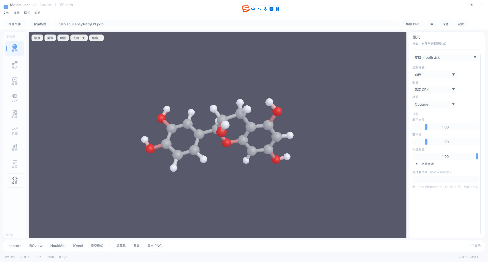
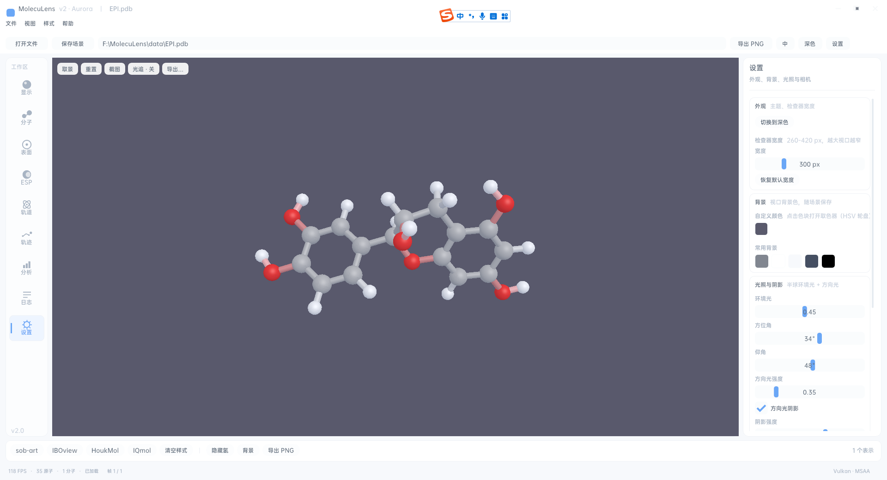
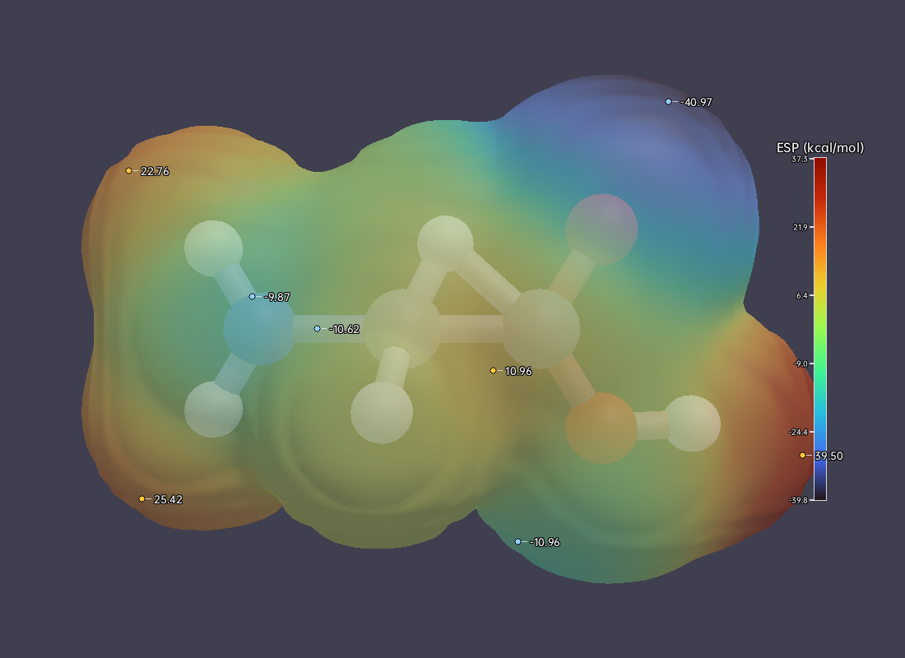

# MolecuLens v2 使用说明

> 适用版本：**v2.2.0（代号 Aurora）**｜平台：Windows x64｜文档版本：2026-10-21
>
> 本文面向第一次使用 MolecuLens 的同学。只想先看效果，直接跳到[第 3 章 五分钟快速上手](#3-五分钟快速上手)。
>
> 未说明的按钮与下拉项，一律**以实际界面为准**；功能是否已实现，以[《功能介绍书》第 8 章](02-功能介绍书.md#8-已知限制)为准。

## 目录

- [1 安装与启动](#1-安装与启动)
- [2 界面导览](#2-界面导览)
- [3 五分钟快速上手](#3-五分钟快速上手)
- [4 典型工作流](#4-典型工作流)
- [5 快捷键与鼠标操作](#5-快捷键与鼠标操作)
- [6 参数参考](#6-参数参考)
- [7 故障排查](#7-故障排查)
- [8 FAQ 与术语表](#8-faq-与术语表)

---

## 1 安装与启动

### 1.1 系统要求

| 项目 | 最低 | 建议 |
| --- | --- | --- |
| 操作系统 | Windows 10 1809 或更高（x64） | Windows 11 x64 |
| CPU | x64 双核 | 四核以上 |
| 内存 | 4 GB | 8 GB 以上（大体系建议 16 GB） |
| 显卡 | 支持 Vulkan 的 GPU（驱动提供 `vulkan-1.dll`） | 独显 + 最新驱动 |
| 显示 | 1280×800 | 1920×1080 及以上 |
| 磁盘 | 约 100 MB（不含数据） | — |

> 提示：MolecuLens 用 Vulkan 渲染，**没有 OpenGL/DirectX 回退路径**。虚拟机里的基础显示驱动、远程桌面的虚拟显卡通常拿不到 Vulkan 设备，会表现为启动后黑屏（见 [7.2](#72-黑屏或白屏)）。

### 1.2 依赖文件与运行库

| 文件 / 组件 | 作用 | 缺失时的现象 |
| --- | --- | --- |
| `vulkan-1.dll` | Vulkan 加载器（随显卡驱动安装） | 启动报 `0xC0000135`，或日志出现 Vulkan 初始化失败 |
| `glfw3.dll` | 窗口与输入 | 启动报 `0xC0000135` |
| VC++ 2015–2022 x64 运行库 | C++ 标准库 | 启动报 `0xC0000135` |
| `font/NotoSansSC-Medium-subset.ttf` | 界面字体（Noto Sans SC 子集，OFL 1.1；构建时由 `data/font/` 拷入，附 `OFL.txt`） | 回退系统字体，界面字号与行高略有差异 |
| `ffmpeg.exe`（可选） | MP4 / WebM 编码 | 当前版本无动画视频导出，此依赖暂不影响使用 |

从源码构建的话，vcpkg 的 DLL 需要手动拷到 exe 旁边（`build\vcpkg_installed\x64-windows\bin` → `build\Debug\`）。构建步骤见 `README.md` 与 `DEPENDENCIES.md`，本文不重复。

> 提示：`post-build` 阶段出现 `MSB3073`（applocal.ps1）是已知噪声，只要 exe 生成即视为构建成功。

### 1.3 首次运行

1. 双击 `build\Debug\moleculens_app.exe`（Release 版在对应目录）；
2. 程序没有独立的控制台窗口；Debug 版会把日志同时写到标准输出（从命令行启动时可在终端看到）；
3. 首次启动是**空场景**：视口中央提示「打开一个结构文件开始」，主题为浅色 Aurora；
4. 程序在当前工作目录下创建 `logs\`，写入 `logs\moleculens.log`；
5. 你的偏好（主题、语言、相机、背景等）保存在 `%APPDATA%\MolecuLens\settings.json`，下次启动自动恢复。

> 提示：日志与设置的位置依赖启动时的**工作目录**。从桌面快捷方式启动和从资源管理器双击，`logs\` 可能出现在不同目录；找不到日志时用「日志」模块底部的路径提示核对。

### 1.4 命令行参数

```
moleculens_app.exe [结构文件] [轨迹文件]
```

| 参数 | 说明 |
| --- | --- |
| 第 1 个位置参数 | 结构文件：`.pdb` / `.gro` / `.sdf` / `.cube` / `.cub` |
| 第 2 个位置参数 | 轨迹文件：`.dcd` / `.xtc` / `.trr`（原子数需与结构一致） |
| 不传参数 | 进入空场景，按 `Ctrl+O` 打开文件 |

示例（在 exe 所在目录执行）：

```bat
moleculens_app.exe data\EPI.pdb
moleculens_app.exe data\md.gro data\md.xtc
```

> 提示：批量渲染另有命令行入口 `moleculens-cli render`（`--esp`、`--iso`、`--cmap`、`--out`、`--style default|soft|publication|vivid` 等参数见 `ESP_SURFACE.md`；轨迹帧用 `--traj md.trr --frame 500` 指定）。它与 GUI 是**两个可执行文件**，GUI 本身只接受上面两个位置参数。

### 1.5 卸载与清理

删除程序目录即可。若要连个人偏好一起清掉，删除 `%APPDATA%\MolecuLens`；需要保留排障证据时先备份 `logs\moleculens.log` 与 `logs\crash.log`。

---

## 2 界面导览

v2 采用固定的五区工作台，**窗口不能停靠拆分了**——这正是为了避免「找不到面板」。默认窗口 1280×800。能改宽度的只有两处：左导航（**92 ↔ 46 px**，`Ctrl+B`）与右检查器（260–480 px，走「设置 → 外观」滑杆）；其余区域位置固定。



按编号认区域：

1. **标题栏（36 px）**：自绘。左侧是**应用标识**（透镜环 + 三原子分子，`aurora::logoMark` 矢量绘制，与 exe 图标同源）、「MolecuLens」、「v2 · Aurora」与当前文件名（未打开文件时显示「未命名场景」）；拖动空白处可移动窗口，双击可最大化；右侧三个窗口按钮（关闭悬停变红）。
2. **菜单栏（36 px）**：文件（打开… / 保存场景… / 导入轨迹… / 导出图片… / 退出）、视图（取景全部 / 重置视角 / 浅色 / 深色 / **收起工作区**（收起时为「展开工作区」）/ 十个模块）、样式（sob-art / IBOview / HoukMol / IQmol / 清空样式）、帮助（快捷键与关于）。
3. **文件栏（44 px）**：路径只读框（未打开文件时提示「尚未打开文件 — 支持 PDB / GRO / SDF / CUBE」）＋ 打开文件 / 保存场景 / 导出 PNG ＋ 语言按钮（中 / EN）＋ 主题按钮（浅色 / 深色）＋ 设置（跳到设置模块）。
4. **左导航（92 px，可收起为 46 px）**：顶部是一个收起按钮（展开态画 ‹‹、收起态画 ››）与「工作区」小标题（收起后隐藏），下面是**十个模块**——显示、分子、表面、ESP、轨道、轨迹、**标注**、分析、日志、设置。每个按钮**图标在上、文字在下**，按钮高 62 px，窗口矮时会自动压缩以保证十项都可见；选中项为浅蓝底 + 左侧竖条，左栏底部标注「v2.0」。点击即切换右检查器，**不会**改变视口内容。
   **左栏可收起**：点顶部的 ‹‹ 按钮（收起后它变成 ››）、按 `Ctrl+B`，或走菜单「视图 → 收起工作区 / 展开工作区」。收起后宽度由 92 px 收到 **46 px**，文字、「工作区」小标题与底部「v2.0」一起隐藏，只剩十个矢量图标，**鼠标悬停才显示模块名**；省下的宽度立刻归视口（视口随之变宽，不需要拖拽或重启）。再按一次 `Ctrl+B`（或点 ››）即展开，视口上方会提示「工作区已展开」。
5. **视口（中央卡片）**：3D 场景。左上角悬浮工具条（取景 / 重置 / 截屏 / 光追 / 导出…），右下角是 ESP 色标条与极值标注（仅当前表示为 ESP 表面且可见时出现），左下角显示「表面生成中…」「已隐藏 H」等状态。
6. **右检查器（默认 380 px）**：当前模块的全部参数。宽度可在 **260–480 px** 之间调整，但**不能拖拽边缘**——入口是「设置 → 外观 → 宽度」滑杆（旁边有「恢复默认宽度」）；标题下方的小字是该模块的一句话说明。
7. **快捷条（46 px）**：`sob-art` / 清空样式 ｜ 隐藏氢 / 网格质量 / 背景 / 光追预览 / 导出 PNG；最右侧显示当前表示数量。点「背景」不是切换明暗，而是弹出取色面板（HSV 轮盘取色器 + 一排预设色板：深灰 / 白 / 浅灰 / 深蓝 / 黑）；更细的取色入口在「设置 → 背景」。「网格质量」弹窗直接改当前表面 / 快速表面的网格间距（粗 1.0 / 中 0.5 / 细 0.25 / 极细 0.15 Å），当前表示不是表面类时会提示；`IBOview` / `HoukMol` / `IQmol` 三套风格仍在菜单「样式」里。
8. **状态栏（26 px）**：左「NN FPS · N 原子 · N 分子 · 已加载 / 空场景」，有轨迹时中部「帧 i / N」，右端「Vulkan · MSAA」。



### 语言与主题

- **语言**：文件栏的「中 / EN」按钮在中文与英文界面间切换，并写入 `settings.json` 的 `language` 键；设置模块里的「语言」下拉做的是同一件事，切换后界面文案即时刷新。
- **主题**：浅色 Aurora Lab 为默认主题，文件栏「深色」按钮或设置模块「切换到深色」可切到深色；主题偏好写入 `settings.json` 的 `theme` 键（`aurora-light` / `aurora-dark`），下次启动保持。
- 旧的 v1 主题预设键不会让新版变黑：无法识别时回落到浅色 Aurora，不会出现黑底配白检查器的混搭。

### 设置模块：七张卡片

左导航最后一项「设置」，检查器里自上而下是七张卡片：

| 卡片 | 能改什么 | 默认 |
| --- | --- | --- |
| 外观 | 「切换到浅色 / 切换到深色」chip、检查器**宽度**滑杆（260–480 px）、「恢复默认宽度」 | 浅色、380 px |
| 背景与主题色 | 自定义背景取色器（HSV 轮盘）+ 常用背景色板 + **主题强调色**取色器与 8 个预设色 | 随场景、内置蓝 |
| 光照与阴影 | 环境光 0–1、方位角 −180°–180°、仰角 2°–89°、方向光强度 0–2、方向光阴影开关、阴影强度 0–1 | 环境光 0.45、方向光 0.35、阴影开 |
| 渲染风格 | 预设下拉（默认 / 柔和 / 出版 / 鲜明）+ 漫反射环绕 0–0.8、轮廓描边 0–1、边缘补光 0–0.5、距离淡出 0–1 | 默认（0.35 / 0.32 / 0.18 / 1.0） |
| 剖切面 | 启用开关、方向（±X/±Y/±Z）、切面位置 −60~60 Å | 关、+X、0 Å |
| 相机 | 正交投影开关、视野 FOV 15°–90°、「取景全部」「重置视角」 | 透视、45° |
| 语言与关于 | 语言下拉（简体中文 / English）+ MolecuLens v2.0 · Aurora / Vulkan 1.3 / Dear ImGui 1.91 / 10 个模块 四行只读信息 | 简体中文 |

> 提示：背景色改完**随场景保存**（存进 `.mlscene`），换一台机器打开同一个场景仍是同一底色；主题、强调色与语言属于程序偏好，存在 `settings.json`。强调色存为 `#RRGGBB`，点「恢复默认主色」会清空该键并回到内置蓝。

> 提示：多数操作会在视口上方居中的位置弹出一条 3 秒左右的提示（例如「样式 · sob-art：球棍 + CPK + 深背景」「图片已导出：…」），看不到按钮是否生效时先看提示气泡。

---

## 3 五分钟快速上手


**第 1 步｜打开结构。** 按 `Ctrl+O`（或点文件栏「打开文件」），选 `data\EPI.pdb`。路径会出现在文件栏的只读路径框，状态栏原子数变为非零，视口出现球棍模型（引擎启动时已带一条默认 `ballstick` 表示）。

**第 2 步｜旋转与缩放。** 在视口按住**左键拖动**旋转，**滚轮**（或中键拖动）缩放；右键拖动平移，`Shift` + 右键绕视线滚转。按 `F` 取景，按 `R` 重置视角。

**第 3 步｜换个样子。** 打开菜单「样式 → IQmol」（白底高光泽），或直接按 `1` 套用快捷条的 `sob-art` 深色风。选 IQmol 后背景变纯白、材质换成拉丝金属高光；想恢复就点快捷条的「清空样式」，或按 `1` 回到 sob-art。

**第 4 步｜加个表面。** 左导航进「表面」→ 点「创建快速表面」→「网格质量」选「中」，「等值面阈值」保持 0.50。视口左下先出现「表面生成中…」，随后表面出现、提示消失，旋转可见表面已包住分子。

**第 5 步｜导出图片。** 按 `Ctrl+E`（或点文件栏「导出 PNG」）打开导出对话框：「超采样倍数」选 `2×`（输出像素 = 视口尺寸 × 倍数），需要纯色底就套白底预设、需要抠图素材就勾「透明背景」，点「导出」并选择保存位置，成功后提示「图片已导出：…」。ESP 表面存在时，色标条与极值标注会一并写入 PNG；**「标注」页的水盒/文字/箭头/水印也会一起栅格化（8-bit 路径）**。

完成。你已经走完「打开 → 看 → 换样式 → 加表面 → 出图」的完整闭环。

---

## 4 典型工作流

### 4.1 小分子可视化并成图

以 `data\(+) - Epicatechin.sdf` 或 `data\EPI.pdb` 为例：

1. `Ctrl+O` 打开文件，按 `F` 取景；
2. 打开菜单「样式 → IQmol」（白底＋拉丝金属材质），或直接用快捷条的 `sob-art`；
3. 氢原子碍眼时点「隐藏氢」（或直接切到「ball & stick」以外不需要氢的样式）；
4. 需要标注元素配色时，在「显示」模块把「配色」设为「元素 CPK」；
5. 预设材质不够「亮」时，在「显示」模块展开 **「材质微调」**：调环境色 / 漫反射色 / 高光色与光泽度（1–256）、金属度、粗糙度；改完即切到「自定义」，点「恢复预设材质」可回退；
6. 视口左上「光追·开」可切到 CPU 光线追踪预览，观察高光与阴影（性能会下降）；
7. `Ctrl+E` 导出，「超采样倍数」选 `2×`–`4×`；底色用快捷条「背景」取色面板或「设置 → 背景」定，需要透空时勾「透明背景」。

> 提示：成图前先按 `F`，让相机适配到所有可见内容；手动拖动后的取景在切换样式（例如加表面）后不会自动更新。

> 提示：**辅基（叶绿素等）用「平板（辅基）」**——每个「链 + 残基」一块彩色方片（每块需 ≥3 个原子，朝向自动取原子云主方向）；颜色只取组内**第一个原子**，所以要区分不同辅基请把「配色」设为「按残基」或「按链」，并用选择表达式只选辅基（如 `resname CHL`）。示意图里常叠一层卡通画骨架。

### 4.2 ESP 映射表面

ESP 一步都不能省：**两个 cube 必须来自同一次计算、同一网格**。

**前置（Multiwfn 侧）**，菜单路径与 `ESP_SURFACE.md` 一致：

1. Gaussian 完成优化/单点，得到 `.fchk`；
2. Multiwfn 载入 fchk，走 `5 → 1 → 3 → 2` 导出 **density.cub**（电子密度，决定表面几何）；
3. Multiwfn 走 `5 → 12` 导出 **totesp.cub**（总静电势，决定颜色）。

**软件内**：

1. 打开结构文件（PDB/GRO/SDF 均可）；
2. 左导航「ESP」→ 点「创建 ESP 表示」；
3. 「密度 cube」点「浏览…」选 `density.cub`（两个路径都不会自动填入，必须逐个指定）；
4. 「静电势 cube」点「浏览…」选 `totesp.cub`（缺少任一文件时模块会提示「补齐两个 cube 文件后表面才会出现」）；
5. 密度阈值保持 `0.001`（约等于 vdW 面；想更外扩用 0.0005，更贴身用 0.005）；
6. 「自动范围」保持开启即为发散型 ±99.5 分位；要固定量程就关掉，手填例如 −45 / +45 kcal/mol；
7. 配色选 `Reference`（黄→绿→青→蓝→紫）或 `Rwb`，需要交换正负端时开「翻转色标」；
8. 视口右下出现色标条，场景中标注极值点（每侧最多 8 个）。



> 提示：cube 里的坐标是 Bohr、电位是 Hartree，导入时会自动换算为 Å 与 kcal/mol（×627.509474），不需要你预先处理文件。

> 提示：极值点是算法检测的（顶点邻域 + 1.2 Å 非极大抑制），与 Multiwfn 的 `surfanalysis.pdb` 可能有差异，投稿前请人工核对关键位点。

### 4.3 轨迹播放

1. 打开 `data\md.gro`（6452 原子，配合 `data\md.xtc` 的 1001 帧）。没有帧数据时轨迹模块会提示「当前场景没有帧数据。导入 DCD/XTC/TRR 轨迹后可在此播放。」并提供「导入轨迹」按钮；
2. 菜单「文件 → 导入轨迹…」，选 `md.xtc` / `md.trr`（原子数必须与结构一致，否则提示「轨迹导入失败」；TRR 是 GROMACS 原生格式，1001 帧 × 10 ps）；
3. 左导航「轨迹」：点播放；用滑块跳到指定帧；「播放速度」调到 0.1×–10×；
4. 只看关键片段时填「帧范围」起/止（止 = 0 表示末帧），开「循环播放」；
5. 状态栏中部显示「帧 i / N」。


> 提示：当前**没有动画/视频导出**：PNG 序列、APNG、GIF、MP4/WebM 均在路线图，动画导出对话框也尚未接入正式界面。需要动态演示时请用逐帧导出 + 外部合成，或直接录屏。

### 4.4 保存场景：链接式 / 嵌入式

**为什么有两种**：`.mlscene` 默认只记录轨迹文件的路径与指纹（大小/mtime），文件很小；但换机器、发给合作者、或轨迹文件被移动/改名后，场景里的轨迹就找不回来了。把帧坐标一起写进场景文件可以单文件带走，代价是体积。

**做法**：

1. 按 `Ctrl+S`，或点文件栏「保存场景」，或走菜单「文件 → 保存场景…」；
2. 工作台弹出「保存场景」框（副标题「选择轨迹的存储方式」），二选一：

   | 选项 | 界面说明 | 适合 |
   | --- | --- | --- |
   | **链接式（推荐）** | 只记录轨迹文件路径与指纹，场景文件很小；轨迹文件移动或改名后需要重新指定。 | 本机日常使用；轨迹文件很大 |
   | **嵌入式（单文件）** | 把轨迹帧一起写进 `.mlscene`，可单文件分发；体积随帧数×原子数增长。 | 发给合作者、换机器、归档 |

3. 框里给出体积预估，两行：「当前场景：N 条轨迹 / 最多 N 帧 / 合计 N 原子」与「内嵌预计：X MB」（按 1024² 换算）；估算 ≥ **200 MB** 时追加红字「体积较大（>200 MB），建议改用链接式。」；当前场景没有轨迹时只显示「当前场景没有轨迹，两种模式保存结果相同（只存结构与表示）。」；
4. 点「保存…」选择保存位置；「取消」则不写盘；
5. 选择会记进 `settings.json` 的 `sceneSaveMode`（`"linked"` / `"embedded"`），下次打开这个框时默认沿用上次的选择。

> 提示：体积估算按 `帧数 × (原子数 × 12 + 36)` 字节计算——每帧每原子 12 B（3 个 float32 坐标），每帧另加 36 B 盒子（界面不区分有无盒子，统一按同一公式估）；多条轨迹各自累加。例：1001 帧 × 6452 原子 ≈ 73.9 MB（界面按 1024² 显示）。估算与最终文件同量级，元数据与命令流段会让实际略大。

> 提示：嵌入式只打包**轨迹帧**。ESP / 轨道引用的 cube 仍是路径，不会被一起打包；单文件分发时请确认对方不需要这些外部文件。

> 提示：打开嵌入式场景不需要外部轨迹文件；链接式场景重开时按记录的路径重新读取轨迹，文件被移动或改名后需要重新导入，或改用嵌入式重新保存。命令行保存仍按链接式（本轮未加 CLI 开关）。

> 提示：**场景标注与保存模式无关**——水盒/标签/箭头/水印总是随 `.mlscene` 保存（可选键 `annotations`），链接式与嵌入式都一样；嵌入式只影响轨迹帧是否打包。

### 4.5 渲染风格与出版出图

1. 左导航进「设置」，找到「渲染风格」卡片，先选预设：**默认 / 柔和 / 出版 / 鲜明**；
2. 「出版」会把背景换成白色、环境光提到 0.42、方向光 0.50 并关闭阴影，适合直接截屏投稿；「柔和」只加大明暗过渡，「鲜明」提高对比；
3. 需要微调时拖四个滑杆（只改全局 UBO，不重建命令流，拖动即时生效）：
   - **漫反射环绕**：0 = 硬明暗交界，0.3–0.6 = 柔和过渡；
   - **轮廓描边**：掠射角压暗约 1–2 像素，勾出球/键/表面的外轮廓；
   - **边缘补光**：深色背景下让轮廓与背景分离；
   - **距离淡出**：需先在场景里开启雾，远处淡向背景色而不是灰雾；
4. 命令行用同一套预设出图，例如：
   ```bat
   moleculens-cli render data\EPI.pdb --style publication --out fig.png
   ```
   `publication` 会自动切白底并关阴影；也可与 `--bg white` 显式组合。

> 限制：当前轮廓是片元着色器内的像素级近似（`fwidth`），**原子之间的内部遮挡轮廓**（真正 SSAO/屏幕空间描边）尚未实现，已列为后续迭代；四个风格参数是运行期状态，不写入 `.mlscene`，重启回到默认。

### 4.6 调色盘：背景/主题色与原子颜色

调色盘分成两个独立入口，互不影响：

1. **背景与主题色**（设置 → 背景与主题色）
   - 背景取色器/色板改视口底色（随场景保存）；
   - **主题强调色**：点色块或 8 个预设之一（蓝/青/绿/琥珀/橙/玫红/紫/石板），整套 UI 的按钮/选中态/滑块主色立即变化；选择记忆在 `settings.json` 的 `accent`（`#RRGGBB`），「恢复默认主色」清空该键并回到内置蓝。
2. **原子颜色**（显示 → 调色盘 · 原子颜色）
   - 点「改为统一色」把当前表示从元素/链/残基配色切到统一色；
   - 点色块打开 HSV 轮盘，或在 12 个预设色块里选；只影响**当前表示**，其他表示不变；
   - 切回元素 CPK 等配色后统一色入口消失，原配色恢复（材质数值仍保留，只是不再生效）。

> 提示：统一色写的是材质 diffuse，不是逐原子自定义颜色；要按原子改色，先用选择表达式选出子集再建表示。背景色随 `.mlscene` 保存，强调色随 `settings.json` 保存。

### 4.7 标注与示意图（水盒 / 文字 / 箭头 / 水印）

**用途**：把分子图变成示意图——画出周期盒、标识分子、用箭头指关系（含光子入射的波浪箭头）、加半透明水印；这些标注**随 PNG 导出**，不需要后期拼图。

**做法**（左导航「标注」，检查器里自上而下四张卡 + 一张「风格与清理」）

1. **水盒 / 周期盒**
   - 打开「显示水盒」；
   - 来源二选一：「跟随轨迹盒」取轨迹首帧的 9 分量 box（支持三斜，需 DCD/GRO/XTC 首帧带 box）；「手动指定」填**盒中心 (Å)** 与**盒半长 (Å)**；
   - 手动模式可点「适配场景」按当前包围盒 ±5% 自动填；
   - 再调「盒线颜色」与「线宽」（0.8–4.0 px）。纯 PDB 没有 box，只能用「手动指定」。
2. **文字标签**
   - 输入文字 → 选锚点（**分子序号 / 坐标 / 视图中心**）→ 设颜色与字号（9–48 px）→「添加标签」；
   - 列表里可勾选可见性、改字号、改颜色、删除；
   - 「为前 N 个分子命名」按分子名批量生成（大体系建议 < 50）。
3. **箭头**
   - 端点二选一（分子序号 / 坐标）；样式「普通箭头」或「波浪（光）」（示意光子入射）；
   - 线宽 1–8、箭头大小 0.4–2.5、可勾「双头箭头」、选颜色 →「添加箭头」；
   - 列表可删/隐藏。
4. **水印**
   - 「显示水印」→ 输入文字 → 颜色/透明度（RGBA）→ 大小（**图高 3%–30%**）→ 锚点（右下 / 左下 / 居中 / 右上）。
5. **一键风格**
   - 「应用示意图风格」：黑底 + 强轮廓（`outline=0.80`、`wrap=0.55`）+ 平光材质 + 关阴影，并**自动打开水盒与水印**；
   - 「应用出版风格」：黑底 + 平光 + 弱轮廓——注意它和设置页的「出版」预设（**白底**）不是同一件事；
   - 「清除全部标注」清空标签/箭头并关掉水盒/水印。
6. **保存与重开**
   - 按 `Ctrl+S` 保存场景时，标注会写进 `.mlscene` 元数据的**可选键 `annotations`**（空标注不写该键，旧版本文件缺键 = 空，完全兼容）；
   - 重开该场景会提示「已载入场景标注（水盒/标签/箭头/水印）」，标签/箭头/水印原样恢复；
   - 水盒按**原始几何**保存（`origin[3]` + `axes[9]`，三斜也精确）；载入后界面显示为「手动指定」，**一旦改中心/半长就切回轴对齐**（三斜几何随之丢失）。

**导出行为**

- 水盒/标签/箭头/水印随 PNG **一起栅格化（8-bit 路径）**，并按图像高度等比放大（900 px 基准）——4× 或 4K 导出时线宽/字号同比变大，不会「导出后变小」；
- **16-bit 与 CPU 光追导出暂不含标注**；
- 勾选「透明背景」时标注**跳过**（与 ESP 色标同一取舍：栅格器只写 RGB，alpha=0 像素上不可见）。

> 提示：标注**随场景保存**（不是只存在于当前视图）；但 `settings.json` 不存标注。示意图风格会把空水印文本自动填成 `MolecuLens`，可在水印卡里改。

---

## 5 快捷键与鼠标操作

### 5.1 快捷键

| 快捷键 | 功能 |
| --- | --- |
| `Ctrl+O` | 打开结构文件 |
| `Ctrl+S` | 保存场景（`.mlscene`，先弹「链接式 / 嵌入式」选择框） |
| `Ctrl+E` | 导出图片（打开导出对话框） |
| `Ctrl+L` | 切换到日志模块 |
| `Ctrl+B` | 收起 / 展开左导航（92 ↔ 46 px，视口自动变宽） |
| `F` | 取景全部 |
| `R` | 重置视角 |
| `1` | 快捷条一键风格 sob-art（IBOview / HoukMol / IQmol 在「样式」菜单） |
| `H` | 隐藏氢 / 恢复（同快捷条「隐藏氢」） |
| `Space` | 轨迹播放 / 暂停 |
| `←` / `→` | 上一帧 / 下一帧 |
| `F1` | 快捷键与关于 |
| `Alt+F4` | 退出 |

> 提示：输入框获得焦点时（例如正在填写「选择表达式」）快捷键不生效，避免打字触发误操作。先点一下视口空白处再按。

> 提示：左栏收起后十个按钮只剩图标，把鼠标停在图标上会弹出模块名，不必先展开；`Ctrl+B` 在任何时候都能切回展开态，菜单「视图 → 展开工作区」同理。收起状态**不会**记忆，下次启动仍是展开的 92 px。

### 5.2 鼠标操作

| 操作 | 效果 |
| --- | --- |
| 左键拖动 | 旋转（轨道） |
| 滚轮 | 缩放（前后移动相机） |
| 右键拖动 | 平移 |
| `Shift` + 右键拖动 | 绕视线滚转 |
| 左键单击 | 拾取（选中鼠标下的原子/表示，具体反馈以界面为准） |

> 提示：检查器宽度**不在**鼠标操作里——左右拖动检查器边缘没有效果，改宽度请走「设置 → 外观 → 宽度」滑杆；同理，快捷条的「背景」是弹出取色面板而不是点一下换一种底色。左导航也不支持拖拽边缘改宽，但顶部 ‹‹ / ›› 是**真按钮**（展开态 ‹‹、收起态 ››），点一下就有 46 px 的宽度差。

---

## 6 参数参考

| 参数 | 取值范围 | 默认值 | 所在位置 |
| --- | --- | --- | --- |
| 绘图样式 | 14 种（新增「平板（辅基）」） | 球棍 | 显示模块 |
| 平板（辅基） | 每「链+残基」一块，≥3 原子；厚度 0.08–0.30 Å | — | 显示模块 · 绘图样式；配色建议按残基/链 |
| 配色 | 元素 CPK / 链 / 残基 / B 因子 / 单色 | 元素 CPK | 显示模块 |
| 材质 | 23 套（Opaque、Transparent、BrushedMetal、Diffuse、Ghost、Glass1–3、Glossy、HardPlastic、MetallicPastel、Steel、Translucent、Edgy、EdgyShiny、EdgyGlass、Goodsell、AOShiny、AOChalky、AOEdgy、BlownGlass、GlassBubble、RTChrome）+ 自定义 | Opaque | 显示模块 |
| 原子半径 | 0.05 – 5.00 | 1.00 | 显示模块 |
| 键半径 | 0.05 – 5.00 | 1.00 | 显示模块 |
| 不透明度 | 0.05 – 1.00 | 1.00（ESP 表面同为 1.00，可降到 0.6–0.85） | 显示 / 表面 / ESP |
| 网格质量 | 低 1.00 / 中 0.50 / 高 0.25 / 超高 0.15 Å | 中 0.50 | 表面模块 |
| 表面等值面 | 0.05 – 2.00 | 0.50 | 表面模块 |
| 密度阈值 iso | 0.0005 – 0.02 a.u. | **0.001** | ESP 模块 |
| ESP 上下限 | −300 – +300 kcal/mol | −45 / +45（自动范围开启时由数据决定） | ESP 模块 |
| ESP 配色 | Rwb / Bwr / Coolwarm / Turbo / Viridis / Jet / Reference | Rwb | ESP 模块 |
| 极值点 | 每侧最多 8 个，1.2 Å 非极大抑制（无开关） | 自动 | ESP 模块 |
| 体数据等值面 | 0.0005 – 0.500 | 0.02 | 轨道模块 |
| 播放速度 | 0.1 – 10.0× | 1.0× | 轨迹模块 |
| 循环播放 | 开 / 关 | 开 | 轨迹模块 |
| 帧范围 In / Out | 整数；Out = 0 表示末帧 | 关闭时播放全部 | 轨迹模块 |
| FOV | 15 – 90° | 45° | 设置模块 |
| 检查器宽度 | 260 – 420 px | **380 px** | 设置 → 外观 |
| 左导航宽度 | 92 px（展开）/ 46 px（收起） | 展开 92 px | 左导航顶部 ‹‹ / ››、`Ctrl+B`、视图菜单 |
| 材质微调 · 光泽度 / 金属度 / 粗糙度 | 1–256 / 0–1 / 0–1 | 随当前预设（Opaque：32 / 0 / 0.40） | 显示模块 · 材质微调 |
| 环境光 | 0 – 1 | 0.45 | 设置 · 光照与阴影 |
| 方位角 / 仰角 | −180°–180° / 2°–89° | 由光照方向换算（以界面为准） | 设置 · 光照与阴影 |
| 方向光强度 | 0 – 2 | 0.35 | 设置 · 光照与阴影 |
| 阴影强度 | 0 – 1 | 0.65 | 设置 · 光照与阴影 |
| 超采样倍数 | 1× / 2× / 4×（输出像素 = 视口尺寸 × 倍数） | 2× | 导出对话框 |
| 场景保存模式 | 链接式 / 嵌入式 | 链接式 | 保存场景对话框（记忆在 `settings.json` 的 `sceneSaveMode`） |
| 水盒来源 | 跟随轨迹盒 / 手动指定 | 跟随轨迹盒 | 标注页；纯 PDB 需手动，轨迹首帧需带 box |
| 盒中心 / 盒半长 | XYZ，Å | 0 / 20 | 手动模式；「适配场景」按包围盒 ±5% 填 |
| 盒线宽 | 0.8–4.0 px | 1.4 px | 盒线颜色可调；导出按图高同比放大 |
| 标签字号 | 9–48 px | 18 px | 锚点：分子序号 / 坐标 / 视图中心 |
| 箭头线宽 / 大小 | 1–8 / 0.4–2.5 | 2.2 / 1.0 | 普通 / 波浪（光）；可双头 |
| 水印大小 / 锚点 | 图高 3%–30% / 四选 | 10% / 右下 | RGBA 透明度可调 |
| MSAA | 整数采样数 | 4 | `settings.json` 的 `msaa` 键（需重启） |

---

## 7 故障排查

排障三步：看视口上方的提示气泡 → 看「日志」模块 → 看 `logs\moleculens.log`。崩溃信息在 `logs\crash.log`。

### 7.1 启动失败并报 0xC0000135

**现象**：双击无窗口，Windows 弹「无法启动此程序，因为计算机中丢失 …」。

**原因**：缺少 DLL 或 VC++ 运行库。**处理**：安装 [Microsoft Visual C++ 2015–2022 Redistributable (x64)]；确认 `glfw3.dll` 与 `vulkan-1.dll` 与 exe 同目录；用 Dependencies 类工具确认缺哪个 DLL；`vulkan-1.dll` 缺失通常意味着显卡驱动没装好。

### 7.2 黑屏或白屏

**现象**：窗口出现，视口全黑（或全白），界面不响应。

**排查**：看 `logs\moleculens.log` 里是否有 Vulkan 设备创建/交换链相关错误；确认是**独显**在跑（笔记本多 GPU 时强制高性能 GPU）。**处理**：更新显卡驱动；安装 Vulkan Runtime；远程桌面/虚拟机上改用物理机。若日志显示设备正常但画面异常，尝试在 `settings.json` 把 `msaa` 改为 0 后重启。

### 7.3 表面不显示

依次检查：① 该表示的「可见」是否勾选；② 表面是否还在生成（视口左下「表面生成中…」）；③ 「等值面阈值」是否**大于**当前体系的密度最大值（阈值过高时表面为空，把 0.50 降到 0.20 试试）；④ 网格质量是否过低导致表面过于粗糙以致看不见（换「中」）；⑤ ESP 表面需要**两个 cube**，缺一个就不会出现。

### 7.4 cube 维度不匹配

**现象**：ESP 模块提示失败，或日志出现 cube 解析 / 网格相关错误。

**原因**：密度 cube 与电位 cube 的网格（`nx/ny/nz`、原点、步长）不一致。**处理**：两个 cube 必须在 Multiwfn 的**同一次任务**里从同一 fchk 导出；不要混用不同泛函/基组/网格的结果；必要时用 Multiwfn 重新导出 `density.cub` 与 `totesp.cub` 各一份。

### 7.5 ESP 表面全灰

**原因与处理**：① 「自动范围」遇到常数场会退化，关闭自动范围手动填 −50 / +50；② 阈值过小，表面落在电位≈0 的区域，把 iso 从 0.0005 提到 0.002；③ 选反了文件（把 density 填进了「静电势 cube」）；④ 配色 `Rwb` 的中段本来就是接近白的浅色，属正常，换 `Turbo` 观察分布。

### 7.6 半透明表面里出现深色「幽灵」剪影

**现象**：ESP 表面 / 快速表面设为半透明后，壳内出现与分子同形的暗斑，看着像"透视穿帮"。

**原因**：方向光阴影贴图只记录球与圆柱，壳面会接收壳内原子投下的阴影；另外双击面网格的背面若未校正法线，会按地面色（偏暗）受光。v2.1 起半透明几何由 CPU 显式置 `shadowMask = 0`（不接收动态阴影），并对背面做了法线翻转。

**处理**：① 升级到 v2.1 以上并重建缓存；② 若仍有暗斑，可在「设置 → 光照与阴影」临时关闭阴影确认是否与阴影相关，并告诉我当时的光向（方位角/仰角）与表面不透明度；③ 命令行可用 `--light-az 180 --light-el 40` 复现特定光向下的效果。

### 7.7 卡顿

按收益排序：① 表面「网格质量」从中/高降到低；② 多分子体系打开「整体系合并表面」；③ 关闭视口「光追」预览；④ 降低 `settings.json` 的 `msaa`（4 → 2）；⑤ 减少同时可见的表示数量；⑥ 轨迹播放时降低播放速度（不等于降帧率，但能减少每帧的表面重建）。

### 7.8 保存场景失败或重开找不到轨迹

**现象**：点「保存场景」提示「保存失败，详见日志」；或重开 `.mlscene` 后分子还在、轨迹页却提示没有帧数据。

**原因与处理**：`.mlscene` 会把结构、表示参数与坐标写进文件，但**轨迹默认只记路径与指纹**（链接式）。因此：① 轨迹文件被移动、改名或替换后，重开时就找不到或指纹不符——重新导入轨迹，或下次保存改用「嵌入式（单文件）」；② 保存失败先看 `logs\moleculens.log` 末尾的 IO 错误（磁盘满、目标只读、路径过长都报在这里）；③ 需要「一个文件带走全部内容」时选嵌入式，注意体积（1001 帧 × 6452 原子约 74 MB，保存框里有预估）；④ 嵌入式只打包轨迹帧，ESP / 轨道用的 cube 仍需随文件一起带上。

### 7.9 界面里中英文混排

**现象**：切到 EN 后仍有部分中文，或切回中文后个别词还是英文。

**原因**：v2 的界面文案由内置语言表驱动，切换范围以实际运行版本为准（文件名、路径、日志行等动态内容不会翻译）。若整块界面没有随语言切换，检查是否同时开了两个窗口、分别写入了不同的 `language` 值，重启一次让配置生效。

### 7.10 「打开文件」对话框里看不到目标文件

**现象**：点「打开文件」（或按 `Ctrl+O`）后，文件列表为空、或只显示一部分文件；目标文件明明在文件夹里，中文/特殊字符路径下尤其明显；切到「所有文件 (*.*)」才看得到。

**根因（2026-10 修复，三条）**：

1. 旧对话框是 **ANSI 版**（`GetOpenFileNameA` + `OPENFILENAMEA`），路径按系统代码页解释，中文或非 GBK 可表示的目录名会被截断/匹配不到；
2. 旧过滤器只写了 `*.pdb;*.gro;*.sdf;*.cube`，漏掉解析器实际支持的 `.ent`（PDB）、`.mol`（SDF）、`.cub`（CUBE）——这些文件在默认过滤器下**根本不可见**；
3. 最隐蔽的一条：Win32 过滤器是「说明`\0`通配`\0`…`\0\0`」的**内嵌 NUL** 串，旧代码用 `std::string(const char*)` 承接，会在第一个 NUL 处截断，对话框只剩说明、没有通配符，于是列表为空。

**修复后的行为**：

- 改用 **Unicode 对话框**（`GetOpenFileNameW` / `GetSaveFileNameW`），owner 显式指定为当前活动窗口（`GetActiveWindow()`，取不到时回退 `GetForegroundWindow()`），路径缓冲 32 KiB（不再是 `MAX_PATH`）；
- 标志为 `OFN_EXPLORER | OFN_FILEMUSTEXIST | OFN_PATHMUSTEXIST | OFN_NOCHANGEDIR | OFN_HIDEREADONLY`（保存另加 `OFN_OVERWRITEPROMPT`），`nFilterIndex = 1`，打开时 `defExt = nullptr`（不再强行补 `.pdb`）；
- 过滤器**由解析器注册表生成**（`ParserRegistry::allExtensions()`：小写、去点、去重、按注册顺序），目前的清单是 `pdb, ent, gro, sdf, mol, cube, cub`，工作台过滤器固定三段：

  | 序号 | 过滤器 | 覆盖的扩展名 |
  | --- | --- | --- |
  | ① | 分子结构文件 | `*.pdb;*.ent;*.gro;*.sdf;*.mol;*.cube;*.cub` |
  | ② | MolecuLens 场景 | `*.mlscene` |
  | ③ | 所有文件 | `*.*` |

  轨迹导入的过滤器是「轨迹 (*.dcd;*.xtc;*.trr)」（TRR 为本轮新增），不在这三段里。

**自检步骤**：① 打开 `D:\论文数据\md.gro` 这类中文目录，文件应直接可见；② `.mol` / `.cub` / `.ent` / `.mlscene` 在默认过滤器下可见；③ 切「所有文件」能看到任意扩展名；④ 选中后仍提示解析失败，说明是**格式本身**不在支持列表，而不是对话框的问题（可用 `moleculens-cli info <文件>` 复核）。

> 说明：以后新增文件格式时，只要在 `ParserRegistry` 注册，打开对话框的过滤器会自动带上该扩展名，不需要再改界面代码——这也是「看不到目标文件」不再复发的前提。

### 7.11 水盒不显示或位置不对

**现象**：勾了「显示水盒」但看不到盒线，或盒子明显偏出分子。

**原因与处理**：① 纯 PDB 没有周期盒信息——「跟随轨迹盒」取不到 box，改用「手动指定」再点「适配场景」；② 轨迹首帧不带 box（部分 DCD/GRO）同样要回退手动；③ 盒子单位是 **Å**，若从 GROMACS 的 nm 数值直接抄会小 10 倍；④ 三斜盒的 9 个分量不能当成 3 个对角长度手填——只有「跟随轨迹盒」能保留三斜；⑤ 盒线离分子太远时先「适配场景」（按包围盒 ±5%），再小幅调「盒半长」。

---

## 8 FAQ 与术语表

### 8.1 常见问题

**Q：为什么打开 fchk 没反应？** A：GUI 只打开解析器注册过的格式：PDB（`*.pdb`/`*.ent`）、GRO（`*.gro`）、SDF（`*.sdf`/`*.mol`）、CUBE（`*.cube`/`*.cub`），以及 `.mlscene` 场景。打开对话框的过滤器由解析器注册表自动生成，所以 fchk / xyz / mol2 不会出现在默认列表里；fchk 请先用 Multiwfn 转成 cube 再导入。

**Q：ESP 能不能不做计算就出图？** A：不能。MolecuLens 不内建量化计算，只负责用现成的 density/esp cube 出图。

**Q：为什么表面是半透明时看不到背面？** A：半透明表面只绘正面（背面剔除）且未实现 OIT，这是性能取舍；需要看内部时降低不透明度或隐藏外层表示。

**Q：左导航占地方，能不能收起来？** A：能。点左导航顶部的 ‹‹（或按 `Ctrl+B`、菜单「视图 → 收起工作区」），宽度从 92 px 收到 46 px，只剩十个图标，鼠标悬停显示模块名；再按一次 `Ctrl+B` 展开。收起后腾出的宽度直接给视口，但**状态不写入设置**，重启回到展开态。

**Q：忘了保存场景怎么办？** A：`.mlscene` 保存结构、坐标与表示参数；轨迹是否一起写进去取决于保存时选的模式（链接式只存路径，嵌入式打包帧）。分析结果（统计数字、极值点列表）不保存。v2 没有「最近文件」菜单，未保存时只能重新打开结构文件后重设参数。

**Q：界面字体好小/好大？** A：v2 字号固定（标题 20 / 正文 16 / 辅助 13），可在 Windows 显示设置里调整缩放；字体缺失会回退系统字体，行高可能变化。

**Q：能同时开两个窗口吗？** A：一个进程一个窗口。需要对比两个文件时请在同一个场景里打开两个分子，用「分子」列表控制可见性。

**Q：导出图为什么比视口大一圈？** A：「超采样倍数」是**输出像素倍数**：视口 900 px 宽选 4× 就得到 3600 px 宽，而不是某种参数化插值；视口尺寸变了，输出尺寸跟着变。

**Q：透明背景的 PNG 边缘发白？** A：透明背景只让背景 alpha=0，分子本身仍不透明，边缘抗锯齿像素是半透明的——放到深色背景上会看到一圈浅色描边，属正常；需要干净边缘时导出 4× 再缩小。

**Q：想恢复到「刚装好」的状态？** A：删除或改名 `%APPDATA%\MolecuLens\settings.json`，重启即恢复默认浅色主题、默认相机与 MSAA 4；场景内容不受影响。

**Q：为什么打开两个分子后只有一个能改样式？** A：表示是**场景级**的，一条表示作用于当前场景的全部分子；想让不同分子不同画法，需要在「显示」模块新建多条表示并用选择表达式区分（如 `resid 1-10`）。

### 8.2 术语表

| 术语 | 含义 |
| --- | --- |
| 表示（Representation） | 一个分子的一种画法（球棍、卡通、表面…），可多个叠加 |
| 收起工作区 | 把左导航从 92 px 收窄到 46 px 的状态（只剩图标，悬停显示模块名），`Ctrl+B` 切换 |
| 水盒 | 周期盒的 12 条棱（轨迹首帧 box 或手动中心+半长），在「标注」页控制显示与线宽 |
| 示意图风格 | 黑底 + 强轮廓 + 平光 + 关阴影的一键风格，并自动打开水盒与水印（「标注」页） |
| 波浪箭头 | 「标注」页的箭头样式「波浪（光）」，用于示意光子入射 |
| 链接式 | 场景只记录轨迹文件路径与指纹（大小/mtime），文件小；源轨迹被移动/改名后需重新指定 |
| 嵌入式 | 把轨迹帧坐标写进 `.mlscene` 的二进制段，可单文件分发；体积随帧数×原子数增长 |
| 体系（System） | 分子的逻辑分组，用于合并表面与实例 |
| 等值面（Isosurface） | 标量场取定值形成的曲面，MolecuLens 用 Marching Cubes 生成 |
| cube 文件 | Gaussian 格式的三维网格数据（`.cube` / `.cub`），含维度、原点、步长与标量值 |
| a.u. | 原子单位；密度等值面常用 0.001 a.u. |
| ESP | 静电势（Electrostatic Potential），单位 kcal/mol |
| iso / 阈值 | 等值面的取值；密度阈值越大表面越贴近原子核 |
| NMS | 非极大抑制，用于极值点去重（此处阈值 1.2 Å） |
| In / Out | 轨迹循环区间的起止帧（Out = 0 表示末帧） |
| MSAA | 多重采样抗锯齿，默认 4× |
| 光追 | 自研 CPU 光线追踪预览，画质更好但更慢 |
| `.mlscene` | MolecuLens 场景文件，保存结构、坐标、表示参数与标注（可选键 `annotations`），材质名是稳定键；轨迹可选链接式或嵌入式 |

> **延伸阅读**：DOS/PDOS、能带、CDD、自旋密度、NCI/IGMH、能级图与势能面曲线等**其它 DFT 出图类型**，以及「数据从哪来、该用什么工具、MolecuLens 能做什么」的对照，见 [《05-DFT 常用绘图指南》](05-DFT常用绘图指南.md)。

---

> 文档版本 2026-10-21。与代码不一致时以代码与 `VERIFICATION.md` 为准；图占位统一位于 `figs_v2/`，由发布流程生成。
