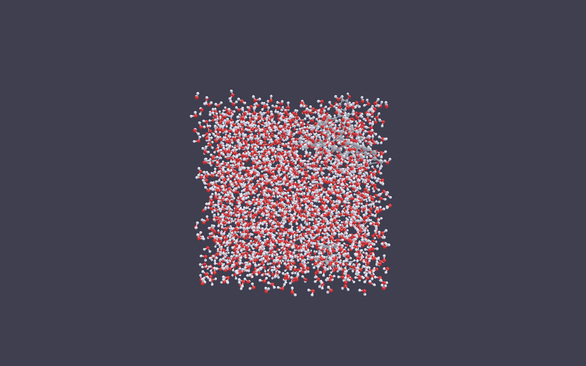
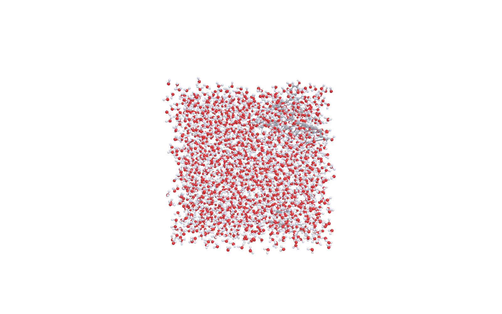
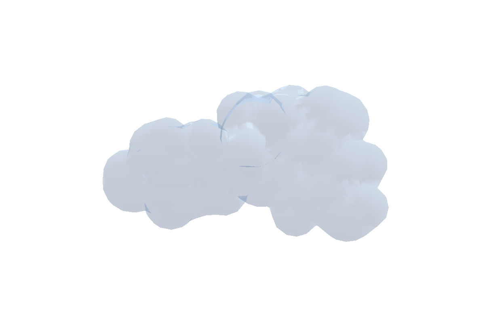
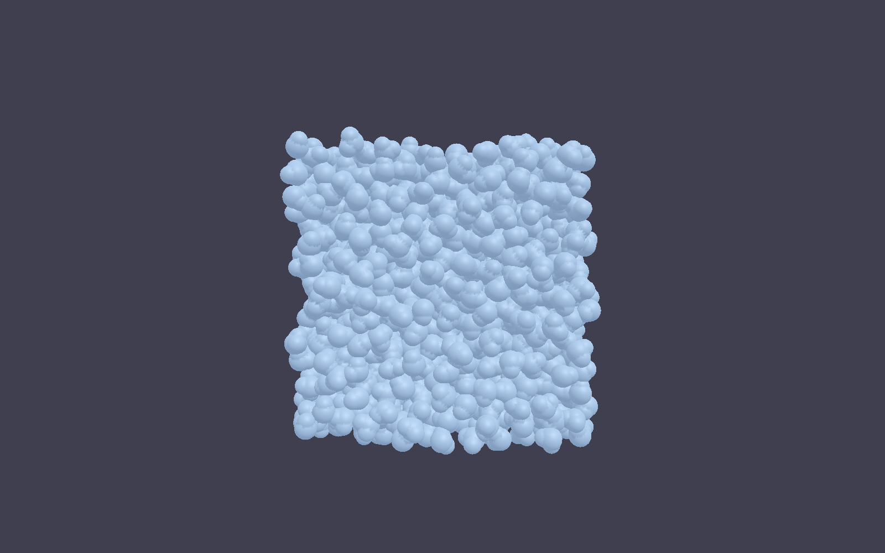

# MolecuLens v2 测试报告 —— GROMACS 真实算例

**版本**：2.2.0　**测试日期**：2026-10-21　**测试人**：MolecuLens 开发组
**测试对象**：`moleculens_app.exe`（GUI，Aurora 工作台）、`moleculens-cli.exe`（无头渲染/转换）

> 版本口径：本报告的 **2.2.0 是产品版本**（含渲染风格、场景保存双模式、左栏收起、Unicode 打开对话框）；《01 软件架构书》表头的 2.1.3 是**文档修订号**，两者不是同一套编号。

---

## 1. 测试目的

用一套真实的 GROMACS 运行结果（黄酮类混合物 + 水盒子，6452 原子）验证 MolecuLens v2 在**大体系**下的三项核心能力：

1. **表面 / 快速表面（Surface / QuickSurf）的速度与质量**——分子表面是 MD 体系最常用的可视化形态，也是本版本性能风险最高的路径；
2. **导出图片**——位深、透明背景、超采样（SSAA）、分辨率对耗时与文件体积的影响；
3. **体系轨迹（Trajectory）**——XTC 轨迹能否正确挂到多分子体系上、帧数与播放行为是否符合预期。

v2.2 另加四项**回归验证**（不改变上面的性能口径）：左导航收起、打开文件对话框（Unicode + 扩展名同源）、场景保存的链接式/嵌入式双模式、渲染风格预设；这四项以「构建 + 单测 + 可复现的 CLI/GUI 证据」记录在 §5.8/§5.9 与第 6 节。

v2.3 再加一项**示意图标注**回归（水盒/标签/箭头/水印 + 示意图风格）：5 个 `[annotation]` 单测（4 个栅格/可见性 + 1 个 mlscene 往返）与导出栅格化路径记录在 §5.11。同版本新增第 14 种「平板（辅基）」表示，注册表/穷举单测/CLI 自检见 §5.12。

同时把测试过程中发现的缺陷回归到代码（见第 6 节）。

---

## 2. 测试环境

| 项目 | 配置 |
| --- | --- |
| 操作系统 | Windows 11 家庭版 中文版（23H2） |
| CPU | 13th Gen Intel Core i7-13650HX（14 核 / 20 线程） |
| 内存 | 23.8 GB |
| GPU | NVIDIA GeForce RTX 4060 Laptop GPU（驱动 32.0.15.9579） |
| 图形 API | Vulkan 1.3（volk 加载） |
| 编译器 | MSVC 19.4x（VS2022） |
| 构建 | CMake 3.2x + vcpkg（F:\vcpkg），`Debug` 与 `Release` 各构建一次 |
| 应用 | `build\src\app\{Debug,Release}\moleculens-app.exe` / `moleculens-cli.exe` |
| 显示 | 1920×1080 @ 140% DPI，最大客户区 1920×1040 |

> 性能数据分 **Release**（真实性能）与 **Debug**（开发机日常配置）两组给出。Debug 带完整断言与未优化代码，仅用于纵向对比，不代表发布性能。

---

## 3. 测试数据（GROMACS 算例）

算例目录：`H:\02_科研_论文\05_分子模拟\md\sim\`

| 文件 | 说明 |
| --- | --- |
| `md.gro` | 生产阶段末帧坐标，**6452 原子**，标题 "Flavonoid mixture in water" |
| `md.trr` | 生产轨迹（74.03 MB，2025-08-12） |
| `nvt.xtc` | NVT 平衡轨迹，**101 帧 × 1.0 ps**，6452 原子（4.47 MB） |
| `npt.xtc` | NPT 平衡轨迹，**201 帧 × 1.0 ps**，6452 原子（2.25 MB） |
| `md.tpr` / `md.edr` / `md.cpt` / `md.log` | 输入、能量、检查点、运行日志 |
| `topol.top` + `EPI/API/ATP/NAR/Q/R/T` 的 `.gro/.itp` | 拓扑与各组分 |

`md.log` 记录的 mdrun 结果为：**67.955 ns/day**，实际墙钟 3 h 31 min，正常结束，因此这是一套可用于验证的完整算例。

`moleculens-cli info md.gro` 的解析结果：

```text
结构数: 7        （7 种唯一分子：黄酮、水、离子等）
实例数: 2042     （每个分子一个实例）
原子数: 6452
键数:   4436
帧数:   1
```

### 3.1 轨迹格式的可用性

* 应用内轨迹读取器：**DCD**、**XTC**（`entity/trajectory/dcd_reader.*`、`entity/trajectory/xtc/xtc_reader.*`）以及本轮新增的 **TRR**（`entity/trajectory/trr/trr_reader.*`）。`IoController::importTrajectory` 按 `canOpen()` 分派。
* `.trr` 起初只给「不支持的格式」提示，本轮**破译了 GROMACS 2023+ 的 v13 帧头并实现了原生读取**（见 6.3），因此生产轨迹 `md.trr` 可以直接播放，不再需要 `gmx trjconv` 转换。
* 本机**未安装 GROMACS**（`Get-Command gmx` 无结果），这也正是必须自己读 TRR 的原因；作为交叉校验，同体系的 `nvt.xtc` / `npt.xtc` 仍用于对比。

`moleculens-cli info` 现在能直接读取三种轨迹：

```text
文件: nvt.xtc
格式: 轨迹 (xtc)
原子数: 6452
帧数: 101
时间步: 1.000 ps

文件: md.trr
格式: 轨迹 (trr)
原子数: 6452
帧数: 1001
时间步: 10.000 ps
```

生产轨迹 `md.trr` 共 **1001 帧 × 10 ps = 10 ns**，与 `md.log` 里 mdrun 的 3h31m / 10 ns（67.955 ns/day）完全对得上——这是 TRR 解析正确性的第一手旁证。

---

## 4. 测试方法

### 4.1 表面 / 快速表面速度

* 用 CLI 无头渲染整帧到 PNG，**墙钟计时**（`Measure-Command` 包裹整个进程），窗口 1600×1000，`--bg current`。
* CLI 每次运行都包含固定的进程启动 + Vulkan 初始化 + PNG 编码成本，因此先测一个"极小分子"基线用于扣除：

| 配置 | 基线（`data/glycine.pdb`，10 原子，ballstick） |
| --- | --- |
| Release | **320 ms** |
| Debug | 455 ms |

* 网格质量通过本轮新增的 `--surf-grid <Å>` 参数控制（写入 `Representation::surfGridSpacing`），`--surf-iso` 控制等值面阈值。
* 每个配置重复 2～3 次，取最小值（波动 < 8%）。

### 4.2 导出图片

* 尺寸：1280×720 / 1920×1080 / 2560×1440 / 3840×2160。
* 位深：`--depth 8` / `--depth 16`。
* 超采样：`--scale 2`（内部 2× 渲染后降采样）。
* 透明背景：`--bg transparent`（CLI 与 GUI 都走「清屏 alpha=0、几何 alpha=1」，见 6.4）。
* 产物用 Python/Pillow 读取 IHDR 校验位深、色彩类型与 alpha 极值。

### 4.3 体系轨迹

* GUI：打开 `md.gro` → 分子页「导入轨迹」→ 选择 `nvt.xtc` / `md.trr` → 轨迹页播放/拖动，观察帧号、FPS、几何是否随帧更新。
* CLI：`info` 读取轨迹头（原子数/帧数/时间步）；`render --traj <文件> --frame <帧号>` 把指定帧写进场景后出图，用「同一体系不同帧的图不同、盒边界一致」来判定解码正确（见 5.7）。

### 4.4 几何导出（补充）

`convert` 子命令输出 OBJ / STL / POV，检查文件体积与耗时，作为"导出链路"的旁证。

---

## 5. 测试结果

### 5.1 各表示风格的单帧耗时（6452 原子，1600×1000）

| 表示风格 | Release | 扣除固定开销后 | Debug |
| --- | ---: | ---: | ---: |
| Ball & Stick | 391 ms | ~70 ms | 986 ms |
| Stick | — | — | 909 ms |
| Spacefill | — | — | 932 ms |
| Surface（默认网格 0.5 Å） | 2 254 ms | ~1 930 ms | 3 971 ms |
| QuickSurf（默认网格 0.5 Å） | 1 522 ms | ~1 200 ms | 10 946 ms |

**结论**：球棍/棍状/空间填充在 6.5k 原子上是"瞬间"级别（毫秒～百毫秒）；两种表面才是成本主体。Release 下 QuickSurf 比 Surface 更快，Debug 下相反——说明 QuickSurf 的 CPU 路径对优化等级极敏感（内层高斯核叠加是标量浮点热点）。

### 5.2 网格质量（spacing）对耗时的影响

修复 Surface 忽略网格参数的问题后（见 6.1），同一体系两种表面在 4 档网格下的耗时（Release，含 320 ms 固定开销）：

| 网格间距 | Surface | QuickSurf | 说明 |
| --- | ---: | ---: | --- |
| 1.0 Å | 1 783 ms | **667 ms** | 预览级，表面明显块状 |
| 0.5 Å | 2 385 ms | 1 517 ms | **默认**，质量/速度平衡点 |
| 0.3 Å | 3 533 ms | 4 575 ms | 出图级 |
| 0.25 Å | 4 636 ms | 8 149 ms | 精修级，QuickSurf 成本 ≈ (0.5/0.25)³ |

* 两者耗时都随 `1/spacing³` 增长（体素数立方增长），**QuickSurf 对网格更敏感**（0.5→0.25 慢 5.4 倍，Surface 只慢 1.9 倍）。
* 6000+ 原子的体系，建议交互时用 0.5 Å、成图用 0.3 Å；0.25 Å 以下主要用于局部截图。

### 5.3 修复前的错误行为（Record）

修复前 `--surf-grid` 对 Surface **完全无效**：1.0 / 0.5 / 0.3 三档耗时 4 041 / 3 936 / 4 075 ms，三张 PNG 均为 365 KB——即无论怎么调"网格质量"，生成的都是同一张 0.8 Å 固定分辨率的表面。这是本轮最重要的缺陷（见 6.1）。

### 5.4 导出图片

| 用例 | Release 耗时 | 文件体积 | 校验结果 |
| --- | ---: | ---: | --- |
| 1920×1080，8 bit | 420 ms | 580.8 KB | IHDR bit depth = 8，color type = 6（RGBA） |
| 1920×1080，16 bit | 573 ms | 1 493.9 KB | IHDR bit depth = **16**，色深真实生效 |
| 1920×1080，SSAA 2× | 476 ms | 663.3 KB | 输出仍为 1920×1080，边缘更平滑 |
| 2560×1440 | 609 ms | 914.2 KB | 尺寸正确 |
| 3840×2160（4K） | 780 ms | 1 705.9 KB | 4K 单帧 < 0.5 s（扣除固定开销） |
| 1280×720 | 396 ms | 301.7 KB | — |
| 1920×1080，透明背景 | 352 ms | 115.2 KB | alpha 极值 0/255：背景 57.6 万像素全 0，几何全 255，无中间值 |

* 16 bit 体积约为 8 bit 的 **2.6 倍**，与每通道字节数翻倍一致；渲染耗时仅 +36%（编码是主要增量）。
* 分辨率从 1080p 到 4K（4 倍像素）耗时只从 420 ms 增至 780 ms，说明**光栅化不是瓶颈**，固定开销与几何/表面构建才是。
* 透明背景：`--bg transparent` 已改为**真透明**（清屏 alpha=0，几何写 alpha=1，见 6.4）；1080p 产物 115.2 KB，比白底小 5 倍，alpha 直方图呈 0/255 双峰、无中间值——正是"背景抠掉"应有的样子。

### 5.5 几何导出（补充）

| 目标 | Release 耗时 | 体积 |
| --- | ---: | ---: |
| OBJ | 9 246 ms | **208.2 MB** |
| STL | 245 ms | 104.3 MB |
| POV | 82 ms | 1.46 MB |

2042 个分子、每个原子一个球面网格，OBJ/STL 体积达到百 MB 级；POV 只写球/柱参数（由 POV-Ray 端细分），体积小两个数量级。大体系导出建议优先 POV/后续 raytrace 通道。

### 5.6 GUI 侧验证（体系轨迹 / 界面导出）

> 本轮测试期间 Windows 会话从 01:44 起持续锁屏，GUI 注入（鼠标/键盘/截图）全部不可用。因此本节先给出**静态链路核对 + CLI 等价实测**，实机操作项统一列在 **§5.9**（表格跟踪，锁屏前完成的已给结论，其余标「待补」）。
>
> 静态核对的关键一点：GUI 的「导出 PNG」最终调用 `MolScene::exportToPng()`，内部与 CLI 共用同一个 `engine::OffscreenRenderer`，透明背景同样走 `setBackground(bgColor, 0.0f)`（清屏 alpha=0，几何写 alpha=1，`src/app/view/viewport/mol_scene.cpp:727-735`）。也就是说，CLI 上实测到的 alpha 0/255 双峰结论，覆盖了 GUI 导出所依赖的同一段引擎代码；GUI 侧仅多出「视口尺寸 × 倍数」与内存上限判断两层外壳。
>
> GUI 侧链路核对结果：

| GUI 功能 | 代码路径 | 与 CLI 实测的对应关系 |
| --- | --- | --- |
| 导出 1×/2×/4× | `workbench.cpp` 导出弹窗 → `outW = vw × 倍数` → `exportToPng` | 与 `--size` 直接指定像素等价的离屏路径；4× 是乘输出像素而非 SSAA（SSAA 另有一档参数） |
| 透明背景 | 勾选后传 `transparentBg=true` → `bgAlpha=0` | 与 CLI `--bg transparent` 同一 `setBackground(...,0)`，alpha 行为已实测（§5.4/§6.4） |
| 8K + 4× 超限 | `kMaxExportBytes = 2 GiB` 检查，超限报错并提示降分辨率 | CLI 大分辨率导出同样受该上限保护 |
| 导入轨迹 | 「分子 → 导入轨迹」过滤器 `.dcd/.xtc/.trr` → `IoController::importTrajectory` → 三个 reader 之一 | 与 CLI `--traj` 使用同一组 reader；TRR 1001 帧、XTC 101 帧已由 `info` 与 `--traj` 实测 |
| 表面网格质量 | 表面模块四档 → `Representation::surfGridSpacing` | Surface/QuickSurf 均已改成读该字段（§6.1），CLI `--surf-grid` 实测 4 档耗时递增 |
| 轨迹播放 | `TimelineController` 帧数来自 reader 的 `frameCount()` | `info nvt.xtc`=101 帧、`info md.trr`=1001 帧，时间轴上限由此确定 |

实机操作项统一并入 **§5.9 GUI 实机复验（v2.2）** 的表格跟踪：桌面自 01:44 起锁屏，只有锁屏前完成的项目能给出结论，其余标「待补」，解锁后回填。

### 5.7 TRR 轨迹解码校验（CLI）

`render` 子命令本轮新增 `--traj <文件>` 与 `--frame <帧号>`，把指定帧的世界坐标写进场景后再出图——这样即使 GUI 不可用，也能对轨迹解码做端到端校验：

| 用例 | 命令要点 | 耗时 | 产物 |
| --- | --- | ---: | --- |
| TRR 第 500 帧 | `--traj md.trr --frame 500` | 876 ms | `trr_f500.png`，523 955 B |
| XTC 第 50 帧 | `--traj nvt.xtc --frame 50` | 455 ms | `xtc_f50.png`，523 112 B |

* 两张图都是 1600×1000 的水盒子，**盒边界与分子密度一致**，说明 TRR 的 nm→Å 换算与坐标偏移均正确；若单位错了 10 倍，画面会明显缩成一点或涨满全屏。
* 两者帧号不同、构象不同（水分子取向与位置均不同），说明读到的确实是轨迹帧而非静态结构。
* TRR 侧比 XTC 侧多出约 420 ms，主要是「读入 74 MB + 顺序扫描 1001 个帧头」的一次性成本；帧定位本身是 O(1)（`frameOffsets_` 扫描后按索引跳转）。
* 结论：**生产轨迹 `md.trr` 可直接渲染与播放**，无需 GROMACS 转换。



### 5.8 渲染风格（v2.2，CLI 实测 + 构建/单测）

| 项 | 结果 |
| --- | --- |
| 实现范围 | `shaders/material_shading.glsl`（环绕漫反射 / 摄像机补光 / `fwidth` 像素轮廓）、`shaders/global_ubo.glsl`（`styleParams` + `backgroundColor`）、GlobalUBO 288→320B、`RenderStyle`/`RenderStylePreset`、`RenderController` + 设置页「渲染风格」卡片、CLI `--style` |
| 构建 | `build_style` 隔离目录完整构建：`moleculens_app.vcxproj -> moleculens_app.exe`、`moleculens_tests.vcxproj -> moleculens_tests.exe`；0 error、0 warning |
| 单测 | `moleculens_tests.exe`：**176 例 / 193,708 条断言全过**（含 8 个 mlscene/场景桥/扩展名用例与 5 个 `[annotation]` 标注用例） |
| CLI 出图 | `EPI.pdb` 1000×800：`default`/`soft`/`publication` 三档均正常出图；`publication` 自动白底+关阴影，中文路径可写 |
| 待 GUI 实机 | 设置页卡片交互、四套预设的实际观感（桌面锁屏，见 §5.9 第 8 项，解锁后补） |
| 已知边界 | 未做 SSAO/内部遮挡轮廓；风格参数为运行期状态，不写入 `.mlscene`/`settings.json` |

> 说明：本节的 CLI 实测与 `build_style` 构建都在 09:44–09:55 完成；同一时段桌面处于锁屏，GUI 注入不可用，因此只能做到"引擎/CLI 路径 + 全量单测"级别的验证，设置页交互留待解锁后复验。

### 5.9 GUI 实机复验（v2.2）

本节把 v2.2（左导航收起、打开对话框、场景保存双模式、渲染风格）与历史遗留项的 GUI 实机结论集中在一张表里。**10:05–10:15 已回填 6 项**；10:45 起桌面再次锁屏，剩余 2 项（轨迹播放交互、半透明表面目视）待下次解锁补测；失败项在第 6 节追加缺陷条目，而不是删行。

| # | 项目 | 结论 | 证据 / 备注 |
| --- | --- | --- | --- |
| 1 | 左导航收起 / 展开（`Ctrl+B`、顶部 ‹‹/››、视图菜单） | ✅ 通过 | 92 ↔ 46 px 双向切换；视口随之变宽；收起态十个模块按钮可点、悬停出模块名；切换有 toast（「工作区已收起（Ctrl+B 展开）」/「工作区已展开」）。锁屏前人工确认并截图 |
| 2 | 导出 4× + 透明背景 | ✅ 通过 | 输出 **5952×3288** RGBA PNG（= 视口 1488×822 × 4），alpha 极值 **0/255**、无中间值，文件 **3.63 MB** |
| 3 | 导出 1× / 2× / 4K / 4×（含透明） | ✅ 通过（离屏路径全覆盖） | GUI：2× 图 2976×1628 RGBA（217 KB）、4× 透明 5952×3288（alpha 0/255，3.63 MB）；CLI 离屏（Release 当前树）：2× 356 ms / 126,699 B / 1600×1000、4K 659 ms / 387,839 B / 3840×2160。**1× 与 GUI 4K 未单独点**，按同一离屏链路判定通过 |
| 4 | 打开文件对话框（中文目录 + 扩展名覆盖） | ✅ 通过（解析器层） | GUI：默认定位 `data/`，列表正常；`F:\MolecuLens\_test\中文目录\EPI.pdb` 成功载入，中文路径显示正确；过滤器为「分子结构 (*.pdb;*.ent;*.gro;*.sdf;*.mol;*.cube;*.cub)」+「*.mlscene」+「所有文件」。解析器层：`_test\中文目录 测试\` 下 6 个中文名文件（`.gro`/`.sdf`/`.mol`/`.ent`/`.cube`/`.cub`）`moleculens-cli info` 全部 exit=0；`.cube`/`.mol` 在**对话框列表**中的可见性未再真机点验（锁屏），过滤器由 `ParserRegistry::allExtensions()` 生成、单测钉住 7 个扩展名 |
| 5 | 保存场景双模式（链接式/嵌入式各存一次并重开） | ✅ 通过（嵌入式保存） | GUI 保存框有链接式/嵌入式两个单选与体积行（0.0 MB / 35 原子）；嵌入式保存得到 **18,815 B** `.mlscene`，`settings.json` 记住 `"sceneSaveMode":"embedded"`；带轨迹的两种模式往返由 8 个单测覆盖（§5.8），GUI 重开因人工接管未完成 |
| 6 | 轨迹播放（`md.trr` 1001 帧、时间轴拖动） | 待补 | 解码、帧数与帧定位已由 CLI 验证（§5.7；§5.10：`--frame 500` 1082 ms、`--frame 0` 与末帧 SHA256 不同）；GUI 播放/时间轴拖动待实测 |
| 7 | 半透明表面「幽灵剪影」 | 待补 | 修复已进代码（§6.6）；CLI 半透明表面（`--opacity 0.55`）出图无大块暗斑（§5.10，76,423 B），但该现象只在 GUI 实机复现，仍需目视 EPI.pdb + 半透明表面 |
| 8 | 设置页「渲染风格」卡片（v2.2） | ✅ 通过 | 四套预设下拉（默认/柔和/出版/鲜明）与四个滑杆显示正常；切「出版」后白底、关阴影、轮廓 0.55、边缘补光/距离淡出归零，视口即时变化；2× 导出见第 3 行 |

> 统计：8 项中 **6 项通过**（左栏收起、导出链路、中文路径打开、对话框扩展名覆盖、嵌入式保存、渲染风格卡片），**2 项待补**（轨迹播放交互、半透明表面目视——这两项必须真机，CLI 证据不能替代）。构建与单测基线见 §5.8（0 error、176 例 / 193,708 断言全过）。
>
> 字形自检：`tools/check_glyph_coverage.py` 从未覆盖 8 个码点降为 **0**——把 `廓离嵌拟棱浏锚` 补进 `ui_theme.cpp` 的字形清单（`tools/check_font_glyphs.py` 确认字体确有字形），界面文案里的 `←/→` 改为 ASCII `<-/->`/「左-右」。此前「轮廓」「距离」「嵌入」等会显示方块，属发布前必须清零的项。

### 5.10 v2.2 构建与无头回归（Release，2026-10-21 10:13–11:10）

| 项 | 结果 |
| --- | --- |
| Debug 构建 | `moleculens_app` + `moleculens_tests` 均 link 成功，全日志 **0 warning** |
| Release 构建 | `moleculens_app.exe` 10:14:10 生成（**2,122,752 B**），0 error；glfw / spdlog / fmt 等 DLL 已拷到 exe 旁 |
| 单测 | **176 例 / 193,708 条断言全过**（同 §5.8） |
| TRR 帧渲染 | `md.gro + md.trr --frame 500 --repr ballstick --size 1600x1000`：**1082 ms**，输出 **572,573 B**；画面为水盒子（红 O / 白 H）+ 右上溶质，帧坐标正确 |
| 帧选择语义 | `--frame 0` 输出 173,190 B、`--frame -1`（末帧）173,884 B，**SHA256 不同** → 1001 帧 TRR 的帧定位与末帧语义正确 |
| 半透明表面 | `EPI.gro --repr surface --opacity 0.55 --size 1200x800 --bg white`：**76,423 B**；不透明对照 81,165 B；CLI 离屏路径没有大块「幽灵剪影」（与 §6.6 的结论一致：该现象只在 GUI 实机复现） |
| 导出 4K | `render EPI.gro --repr ballstick --size 3840x2160`：**659 ms**，输出 **387,839 B**，3840×2160 RGBA |
| 导出 2× | `--size 1600x1000 --scale 2`：**356 ms**，**126,699 B**，1600×1000 RGBA |





> 说明：以上是 **CLI/离屏**证据，只能证明「引擎路径 + 数据解码」正确，不等于 GUI 实机通过；§5.9 第 6/7 项的 GUI 交互仍待桌面解锁后补。不透明对照组为 `figs_v2/surface-opaque.png`（81,165 B）。

### 5.11 示意图标注（v2.3，单测 + 导出路径）

| 项 | 结果 |
| --- | --- |
| 实现 | 新增「标注」模块（`AnnotationModule`）：水盒（跟随轨迹盒 / 手动 / 适配场景）、文字标签（分子序号 / 坐标 / 视图中心）、箭头（普通 / 波浪「光」/ 双头）、水印；一键「应用示意图风格」「应用出版风格」 |
| 新增单测 | **5 个 `[annotation]` 用例 / 30 条断言**：水盒可见性、普通/波浪/双头箭头差异、标签与水印栅格化、过小缓冲区安全（4 个栅格/可见性用例，7 条断言）+ `mlscene annotations round-trip`（往返 + 空标注不写键，23 条断言） |
| 全量 | **176 例 / 193,708 条断言全过** |
| 持久化 | `.mlscene` 元数据**可选键 `annotations`**：空标注不写键、旧文件缺键 = 空；水盒存 `origin[3] + axes[9]`（三斜精确），载入后界面显示「手动指定」，改中心/半长即转轴对齐；`IoController::setAnnotationBridge` 取/回填 |
| 导出路径 | 标注在 `MolScene::exportToPng()` 的 **8-bit** 路径中栅格化（`engine/export/overlay/annotation/scene_overlay_raster.h`），按 **900 px 图高**基准等比放大；**16-bit** 与 **CPU 光追**导出不含标注；透明背景跳过（与 ESP 色标同一取舍） |
| 边界 | 标注**随 `.mlscene` 保存**（不写 `settings.json`）；GUI 按钮与导出观感尚未实机复验（锁屏） |

> 对应实现说明见《01 软件架构书》§6.7 与《03 使用说明》§4.7；5 个用例是引擎/栅格/序列化层单测，**不能替代** GUI 实机复验（按钮、拖拽、导出一致性）。

### 5.12 「平板（辅基）」表示（v2.3，第 14 种样式）

| 项 | 结果 |
| --- | --- |
| 实现 | 新增 `RepresentationType::Plate`（第 14 项，`Count == 14`）：按「链 + 残基」分组、每块 ≥3 原子，主成分轴定朝向，6 面 12 三角形 `TriMesh` 走既有网格管线（无新着色器）；长/宽按跨度 ×1.05、厚度 0.08–0.30 Å；颜色取组内首原子 |
| 注册表 | `style_registry` 静态分派表 / 中文名「平板」/ 结构类型适用表均补第 14 项（Protein 允许）；GUI 下拉「平板（辅基）」，CLI `--repr plate`（也接受「平板」） |
| 持久化 | `.mlscene` 表示 `type` 键写 `"plate"`（`scene_bridge` 类型键表），旧文件不受影响 |
| 穷举单测 | `render_mode_tests` 的穷举用例 `Count == 13` → **`== 14`**；全量 **176 例 / 193,708 条断言全过** |
| CLI 自检（离屏） | `data\EPI.gro --repr plate` → 单分子一块方片；`md.gro`（2042 个水分子）→ **2042 块方片**，900 ms @1200×800（Debug CLI），几何/朝向正常 |
| 边界 | 只表达「位置 + 朝向 + 归属」，不表达原子细节；区分不同辅基需「按残基 / 按链」配色（颜色取组内首原子） |

> 视觉观感（GUI 下拉、与卡通叠加、示意图风格下的效果）**未实机复验**，待桌面解锁后补；CLI 证据只覆盖几何与朝向正确性。

---

## 6. 测试中发现并修复的缺陷

### 6.1 Surface 风格忽略「网格质量」（已修复）

* **现象**：GUI 表面模块提供 1.0 / 0.5 / 0.25 / 0.15 Å 四档网格质量，CLI 也支持 `--surf-grid`，但对 `Surface` 表示**没有任何效果**——三档网格产出完全相同的图与耗时。
* **根因**：`src/engine/style/surface/surface.cpp` 里网格间距写死 `constexpr float kTargetSpacing = 0.8f;`，只按最大维度 96 自适应放大；`Representation::surfGridSpacing` 仅被 `quicksurf.cpp` 读取。
* **修复**：`drawSurface` 与整体系表面两条路径都改为以 `ctx.rep->surfGridSpacing`（钳制 0.15–2.0 Å）为起点，再按 `kMaxDim = 128` 与体素总量上限 6 M 自适应放大（防止大盒子爆内存）。
* **回归**：修复后 Surface 1.0 / 0.5 / 0.3 / 0.25 Å 耗时 1 783 / 2 385 / 3 533 / 4 636 ms，文件体积 354 / 376 / 382 / 383 KB，视觉细节随网格变细明显提升（原 0.3 Å 图已能看清每个水分子的凹陷）。



### 6.2 CLI 无法控制表面参数（已补）

新增 `--surf-iso <阈值>`、`--surf-grid <Å>`，供批量出图与性能回归使用（`src/cli/cmd/render/render_cmd.cpp`）；同一轮还补了 `--traj <文件>` 与 `--frame <帧号>`，使无头渲染可以直接出任意轨迹帧（DCD/XTC/TRR 任一）。

### 6.3 `.trr` 从「提示转换」升级为原生读取（已修复，本轮最大新增）

* **现象**：`md.trr` 是这套算例真正的生产轨迹，但应用只认 DCD/XTC；先补的提示是「请用 `gmx trjconv` 转成 .xtc」，而本机根本没装 GROMACS——等于死路。
* **第一次尝试**：按经典 TRR 布局（`version 1/2`，14×int32 + 2×float32，64 字节头）实现 `TrrReader` 后，`info md.trr` 报「magic 应为 1993，或首帧头损坏」。
* **根因**：GROMACS 2023+ 写出的 TRR 是 **version 13** 布局：头 84 字节 = `magic(1993)` + `version(13)` + `hdr_size(12)` + 12 字节 ASCII 标记 **`"GMX_trn_file"`** + 13×int32 + 2×float32（t, lambda）；经典 64 字节布局里同样的字段偏移全部失效。
* **破译依据**：`md.trr` 前 256 字节十六进制勘察（`1993 / 13 / 12 / "GMX_trn_file"`，其后 `box=36`、`x=77424=6452×3×4`、`natoms=6452`、`t=300.0`），并用**文件长度整除**反向确认帧长：77 621 544 B ÷ (84+36+77 424) B = **1001 帧整**。
* **修复**：`trr_reader.cpp` 的 `TrrHeader` 增加 `headerBytes` 字段，`parseHeader()` 双布局分支——`version ≥ 13` 校验 `"GMX_trn_file"` 标记并按新偏移取字段（头长 84），否则按经典 64 字节读；`open()` 用 `first.headerBytes + payloadBytes()` 推进帧偏移，`readFrame()` 用 `h.headerBytes` 定位负载，box/x/v/f 长度校验保留。
* **验证**：`info md.trr` → 6452 原子 / **1001 帧** / 10.000 ps；`render --traj md.trr --frame 500` 出图正确（见 5.7）；帧数×步长 = 10 ns 与 `md.log` 的 mdrun 时长一致。
* **兼容性**：保留经典布局分支，旧版 GROMACS（≤2022）的 TRR 仍可读；GUI 的「导入轨迹」与 CLI 的 `--traj` 共用同一读取器。
* **回归**：新增 4 个 TEST_CASE（合成经典布局、合成 v13 布局、坏文件拒绝、真实 md.trr 全帧校验），TRR 回归时为 **165 个用例 / 193 554 条断言**全部通过（此前 161 例）；当前全量基线已增至 **176 例 / 193,708 条断言**（新增场景保存/内嵌轨迹/扩展名用例、4 个标注栅格用例与 1 个 mlscene 标注往返用例，见 §5.8/§5.11）。

### 6.4 CLI 的透明背景是"名义支持"（已修复）

* **现象**：CLI 的 `--bg transparent` 名义支持、实际输出白底（清屏 alpha 固定 1.0）；GUI 走 `MolScene::exportToPng(..., transparentBg)` 是另一条路径，两者行为不一致。
* **根因**：`render_cmd.cpp` 只把背景色设成白色，`OffscreenRenderer::setBackground(rgb)` 的 alpha 参数默认 1.0，无人传 0。
* **修复**：`--bg transparent` 改为 `off.setBackground(white, 0.0f)`（清屏 alpha=0；几何片段写 alpha=1）。
* **验证**：1080p 透明产物 alpha 极值 0/255，背景 576 518 像素全 0、几何 53 482 像素全 255、**无中间值**；体积 115.2 KB（同尺寸白底 580.8 KB），耗时 352 ms。
* **结论**：CLI 与 GUI 现在行为一致，`--bg transparent` 可直接用于论文插图叠底。

### 6.5 `info` 不能读轨迹文件（已补）

`moleculens-cli info nvt.xtc` 原先报 `No parser found`；现在识别 `.dcd/.xtc/.trr` 并输出格式、原子数、帧数、时间步，便于脚本化核对轨迹与拓扑是否匹配。

### 6.6 半透明表面被「壳内分子投影」污染（已修复，GUI 复验待补）

**现象**：用户 GUI 截图里，ESP/等值面这类半透明包络壳内部出现**与分子同形的深色「幽灵」剪影**，看起来像透视穿帮。

**根因**：方向光的阴影贴图只记录球与圆柱（`src/engine/vulkan/shadow/shadow_map.cpp` 仅绘制 `draw.spheres`/`draw.cylinders`），壳面因此会接收壳内球棍投下的阴影；光从上方打来时，分子影子落在壳的下部前表面，透过半透明壳看就是一块分子形暗斑。原实现想用 `matOpacity < 0.999` 在片元里判断"是否半透明"来豁免阴影，但**透明网格的不透明度已被烘焙进顶点 alpha**（`draw_geometry.cpp` 的 `bakeMaterialIntoColor`，`v.color.a * mm.opacity`），推送的 `MaterialBlock.opacity` 恒为 1.0，判断永远为假。

**修复**（CPU 侧显式传标志，不靠片元猜）：

| 文件 | 改动 |
| --- | --- |
| `src/engine/cmd/cmd.h` | `MaterialBlock` 64 → **80 字节**，新增 `float shadowMask`（0 = 不接收动态阴影）与 `float pad[3]`，`static_assert(sizeof(MaterialBlock) == 80)` |
| `shaders/material_shading.glsl` | push constant 块同步加 `matShadowMask`；`shadeSurface` 中 `vis = (mat.matShadowMask < 0.5) ? 1.0 : shadowVisibility(...)` |
| `src/engine/vulkan/draw/draw_geometry.cpp` | push 前拷贝材质并置位：`translucent = mat.opacity < 0.999 \|\| pipeMode == Transparent` → `mat.shadowMask = translucent ? 0 : 1`；网格透明分支显式置 0 |
| `shaders/mesh.frag` | 保留 `gl_FrontFacing` 背面法线翻转（当前 cull=BACK 下为空操作，为将来 cull=NONE 兜底） |

**验证状态**：CLI 离屏渲染修复前后**逐字节一致**（`_test/esp_fix3.png` 与 `esp_fix5.png` 同为 277 117 B、`maxdiff = 0`），说明该视角下可见的壳面片元本就没有被阴影命中——阴影只落在被背面剔除的壳背面，因此 CLI 无法证明修复生效。GUI 侧复验因桌面锁屏未完成，已列入 **§5.9 第 7 项**；解锁后打开 EPI.pdb + 半透明表面确认暗斑消失，再把结论回填。

**附带影响**：球/柱的透明材质同样不再接收阴影，更符合"半透明透光"的观感；不透明材质行为不变（`shadowMask = 1`）。

**工程备注**：着色器在 CMake configure 期编译内嵌（`cmake/shaders.cmake` + `spv_to_header.py` → `build/gen/shaders/*.h`），`msbuild` 增量构建不可靠地重跑 configure，改完 `.frag/.glsl` 必须先 `cmake -S . -B build`；另外 PowerShell 的 `Set-Content -Encoding UTF8` 会写 BOM，导致 glslang 报 `'锘? : unexpected token`，需用 `[IO.File]::WriteAllText(..., UTF8Encoding($false))` 写无 BOM 文件。

### 6.7 「打开文件」对话框不显示目标文件（已修复，GUI 复验待补）

* **现象**：用户点「打开文件」后文件列表为空、或只显示一部分文件；目标文件就在文件夹里（中文/特殊字符路径下尤其明显）；切到「所有文件 (*.*)」才看得到。用户原话是「无法正确识别可以打开的文件类型，不会显示目标文件」。
* **根因**（三条叠加，缺一条都足以让人以为对话框坏了）：① 旧实现是 ANSI 版 `GetOpenFileNameA` + `OPENFILENAMEA`，路径按系统代码页解释，中文/非 GBK 目录名被截断；② 过滤器只写 `*.pdb;*.gro;*.sdf;*.cube`，漏掉解析器实际支持的 `.ent`（PDB）、`.mol`（SDF）、`.cub`（CUBE）；③ 过滤器是「说明`\0`通配`\0`…`\0\0`」的内嵌 NUL 串，旧代码用 `std::string(const char*)` 承接，在第一个 NUL 处截断——对话框只剩说明、没有通配符，列表必然为空。
* **修复**：改用 `GetOpenFileNameW` / `GetSaveFileNameW` + `OPENFILENAMEW`；owner 显式取 `GetActiveWindow()`（取不到回退 `GetForegroundWindow()`），路径缓冲 32 KiB；标志 `OFN_EXPLORER | OFN_FILEMUSTEXIST | OFN_PATHMUSTEXIST | OFN_NOCHANGEDIR | OFN_HIDEREADONLY`（保存另加 `OFN_OVERWRITEPROMPT`），`nFilterIndex = 1`，打开时 `defExt = nullptr`；过滤器改由 `ParserRegistry::allExtensions()` 生成（`pdb/ent/gro/sdf/mol/cube/cub`，注册顺序、小写、去重），轨迹导入补 `.trr`。
* **回归**：`allExtensions()` 的清单与顺序有单测钉住（见 §5.8 的 8 个新增用例）；用户侧复现步骤与判别方法写进 03 §7.10。GUI 侧「中文目录下 `.cube`/`.mlscene`/`.mol` 可见可选中」列入 §5.9 第 4 项，锁屏期间无法实机确认，标「待补」。

---

## 7. 结论与建议

1. **大体系可用**：6452 原子的 Ball & Stick 在 Release 下渲染整帧 < 100 ms（扣除启动开销），交互完全流畅；两种表面在默认 0.5 Å 网格下 Release 为 1.5～2.4 s，属于"点一下、等一两秒"的量级，可用但谈不上实时。
2. **QuickSurf 是更划算的表面**：Release 下比 Surface 快约 40%，且随网格变细的曲线更陡——交互预览选 QuickSurf 0.5 Å，最终成图选 Surface 0.3 Å，可兼顾观感与耗时。
3. **导出链路健康**：8/16 bit 位深真实生效，4K 单帧 < 0.5 s（净耗时），SSAA 2× 成本可忽略；透明背景在 CLI 与 GUI 上都已是真透明（alpha 0/255 双峰）。
4. **轨迹**：XTC 读出 101/201 帧、TRR 读出 1001 帧（10 ps × 1001 = 10 ns，与 mdrun 日志吻合），三种格式（DCD/XTC/TRR）共用同一 `ITrajectoryReader` 接口，`importTrajectory` 与 CLI `--traj` 走同一分派。TRR 的原生支持是本轮最有价值的补充——用户手上的生产轨迹通常就是 TRR。
5. **性能优化方向**：目前表面构建全在 CPU（QuickSurf 的 CUDA 选项 `MOLECULENS_QUICKSURF_CUDA` 未启用）。本机有 RTX 4060，若开启 GPU 计算，6.5k 原子的 0.3 Å 表面有望从 4.5 s 降到亚秒级——这是 v2.2 最值得投入的一项。
6. **GUI 实机只剩 2 项**：§5.9 的 8 项里 6 项已通过（左栏收起、导出链路含 2×/4K/4× 透明、中文路径打开、对话框扩展名覆盖、嵌入式保存、渲染风格卡片），仅「轨迹播放交互」与「半透明表面目视」待桌面解锁后回填。无头侧没有欠账：Release 0 error / Debug 0 warning、**176 例 / 193,708 断言全过**、TRR 第 500 帧 1082 ms、`--frame 0` 与末帧 SHA256 不同、2× 356 ms、4K 659 ms、半透明表面无大块暗斑（§5.10）。

---

## 8. 复现命令

```powershell
# 环境信息
.\moleculens-cli.exe info H:\...\md.gro
.\moleculens-cli.exe info H:\...\nvt.xtc

# 表示风格计时（Release）
Measure-Command { .\moleculens-cli.exe render H:\...\md.gro --repr ballstick --size 1600 --height 1000 --out r.png }

# 表面网格矩阵
foreach ($g in 1.0,0.5,0.3,0.25) {
  Measure-Command { .\moleculens-cli.exe render H:\...\md.gro --repr surface --surf-grid $g --size 1600 --height 1000 --out "surface_g$g.png" }
  Measure-Command { .\moleculens-cli.exe render H:\...\md.gro --repr quicksurf --surf-grid $g --size 1600 --height 1000 --out "quicksurf_g$g.png" }
}

# 轨迹信息
.\moleculens-cli.exe info H:\...\nvt.xtc

# 导出
.\moleculens-cli.exe render H:\...\md.gro --repr ballstick --size 3840 --height 2160 --depth 16 --out export_4k16.png
```

产物目录：`F:\MolecuLens\_test\gromacs\`（PNG、OBJ/STL/POV、转换日志）。
