# 06 · 开源数据集与演示

本页记录仓库内 [`datasets/`](https://github.com/moyudoing/MolecuLens/tree/master/datasets) 目录的公开数据集，以及用 `moleculens-cli` 从中生成的可复现演示图。所有图片都是命令行直接渲染的原始 PNG（出版风格、白底、1600×1200 或 1400×1050），没有手工修图或后期合成。

- **数据规模**：19 个数据文件，5.95 MiB（清单与 SHA-256 见 [`datasets/README.md`](https://github.com/moyudoing/MolecuLens/blob/master/datasets/README.md)）
- **覆盖类型**：蛋白质 / 核酸晶体结构、小分子 3D 构象、分子动力学轨迹、ESP 表面演示夹具
- **许可原则**：只收录可再分发的公开数据（wwPDB、PubChem 公有领域、MIT、项目自制），不含 GPL / NC / ND / 来源不明数据

> 数据集本身**不适用**本项目的 Apache-2.0；各文件保留上游许可。只有 `datasets/esp/glycine/` 下的合成夹具随项目以 Apache-2.0 发布。

---

## 1. 数据集一览

| 家族 | 文件 | 内容 | 原子 / 帧 | 来源 | 许可 |
| --- | --- | --- | ---: | --- | --- |
| 蛋白质 | `pdb/1CRN.pdb` | crambin，1.50 Å | 327 | RCSB PDB [1CRN](https://www.rcsb.org/structure/1CRN) | wwPDB 公开数据 |
| 蛋白质 | `pdb/1UBQ.pdb` | 泛素，1.80 Å | 660 | RCSB PDB [1UBQ](https://www.rcsb.org/structure/1UBQ) | wwPDB 公开数据 |
| 核酸 | `pdb/1BNA.pdb` | B-DNA 十二聚体，1.90 Å | 566 | RCSB PDB [1BNA](https://www.rcsb.org/structure/1BNA) | wwPDB 公开数据 |
| 蛋白质 | `pdb/4HHB.pdb` | 人脱氧血红蛋白，1.74 Å | 4,779 | RCSB PDB [4HHB](https://www.rcsb.org/structure/4HHB) | wwPDB 公开数据 |
| 微蛋白 | `pdb/1L2Y.pdb` | Trp-cage TC5b，NMR 38 模型 | 304 / 38 | RCSB PDB [1L2Y](https://www.rcsb.org/structure/1L2Y) | wwPDB 公开数据 |
| 蛋白-配体 | `pdb/1HVR.pdb` | HIV-1 蛋白酶 + XK2 抑制剂，1.80 Å | 1,890 | RCSB PDB [1HVR](https://www.rcsb.org/structure/1HVR) | wwPDB 公开数据 |
| 膜蛋白 | `pdb/1U19.pdb` | 牛视紫红素 + 视黄醛/糖链/Zn，2.20 Å | 5,948 | RCSB PDB [1U19](https://www.rcsb.org/structure/1U19) | wwPDB 公开数据 |
| 小分子 | `pubchem/aspirin_2244.sdf` | 阿司匹林（CID 2244），3D 构象 | 21 | [PubChem](https://pubchem.ncbi.nlm.nih.gov/compound/2244) | 公有领域 |
| 小分子 | `pubchem/caffeine_2519.sdf` | 咖啡因（CID 2519），3D 构象 | 24 | [PubChem](https://pubchem.ncbi.nlm.nih.gov/compound/2519) | 公有领域 |
| 小分子 | `pubchem/ibuprofen_3672.sdf` | 布洛芬（CID 3672），3D 构象 | 33 | [PubChem](https://pubchem.ncbi.nlm.nih.gov/compound/3672) | 公有领域 |
| 小分子 | `pubchem/ethanol_702.sdf` | 乙醇（CID 702），3D 构象 | 9 | [PubChem](https://pubchem.ncbi.nlm.nih.gov/compound/702) | 公有领域 |
| 小分子 | `pubchem/benzene_241.sdf` | 苯（CID 241），3D 构象 | 12 | [PubChem](https://pubchem.ncbi.nlm.nih.gov/compound/241) | 公有领域 |
| 小分子 | `pubchem/glucose_5793.sdf` | 葡萄糖（CID 5793），3D 构象 | 24 | [PubChem](https://pubchem.ncbi.nlm.nih.gov/compound/5793) | 公有领域 |
| 小分子 | `pubchem/resveratrol_445154.sdf` | 白藜芦醇（CID 445154），3D 构象 | 29 | [PubChem](https://pubchem.ncbi.nlm.nih.gov/compound/445154) | 公有领域 |
| 轨迹 | `md/md_1u19.gro` + `md_1u19.xtc` | 视紫红素（PDB 1U19）全原子轨迹，51 帧 × 20 ps | 5,547 / 51 | [MolSysMT](https://github.com/uibcdf/MolSysMT) | MIT（仓库级） |
| ESP 夹具 | `esp/glycine/*` | 甘氨酸结构 + 合成密度/静电势 cube | 10 | 本项目自制 | Apache-2.0 |

完整来源 URL、采集日期、逐文件 SHA-256 与 `moleculens-cli info` 实测结果见 [`datasets/README.md`](https://github.com/moyudoing/MolecuLens/blob/master/datasets/README.md)。

---

## 2. 演示图库

### 2.1 蛋白质与核酸结构

<table>
<tr>
<td width="50%"><br>
<sub><b>1CRN · 改进卡通</b> —— crambin（327 原子），白底出版风格；<code>--repr newcartoon</code>。</sub></td>
<td width="50%">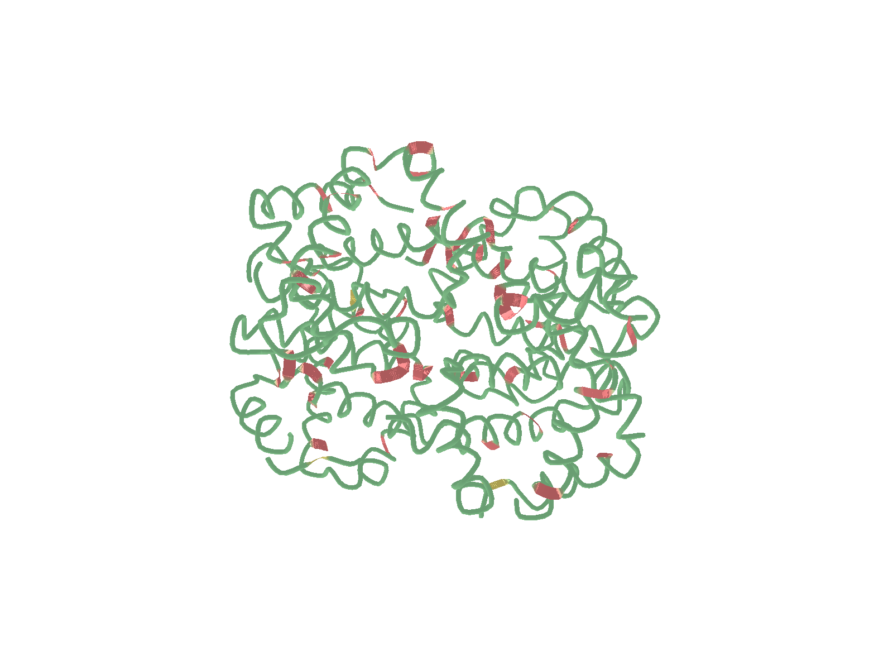<br>
<sub><b>4HHB · 卡通 + 按链配色</b> —— 人脱氧血红蛋白四聚体（4,779 原子），血红素以球棍显示。</sub></td>
</tr>
<tr>
<td width="50%">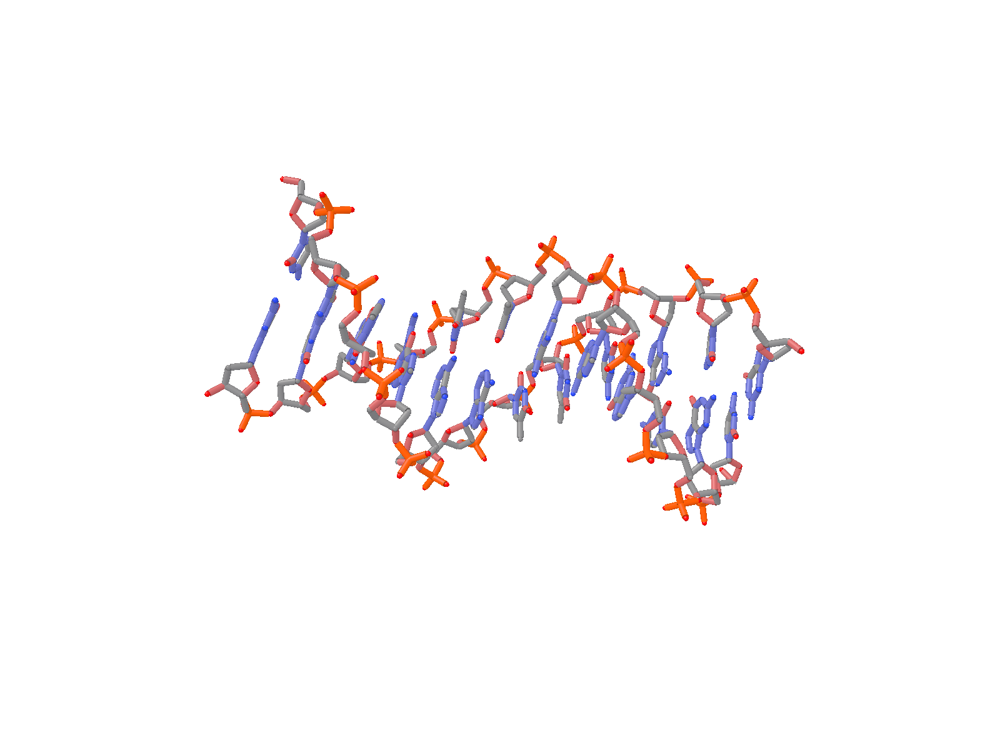<br>
<sub><b>1BNA · 棒状 + 侧视</b> —— B-DNA 十二聚体；选择表达式 <code>not resname HOH</code> 去掉 80 个结晶水。</sub></td>
<td width="50%">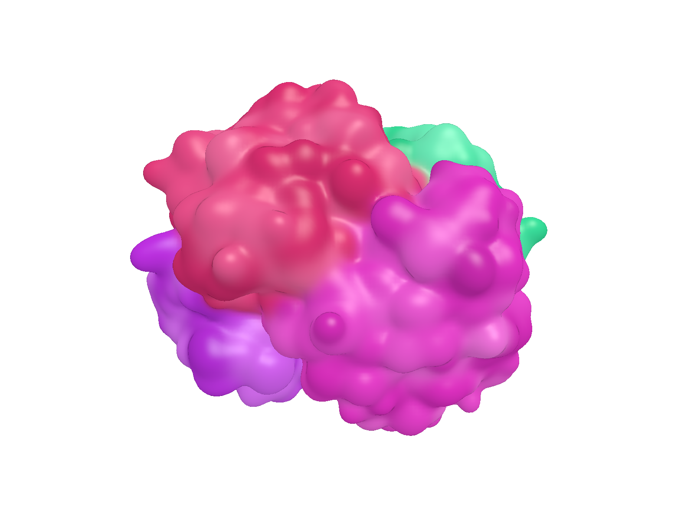<br>
<sub><b>4HHB · QuickSurf 表面</b> —— 整体系密度表面 + 按链配色，CPU Marching Cubes。</sub></td>
</tr>
</table>

<details>
<summary>复现命令</summary>

```powershell
$cli = "build\src\cli\Release\moleculens-cli.exe"

# 1CRN：改进卡通，收紧取景
& $cli render datasets\pdb\1CRN.pdb --repr newcartoon --zoom 1.5 `
    --style publication --bg white --size 1600 --height 1200 `
    --out docs\figs_v2\demo\1crn_newcartoon.png

# 4HHB：卡通 + 按链配色
& $cli render datasets\pdb\4HHB.pdb --repr cartoon --coloring chain --zoom 1.35 `
    --style publication --bg white --size 1600 --height 1200 `
    --out docs\figs_v2\demo\4hhb_cartoon.png

# 1BNA：棒状、侧视、去掉水
& $cli render datasets\pdb\1BNA.pdb --rep "stick:not resname HOH:element" --camera side --zoom 1.2 `
    --style publication --bg white --size 1600 --height 1200 `
    --out docs\figs_v2\demo\1bna_stick.png

# 4HHB：整体系 QuickSurf 表面
& $cli render datasets\pdb\4HHB.pdb --rep "quicksurf:all:chain" --zoom 1.35 `
    --style publication --bg white --size 1600 --height 1200 `
    --out docs\figs_v2\demo\4hhb_quicksurf.png
```

</details>

### 2.2 小分子

<table>
<tr>
<td width="50%">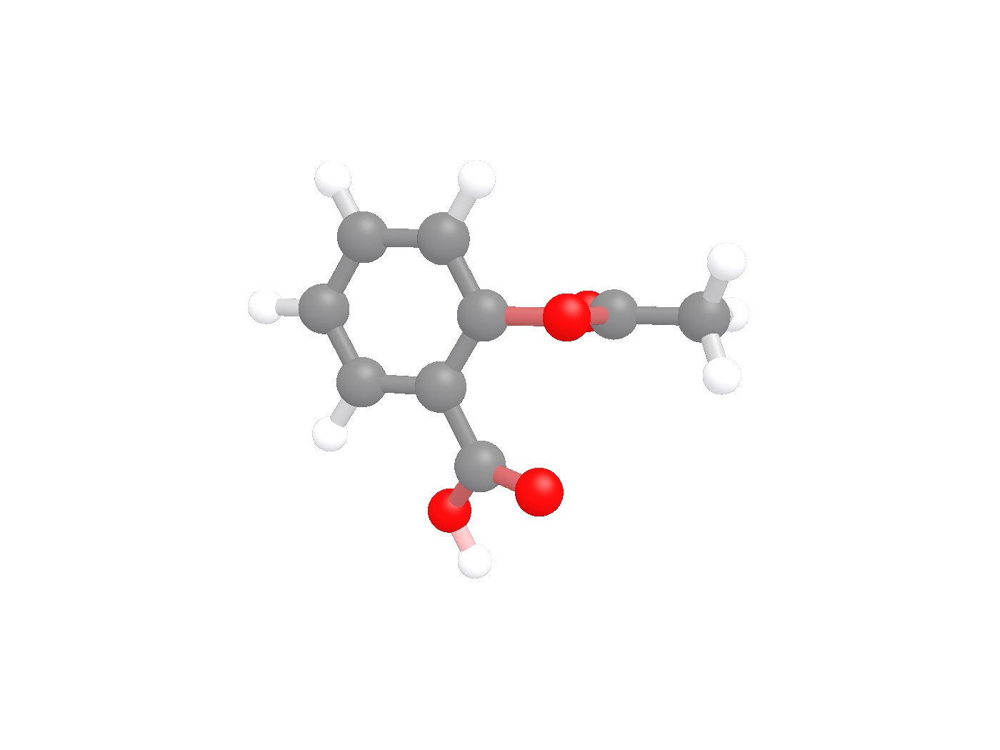<br>
<sub><b>阿司匹林 · 球棍</b> —— PubChem 3D 构象（21 原子），元素 CPK 配色。</sub></td>
<td width="50%">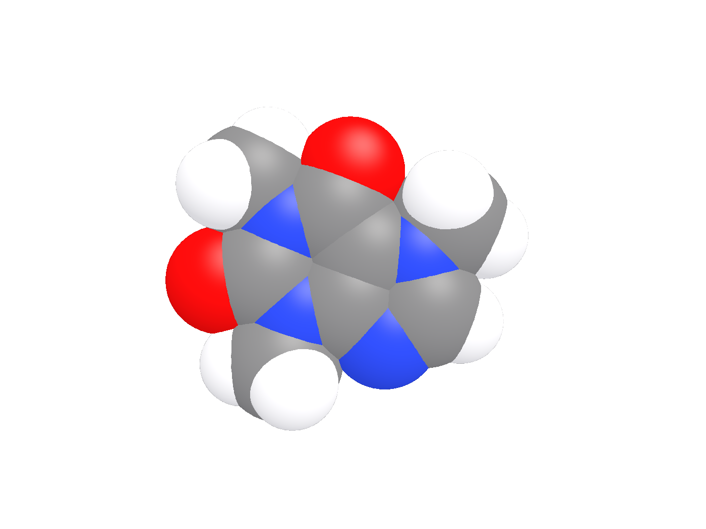<br>
<sub><b>咖啡因 · 空间填充</b> —— 24 原子，范德华球展示分子外形。</sub></td>
</tr>
<tr>
<td width="50%"><br>
<sub><b>阿司匹林 · CPU 光追</b> —— 4 spp，柔和阴影与球体反射，无需 GPU。</sub></td>
<td width="50%"><sub><b>格式说明</b> —— 三个 SDF 都是 PubChem 的 V2000 记录，含 3D 坐标；文件名带 CID 便于回溯。记录尾部的 SD 属性块会让 CLI 打印一条 <code>unsupported SDF/MOL version</code> 告警，分子本身解析正常。</sub></td>
</tr>
</table>

<details>
<summary>复现命令</summary>

```powershell
# 阿司匹林：球棍
& $cli render datasets\pubchem\aspirin_2244.sdf --repr ballstick `
    --style publication --bg white --size 1400 --height 1050 `
    --out docs\figs_v2\demo\aspirin_ballstick.png

# 咖啡因：空间填充（拉远一点，避免球被裁切）
& $cli render datasets\pubchem\caffeine_2519.sdf --repr spacefill --zoom 0.8 `
    --style publication --bg white --size 1400 --height 1050 `
    --out docs\figs_v2\demo\caffeine_spacefill.png

# 阿司匹林：CPU 光追 4 spp
& $cli render datasets\pubchem\aspirin_2244.sdf --repr ballstick --rt 4 `
    --style publication --bg white --size 1400 --height 1050 `
    --out docs\figs_v2\demo\aspirin_rt.png
```

</details>

### 2.3 轨迹与 ESP 表面

<table>
<tr>
<td width="50%"><br>
<sub><b>轨迹第 25 帧</b> —— 视紫红素 5,547 原子、51 帧 × 20 ps；帧号可精确跳转。</sub></td>
<td width="50%"><br>
<sub><b>ESP 映射表面</b> —— 密度等值面按静电势逐顶点着色，附色标条与极值标注（合成夹具，仅演示管线）。</sub></td>
</tr>
</table>

<details>
<summary>复现命令</summary>

```powershell
# 轨迹第 25 帧（.gro 拓扑 + .xtc 轨迹）
& $cli render datasets\md\md_1u19.gro --traj datasets\md\md_1u19.xtc --frame 25 `
    --repr stick --zoom 1.35 --style publication --bg white `
    --size 1600 --height 1200 --out docs\figs_v2\demo\md_1u19_frame25.png

# ESP 映射表面：结构 + 密度 cube + 静电势 cube
& $cli render datasets\esp\glycine\glycine.pdb `
    --esp datasets\esp\glycine\glycine_esp.cube `
    --density datasets\esp\glycine\glycine_density.cube `
    --repr stick --cmap coolwarm --style publication --bg white `
    --size 1400 --height 1050 --out docs\figs_v2\demo\glycine_esp.png
```

</details>

### 2.4 更多结构与小分子案例

<table>
<tr>
<td width="50%"><br>
<sub><b>1HVR · 蛋白-配体</b> —— HIV-1 蛋白酶卡通 + XK2 抑制剂球棍（配体 46 原子），<code>resname XK2</code> 选择。</sub></td>
<td width="50%">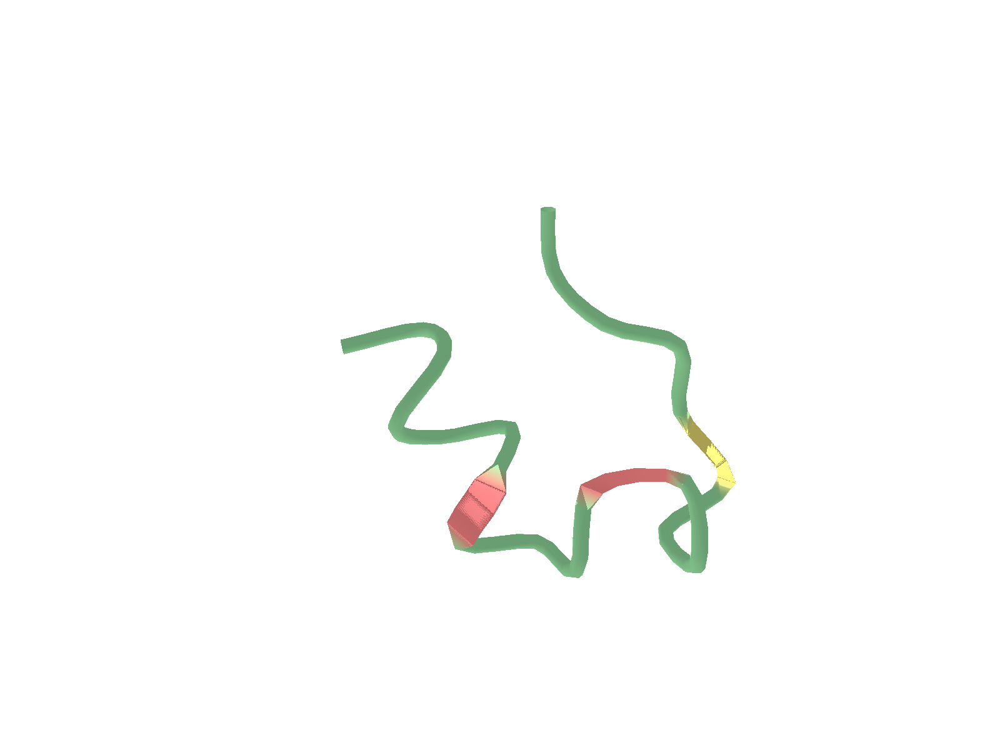<br>
<sub><b>1L2Y · Trp-cage</b> —— 304 原子微蛋白，38 个 NMR 模型；卡通表示。</sub></td>
</tr>
<tr>
<td width="50%">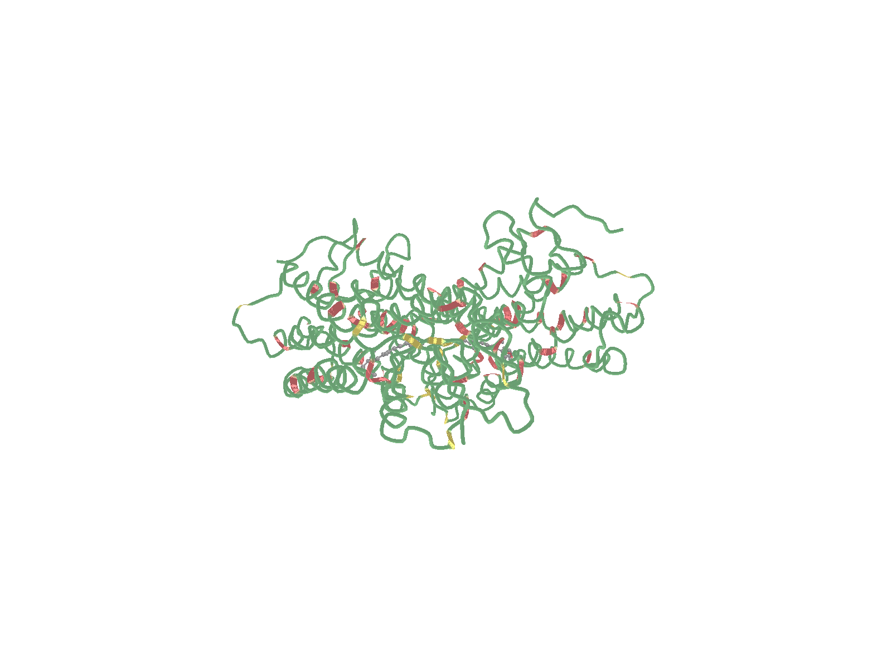<br>
<sub><b>1U19 · 视紫红素</b> —— 5,948 原子膜蛋白，卡通 + 视黄醛 RET 球棍；含糖链与 Zn。</sub></td>
<td width="50%">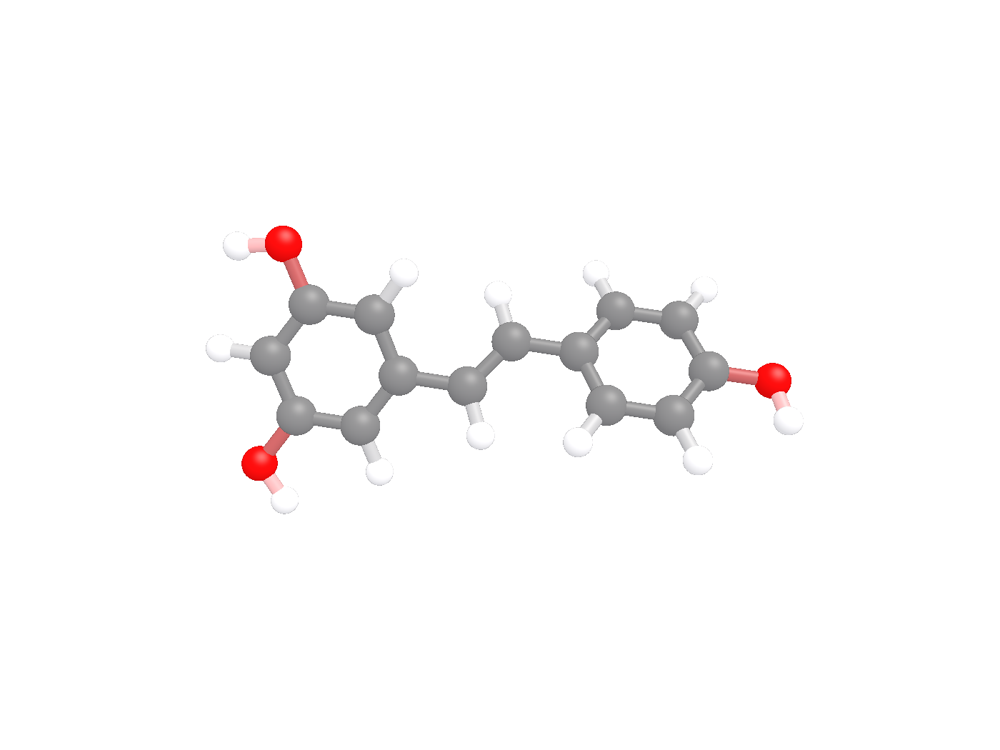<br>
<sub><b>白藜芦醇 · 球棍</b> —— PubChem 3D 构象（29 原子），共轭多酚体系。</sub></td>
</tr>
</table>

<table>
<tr>
<td width="33%">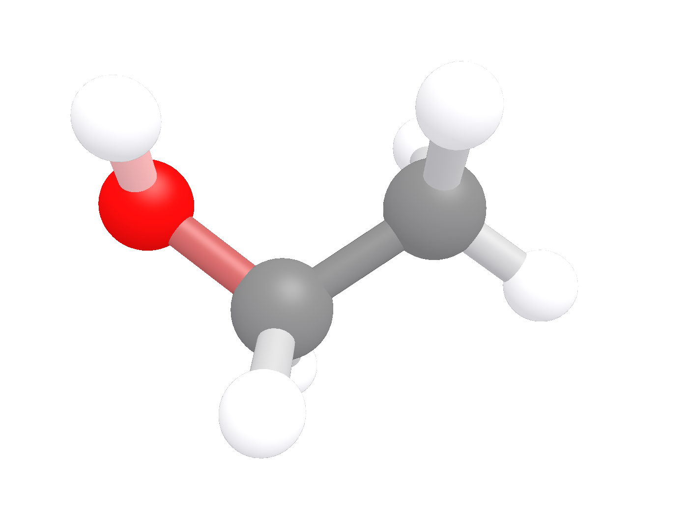<br>
<sub><b>乙醇</b> —— 9 原子，最小分子案例。</sub></td>
<td width="33%">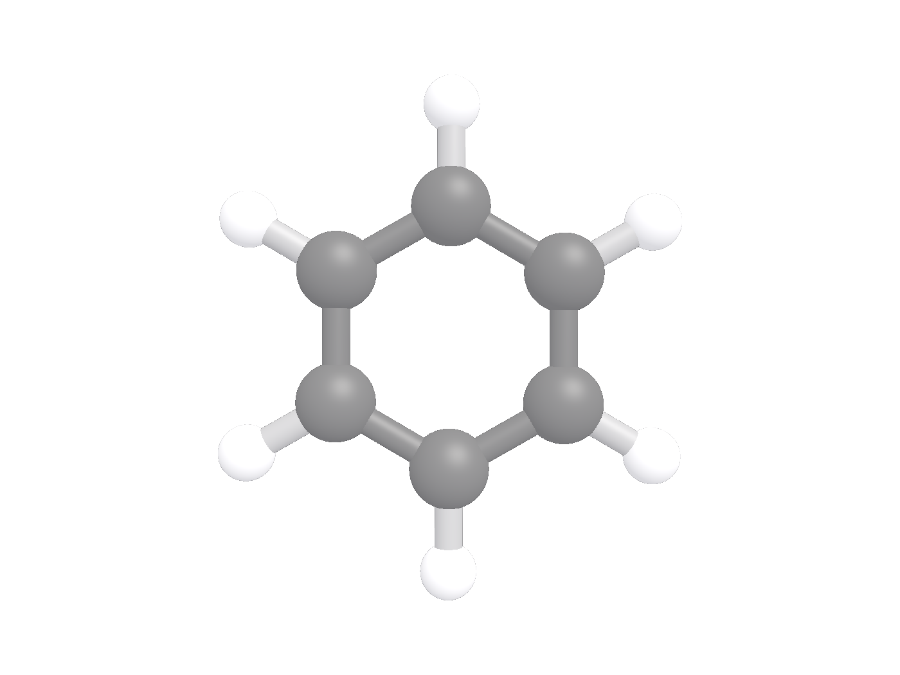<br>
<sub><b>苯</b> —— 12 原子，芳香环。</sub></td>
<td width="33%">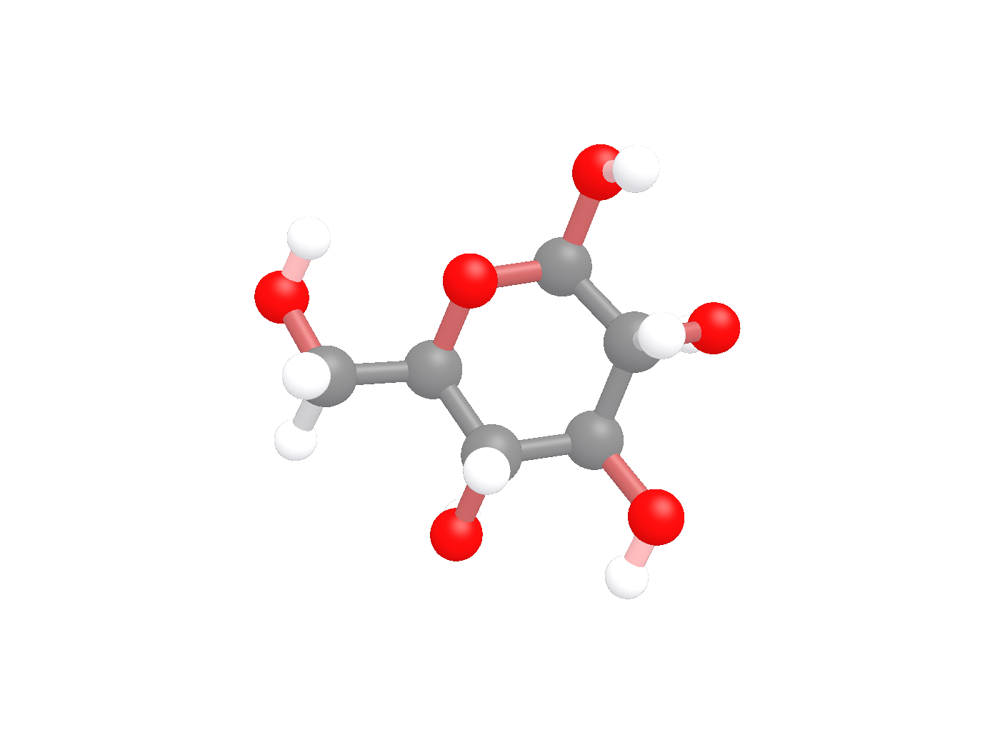<br>
<sub><b>葡萄糖</b> —— 24 原子，多羟基。</sub></td>
</tr>
</table>

<details markdown="1">
<summary>复现命令</summary>

```powershell
# 1HVR：卡通 + XK2 抑制剂
& $cli render datasets\pdb\1HVR.pdb `
    --rep "cartoon:not resname XK2:chain" --rep "ballstick:resname XK2:element" `
    --zoom 1.2 --style publication --bg white --size 1600 --height 1200 `
    --out docs\figs_v2\demo\1hvr_ligand.png

# 1L2Y：NMR 多模型，第 0 帧
& $cli render datasets\pdb\1L2Y.pdb --repr cartoon --frame 0 --zoom 1.2 `
    --style publication --bg white --size 1600 --height 1200 `
    --out docs\figs_v2\demo\1l2y_cartoon.png

# 1U19：卡通 + 视黄醛
& $cli render datasets\pdb\1U19.pdb `
    --rep "cartoon:not resname HOH:chain" --rep "ballstick:resname RET:element" `
    --zoom 1.2 --style publication --bg white --size 1600 --height 1200 `
    --out docs\figs_v2\demo\1u19_retinal.png

# 白藜芦醇：球棍
& $cli render datasets\pubchem\resveratrol_445154.sdf --repr ballstick `
    --style publication --bg white --size 1400 --height 1050 `
    --out docs\figs_v2\demo\resveratrol_ballstick.png
```

</details>

> 乙醇、苯、葡萄糖的图与 Python 生成的同一批案例见 [Python 接口与案例](07-Python接口与案例.md)。

---

## 3. 从零复现

```powershell
# 1) 构建（需要 CMake >= 3.21、C++20 编译器、Vulkan SDK、vcpkg）
cmake -B build -S . -DCMAKE_BUILD_TYPE=Release `
      -DCMAKE_TOOLCHAIN_FILE="$env:VCPKG_ROOT/scripts/buildsystems/vcpkg.cmake"
cmake --build build --config Release -j

# 2) 确认数据可读（原子数 / 帧数应与此页一致）
build\src\cli\Release\moleculens-cli.exe info datasets\pdb\1CRN.pdb
build\src\cli\Release\moleculens-cli.exe info datasets\md\md_1u19.gro

# 3) 渲染任意一张演示图：把第 2 节的命令复制执行即可
```

Linux / macOS 下把可执行文件路径换成 `./build/src/cli/moleculens-cli`，数据路径分隔符换成 `/`；CLI 参数完全一致。

---

## 4. 数据来源、引用与许可

### 4.1 引用建议

- **PDB 条目**：在论文中写清 PDB ID 与原始文献。建议格式：
  `Crambin (PDB 1CRN; Teeter & Hendrickson, J. Mol. Biol. 1981)`。
  七条目的完整文献信息见 [`datasets/README.md` §2](https://github.com/moyudoing/MolecuLens/blob/master/datasets/README.md#2-蛋白质与核酸结构--rcsb-pdb)。
- **PubChem**：注明 `PubChem CID 2244 / 2519 / 3672 / 702 / 241 / 5793 / 445154`，并引用 PubChem 数据库（Kim et al., *Nucleic Acids Res.*）。
- **MolSysMT 轨迹**：注明数据随 [MolSysMT](https://github.com/uibcdf/MolSysMT)（MIT）分发；上游未提供独立数据 DOI，详见清单 §4 的溯源说明。
- **甘氨酸 ESP 夹具**：**合成数据**，只用于软件管线演示，不得作为科学结果引用。

### 4.2 许可边界

| 内容 | 许可 | 能否以 Apache-2.0 再授权 |
| --- | --- | --- |
| MolecuLens 源代码、着色器、文档 | Apache-2.0 | ✅ |
| `datasets/esp/glycine/*`（自制合成夹具） | Apache-2.0 | ✅ |
| `datasets/pdb/*` | wwPDB 公开数据 | ❌ 保留上游条款 |
| `datasets/pubchem/*` | 公有领域（US NIH） | ❌ 保留上游说明 |
| `datasets/md/*` | MIT（MolSysMT 仓库级） | ❌ 需保留版权与许可文本 |

第三方库、字体与测试数据的完整声明见 [`THIRD_PARTY_NOTICES.md`](https://github.com/moyudoing/MolecuLens/blob/master/THIRD_PARTY_NOTICES.md)。

---

## 5. 注意事项

1. **ESP cube 是合成数据**：`glycine_density.cube` / `glycine_esp.cube` 由解析密度与点电荷场生成，仅验证等值面、色标与透明度管线；不能用于比较实验静电势或得出化学结论。
2. **SDF 告警属预期**：PubChem 记录尾部的 `> <PUBCHEM_...>` 属性块会触发 `unsupported SDF/MOL version`，分子解析与渲染不受影响。
3. **`.gro` 拓扑不支持卡通**：对 `md_1u19.gro` 用 `--repr cartoon` 会得到空白图（PDB 输入正常）；轨迹演示请用 `stick` / `ballstick`。
4. **1CRN 只有 3 条键**：原始 PDB 没有完整 `CONECT` 记录，属文件特征，不影响卡通/棒状按残基连线。
5. **轨迹溯源**：`md_1u19.*` 来自 MIT 许可的 MolSysMT 仓库，但上游没有单独的数据 DOI；若论文需要严格可追溯引用，请替换为带 DOI 的数据集（清单中已标注）。
6. **`1U19.pdb` 无氢、含 13 个未知元素原子（Xx）**：X 射线结构特征；与 `md_1u19.gro`（5,547 原子、全原子）不是同一套原子列表，不能直接配对。
7. **`1L2Y.pdb` 是 38 模型 NMR 结构**：MolecuLens 按 38 帧读取，`--frame` 可逐模型查看。
8. **不要新增不可再分发数据**：提交前确认许可为公有领域 / CC0 / CC-BY / MIT / BSD 等；禁止 GPL、NC、ND 与来源不明文件。新增数据需同时更新 `datasets/README.md` 的来源、许可、SHA-256 与 `info` 实测结果。

---

## 6. 相关文档

- [Python 接口与案例](07-Python接口与案例.md) —— 用 Python 加载这些数据、做选择、出图与导出
- [DFT 常用绘图指南](05-DFT常用绘图指南.md) —— cube 的单位、等值面阈值与 ESP 出图参数
- [使用说明](03-使用说明.md) —— CLI 参数全集与 GUI 操作
- [数据集清单](https://github.com/moyudoing/MolecuLens/blob/master/datasets/README.md) —— 逐文件来源、哈希与校验命令
- [第三方声明](https://github.com/moyudoing/MolecuLens/blob/master/THIRD_PARTY_NOTICES.md) —— 字体、库与测试数据许可
