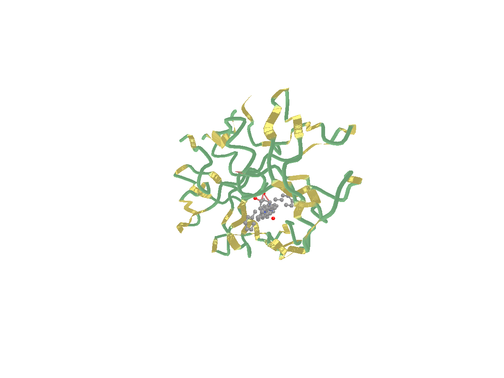
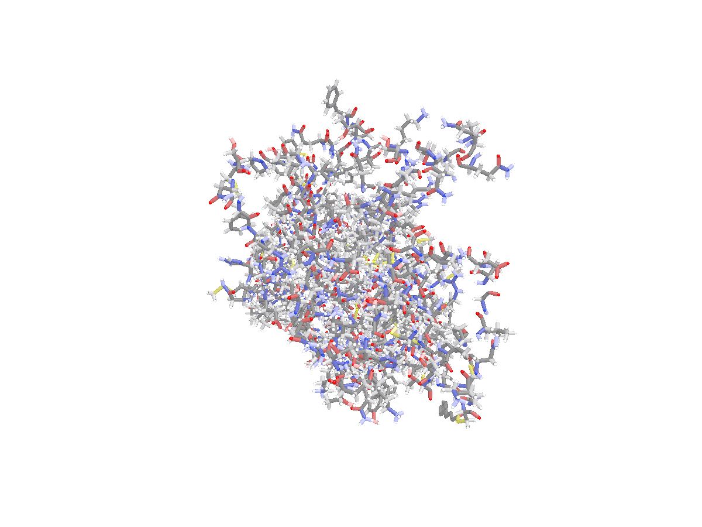
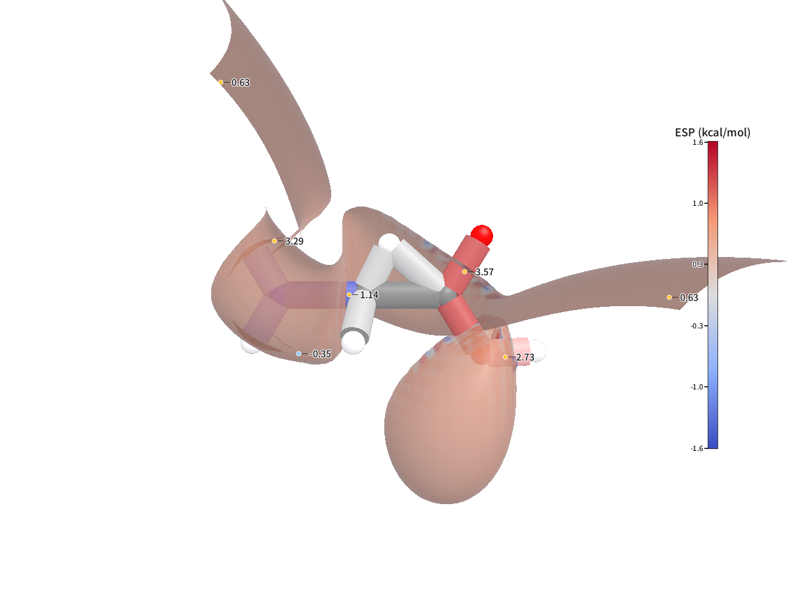

# 07 · Python 接口与数据案例

`python/` 提供 MolecuLens 的 Python 接口，覆盖「读结构 → 选择 → 出图 → 动画 → 导出」全流程。它分两层：

| 层 | 入口 | 依赖 | 能做什么 |
| --- | --- | --- | --- |
| **数据层** | `moleculens.load` / `Structure` | pybind11 + `moleculens_entity`（无 Vulkan / GLFW） | 解析 PDB / GRO / SDF / cube，读原子、键、坐标、统计与选择语言 |
| **绘图层** | `moleculens.render` / `render_animation` / `convert` | 同仓库的 `moleculens-cli` | 单帧、轨迹帧、ESP、光追、动画与 OBJ / STL / POV / mlscene 导出 |

绘图层不复制渲染实现：Python 只拼装命令行参数，GUI、CLI、Python 共用同一套 C++ 路径。因此服务器无图形环境也能批量出图，参数名与 `moleculens-cli render --help` 一一对应。

---

## 1. 构建与导入

前置：CMake ≥ 3.21、C++17 编译器、Python 3.9+。`pybind11` 是 header-only 依赖：

```powershell
python -m pip install pybind11 pytest pillow

cmake -S . -B build -DMOLECULENS_BUILD_PYTHON=ON
cmake --build build --config Release --target _native moleculens-cli

$env:PYTHONPATH = "$PWD\build\python"
python -c "import moleculens; print(moleculens.__version__)"
```

产物在 `build/python/moleculens/`：包文件 + `_native.cp39-win_amd64.pyd` + 运行期 DLL。Windows 上只有 Release 写入固定的 `build/python/`；Debug 输出到 `build/python-debug/`。

> 绑定默认 **OFF**，发布的应用不依赖 Python。只想要数据层时，可单独构建 `_native` 目标（它只链接 `moleculens_entity`）。

---

## 2. 数据层：加载与统计

`datasets/` 的 19 个文件都可以直接加载。以 1CRN 和 1HVR 为例：

```python
import moleculens as ml

mol = ml.load("datasets/pdb/1CRN.pdb")
len(mol), mol.atom_count, mol.bond_count       # 327, 327, 3
mol.atoms[0].element                           # 'C'
mol.atoms[0].residue_name                      # 'THR'
mol.atoms[0].position                          # (x, y, z) Å

summary = mol.summary()
summary["atom_count"], summary["frame_count"]  # 327, 1
summary["composition"]                         # {'C': 202, 'N': 55, 'O': 64, 'S': 6}
summary["warnings"]                            # 解析警告（行号 + 消息）
```

`Structure` 是加载时刻的**只读快照**：原子、键、残基/链名、坐标与解析警告都在里面，后续 C++ 场景变化不会回写。

### 2.1 蛋白-配体复合物：1HVR

`1HVR` 是 HIV-1 蛋白酶与环脲类抑制剂 **XK2** 的复合物（1,890 原子）。选择语言直接复用渲染器的语法：

```python
hiv = ml.load("datasets/pdb/1HVR.pdb")
ligand = hiv.select("resname XK2")              # 46 个全局原子下标
pocket = hiv.select("within 6 of resname XK2")  # 260 个口袋原子
assert set(ligand) <= set(pocket)
```

### 2.2 膜蛋白与配体：1U19

`1U19` 是牛视紫红素（5,948 原子，X 射线、无氢），含视黄醛 `RET`、糖链与 Zn：

```python
rhodopsin = ml.load("datasets/pdb/1U19.pdb")
retinal = rhodopsin.select("resname RET")                              # 40
glycans = rhodopsin.select("resname NAG or resname MAN or resname BMA") # 145
```

### 2.3 多模型 NMR：1L2Y

`1L2Y` 的 38 个 NMR MODEL 被读成 38 帧；`frame_count` 可直接用于遍历：

```python
trp_cage = ml.load("datasets/pdb/1L2Y.pdb")
trp_cage.frame_count                            # 38
for frame in range(trp_cage.frame_count):
    ...                                         # 逐模型处理（当前绑定不暴露逐帧坐标）
```

### 2.4 小分子与组成统计

```python
ethanol = ml.load("datasets/pubchem/ethanol_702.sdf")
ethanol.summary()["composition"]                # {'C': 2, 'H': 6, 'O': 1}
ml.element_info("C").mass                       # 12.011
```

---

## 3. 绘图层：Python 直接出图

`moleculens.render` 返回输出路径；失败（非零退出码/超时）抛 `CliError`，异常对象保留 `command` / `returncode` / `stdout` / `stderr`，可直接复现。

### 3.1 蛋白-配体：卡通 + 配体球棍

```python
import moleculens as ml

ml.render(
    "datasets/pdb/1HVR.pdb",
    "figs/1hvr_ligand.png",
    rep=["cartoon:not resname XK2:chain", "ballstick:resname XK2:element"],
    zoom=1.2, style="publication", background="white", size=(1200, 900),
)
```



### 3.2 轨迹帧：视紫红素第 25 帧

```python
ml.render(
    "datasets/md/md_1u19.gro",
    "figs/md_frame25.png",
    rep="stick",
    trajectory="datasets/md/md_1u19.xtc",
    frame=25, zoom=1.35, style="publication", background="white",
    size=(1200, 900),
)
```



### 3.3 ESP 映射表面

```python
ml.render(
    "datasets/esp/glycine/glycine_density.cube",
    "figs/glycine_esp.png",
    esp="datasets/esp/glycine/glycine_esp.cube",
    rep="stick", cmap="coolwarm", vmin=-40, vmax=40, zoom=0.65,
    style="publication", background="white", size=(1200, 900),
)
```



> 该 cube 是**合成夹具**，只用于验证 ESP 管线，不能用于科学结论。

### 3.4 动画与几何导出

```python
ml.render_animation(
    "datasets/md/md_1u19.gro",
    "figs/trajectory.gif",
    trajectory="datasets/md/md_1u19.xtc",
    frame_range="0:30", fps=12, rep="stick", size=(640, 480),
)

ml.convert("datasets/pubchem/ethanol_702.sdf", "figs/ethanol.obj", rep="ballstick")
```

扩展名决定动画格式（`.gif` / `.apng` / `.mp4` / `.webm`）；几何导出支持 `.obj` / `.stl` / `.pov` / `.mlscene`，OBJ 同时写 `.mtl`。

---

## 4. 数据案例巡览脚本

[`python/examples/dataset_tour.py`](https://github.com/moyudoing/MolecuLens/blob/master/python/examples/dataset_tour.py) 把上面的能力串成一条可重复的流水线：

```powershell
$env:PYTHONPATH = "$PWD\build\python"
python python\examples\dataset_tour.py --out-dir .tmp\dataset_tour
```

它会：

1. 加载 15 个结构/轨迹案例，打印原子、键、帧与元素组成；
2. 执行 `resname XK2`、`within 6 of resname XK2`、`resname RET`、糖链等选择；
3. 用 `moleculens.render` 生成 4 张 PNG（1HVR / 1L2Y / MD / ESP）；
4. 用 `moleculens.convert` 导出一个 OBJ；
5. 写出 `report.md`，包含数据表、选择结果与产物大小。

实测输出（节选）：

```text
case          atoms  bonds frames  composition
1CRN            327      3      1  C202 N55 O64 S6
1L2Y            304    310     38  C98 H150 N27 O29
1HVR           1890     72      1  C1017 H330 N262 O275 S6
1U19           5948    418      1  C3913 N856 O1110 S56 Xx13
md_1u19        5547   5284      1  C1870 H2744 N424 O483 S26

选择语言：
  1HVR 配体 XK2                 46   resname XK2
  1HVR 结合口袋（6 Å）            260   within 6 of resname XK2
  1U19 视黄醛 RET                40   resname RET
  1U19 糖链                     145   resname NAG or resname MAN or resname BMA
  1L2Y NMR 模型数                 38   frame_count
```

---

## 5. 数据案例一览

| 案例 | 文件 | 原子 / 帧 | Python 里可以做什么 |
| --- | --- | ---: | --- |
| crambin | `pdb/1CRN.pdb` | 327 / 1 | 最小蛋白；卡通/球棍基线 |
| 泛素 | `pdb/1UBQ.pdb` | 660 / 1 | 完整二级结构；链/残基选择 |
| B-DNA | `pdb/1BNA.pdb` | 566 / 1 | 核酸；`not resname HOH` 去水 |
| 血红蛋白 | `pdb/4HHB.pdb` | 4,779 / 1 | 多链 + 血红素；按链配色 |
| Trp-cage | `pdb/1L2Y.pdb` | 304 / **38** | NMR 多模型；`frame_count` 遍历 |
| HIV 蛋白酶 | `pdb/1HVR.pdb` | 1,890 / 1 | 蛋白-配体；`resname XK2` / `within` |
| 视紫红素 | `pdb/1U19.pdb` | 5,948 / 1 | 膜蛋白 + RET/糖链/Zn |
| 阿司匹林 | `pubchem/aspirin_2244.sdf` | 21 / 1 | SDF 直接加载；组成统计 |
| 咖啡因 | `pubchem/caffeine_2519.sdf` | 24 / 1 | 空间填充；元素配色 |
| 布洛芬 | `pubchem/ibuprofen_3672.sdf` | 33 / 1 | 球棍；OBJ 导出 |
| 乙醇 | `pubchem/ethanol_702.sdf` | 9 / 1 | 最小分子；OBJ 导出 |
| 苯 | `pubchem/benzene_241.sdf` | 12 / 1 | 芳香环；键级检查 |
| 葡萄糖 | `pubchem/glucose_5793.sdf` | 24 / 1 | 多羟基；氢键视角 |
| 白藜芦醇 | `pubchem/resveratrol_445154.sdf` | 29 / 1 | 共轭体系；出版出图 |
| 视紫红素轨迹 | `md/md_1u19.gro` + `.xtc` | 5,547 / **51** | 逐帧渲染、动画导出 |

所有文件的来源、许可、SHA-256 与实测统计见 [`datasets/README.md`](https://github.com/moyudoing/MolecuLens/blob/master/datasets/README.md)；CLI 复现命令见 [开源数据集与演示](06-开源数据集与演示.md)。

---

## 6. 错误处理与 CLI 查找

| 场景 | 行为 |
| --- | --- |
| 文件不存在 | `FileNotFoundError` |
| 传入目录 | `IsADirectoryError` |
| 无解析器 / 内容非法 | `MoleculensError`，消息前缀为错误码（如 `FormatError:`） |
| 非法选择表达式 | `ValueError` |
| CLI 非零退出 / 超时 | `CliError`，含 `command` / `returncode` / `stdout` / `stderr` |

CLI 查找顺序：显式 `executable=` → 环境变量 `MOLECULENS_CLI` → `PATH` → 仓库 `build/src/cli/<Config>/`。找不到时抛出 `FileNotFoundError` 并提示构建命令。

```python
try:
    ml.render("missing.pdb", "x.png")
except FileNotFoundError as exc:
    print(exc)
```

---

## 7. 语义约定与边界

| 项 | 约定 |
| --- | --- |
| 原子下标 | 全局下标：`instances` 顺序 × 结构原子顺序，与渲染器/场景坐标段一致 |
| `Structure` | 加载时刻的只读快照 |
| `occupancy` | 0–100（与选择语言 `occupancy` 关键字一致） |
| `bfactor` | Ų（内核以 ×100 整数存储，绑定层已还原） |
| 坐标 | 统一 Å；GRO 的 nm 坐标在解析时换算 |
| 统计口径 | 按实例累加（`md_1u19.gro` = 5,547 原子，而非首个残基的原子数） |
| 多模型 | `frame_count` 暴露模型数；逐帧坐标读取尚未绑定 |
| 渲染 | 一律离屏出图；Python 进程内不持有 Vulkan 设备/实时视口 |

暂未覆盖：场景编辑（增删实例/变换/表示）、`Structure` 原地修改、Python 内实时视口。需要这些能力时，可先用 CLI/`.mlscene` 完成，再回到 Python 读取结果。

---

## 8. 相关文档

- [Python 包说明与完整 API](https://github.com/moyudoing/MolecuLens/blob/master/python/README.md)
- [开源数据集与演示](06-开源数据集与演示.md)
- [DFT 常用绘图指南](05-DFT常用绘图指南.md) —— cube 单位、等值面阈值与 ESP 参数
- [使用说明](03-使用说明.md) —— GUI 操作与 CLI 参数全集
- [数据集清单](https://github.com/moyudoing/MolecuLens/blob/master/datasets/README.md)
